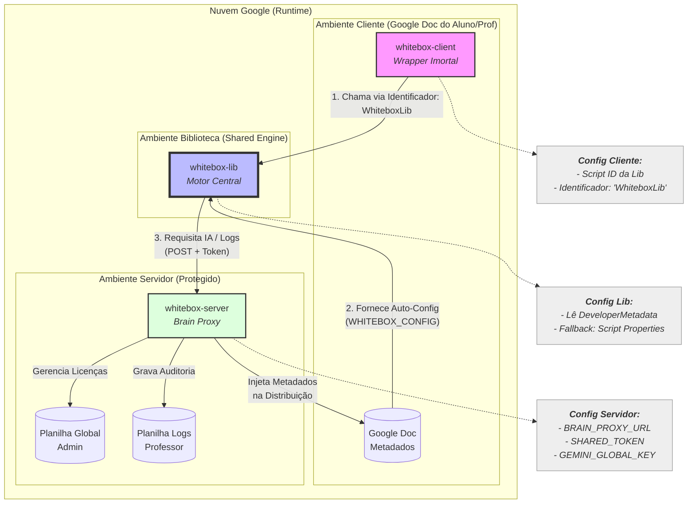

# WhiteBox - Google Docs Add-on

## O que é o WhiteBox?
O WhiteBox é uma ferramenta inteligente criada para o ambiente educacional do Google Workspace. Ele se integra perfeitamente ao **Google Docs** na forma de um painel lateral (Add-on) cuja missão é abrir a "caixa-preta" do processo da escrita. 

Ao rastrear metadados como  tempo de foco, rítmo de digitação e comportamentos massivos de cópia e cola, o WhiteBox fornece aos educadores as **evidências da construção do aluno**, desmistificando intervenções de IA Generativa. A ideia não é atuar como uma punição ("caça às bruxas"), mas sim como um escudo que confere mérito ao estudante que se esforçou, fomentando relatórios práticos para a mediação pedagógica em sala de aula de maneira justa!

---

## 👩‍🏫 Passo a Passo: Para os Professores

**1. Acesso à Ferramenta na POC (Contas Pessoais)**
* Como nesta fase as escolas não contam com assinatura _Google Workspace for Education_, o uso inicial é focado em **contas pessoais de e-mail** (do professor e do aluno). Sendo o produto um MVP, **o sistema não estará listado na loja de complementos do Google (Marketplace)**.
* Ao invés disso, trabalharemos via _Scripts Embutidos_ (Container-bound). O professor receberá um arquivo **"Documento Modelo"** da nossa equipe que já contém toda a inteligência do WhiteBox injetada. 

**2. Criação Rápida da Atividade**
1. O Professor(a) acessa o seu **Google Classroom** (Sala de Aula) pessoal.
2. Cria a atividade aninhando nela aquele **"Documento Modelo"** recebido com o script embutido, em vez de criar um Documento em branco.
3. **Importante:** Marque a opção de distribuição como **"Fazer uma cópia para cada aluno"**. Essa é a mágica do Workspace: a cópia que chegará pro aluno herdará todos os rastreios embutidos no seu documento modelo!

**3. Entendendo Onde Estão as Evidências**
1. Como **Professor(a)**, ao abrir o documento entregue por um **Aluno(a)**, o WhiteBox reconhecerá automaticamente a qual turma e estudante aquele texto pertence. Com isso, o painel lateral exibirá para você um resumo comportamental exclusivo daquela entrega, focando sempre em ilustrar perfeitamente para você o nível de esforço e originalidade daquele Aluno na produção do conteúdo. 
2. Se o Professor dispor de uma chave_API, a IA atestará (ex: *"Mudança brusca de estilo e complexidade detectada"* ou *"80% das palavras foram produto de colagens massivas do teclado"*). E na própria tela da ferramenta, lhe oferecerá dicas _"sócraticas"_ de quais os próximos passos pedagógicos você pode engajar com o aluno específico na devolutiva.

**4. ⚠️ A Regra de Ouro Pedagógica (Ativação Passiva)**
Por bloqueios rigorosos de privacidade e antivírus do sistema web do Google, nenhum rastreador de conteúdo no formato _Add-on_ consegue rodar e "vigiá-lo" oculto assim que o documento é aberto. Ou seja, você precisará firmar um contrato pedagógico com a sua turma.
Sempre instrua a sua sala no envio da atividade:
* *"Turma, ao abrirem a nossa Redação pelo Classroom, vão imediatamente no menu **Extensões > WhiteBox > Abrir Painel** para disparar o modo prova. Na primeira vez, aparecerá o pop-up de permissão de segurança da sua conta, clique em 'Permitir'. Se o painel da ferramenta não estiver aberto enquanto vocês digitam, seu processo não gerará pontuação/evidência de esforço. Lições entregues sem métricas geradas no painel não serão pontuadas. O WhiteBox é uma ferramenta de proteção ao mérito do aluno. O WhiteBox só funciona em computadores, não em celulares. O Whitebox respeita a privacidade do aluno e não coleta dados pessoais.

---

## 🎓 Passo a Passo: Para os Alunos

**1. Aceitando a Tarefa Transparente**
1. Ao acessar uma atividade do seu professor no Google Classroom e abrir o seu arquivo de texto, o Aluno verá que pode focar no que importa e começar a desenvolver o seu texto.
2. O "WhiteBox " opera de forma protetiva registrando o seu verdadeiro processo construtivo.

**2. Apoiando a Produção Limpa**
1. O Aluno pode abrir o painel lateral do nosso Add-on clicando no ícone dentro do Docs para checar seus pômordos.
2. De tempos em tempos (se o Aluno efetivamente estiver teclando e criando novos conteudos), o sistema calcula matematicamente a sua biometria de teclado. Não é o texto gravado pronto no final que importará apenas, é o tempo gasto de foco contínuo — criando uma comprovação genuína contra IAs automatizadoras de que você efetivamente redigiu sua obra do zero.

---

## 🛠 Guia Técnico: Implantação do Ecossistema

O WhiteBox utiliza uma arquitetura de **Biblioteca Central** e **Brain Proxy** para garantir segurança e escalabilidade. Abaixo, o diagrama que ilustra a interação entre os componentes:



### 🗝️ Guia de Configurações Reais

| Componente | Script ID / URL | Finalidade |
| :--- | :--- | :--- |
| **Cliente** | `1AcsKf8oIp2aS2VWPSm86wq_HSUo07KEAZFP2ST3vdilgkvfz9Jc9ZKK4` | Wrapper leve vinculado aos docs. |
| **Biblioteca** | `1iclQyZIbPsAL90mIX-aA3uZVfJ2TzQjbA5NsJYygme5jNezqnClnzmWJ` | Motor central (ID usado no vínculo do cliente). |
| **Servidor** | `1vGcyooljMaUVRPoN1gkkDfKNUb-oi65p0x1PODqnN006249US_P6iilp` | Gateway de IA e Gestão de Logs. |

---

### 1. Servidor (whitebox-server)
O servidor centraliza a lógica de IA (Gemini), o armazenamento de logs e o gerenciamento de licenças.
Vá até a pasta Classroom e crie a pasta WhiteBox Admin. Crie um novo Script Google Apps. Vá até Configurações e copie o 'Código do script' e cole no clasp.json do whitebox-server. Execute o comnado  clasp push -f para transferir o codigo fonte para o script google . 

3.  **Deploy**: No editor do Apps Script, realize uma "Nova Implantação" como **Web App**.
    *   **Executar como**: Eu (seu e-mail de administrador).
    *   **Quem tem acesso**: Qualquer pessoa (a segurança é garantida via `SHARED_TOKEN`).
4.  **Coleta de Dados**: Após o deploy, copie a **URL do Web App** gerada. Esta será a "ponte" de comunicação para o cliente.

### 2. Cliente (whitebox-client) - O Wrapper "Imortal"
O cliente agora atua como um despachante leve (Wrapper) que consome a lógica central de uma **Biblioteca**. Isso permite atualizar o código de milhares de documentos distribuídos instantaneamente, sem que o professor precise trocar o documento modelo.

1.  **Vincular Biblioteca**: No editor do Apps Script do cliente, adicione a `WhiteboxLib`.
    *   **Script ID**: O ID do script é a parte longa da URL de compartilhamento da biblioteca: `https://script.google.com/macros/library/d/[SCRIPT_ID]/[VERSAO]`.
    *   **Identificador**: Deve ser obrigatoriamente `WhiteboxLib`.
2.  **Sincronizar o Wrapper**:
    ```bash
    cd whitebox-client
    clasp push
    ```
3.  **Auto-Configuração**: O cliente tenta se configurar sozinho via `DeveloperMetadata` injetados pelo servidor. Caso falhe, ele busca nas `Propriedades do Script`:
    *   `BRAIN_PROXY_URL`: URL do Web App do servidor.
    *   `SHARED_TOKEN`: Token de segurança idêntico ao do servidor.

### 3. Biblioteca (whitebox-lib) - O Motor Central
Contém toda a lógica de negócio, UI e utilitários.
1.  **Deploy**: Realize o push do código e crie uma "Nova Implantação" do tipo **Biblioteca**.
2.  **Versão**: Sempre que fizer mudanças críticas na lógica, crie uma nova versão da biblioteca no console e atualize o cliente (ou mantenha na versão 'Head' para desenvolvimento).

### 3. A "Mágica" da Replicação (Criação do Doc Modelo)
Para distribuir a ferramenta via **Google Classroom**:
1.  Abra o Google Doc que servirá de "Texto Semente" (Template).
2.  Certifique-se de que o script do cliente está vinculado a este documento.
3.  Ao criar a atividade no Classroom, anexe este Doc e selecione **"Fazer uma cópia para cada aluno"**.
    *   O Google copiará o arquivo e o script embutido, permitindo que cada aluno tenha sua própria instância do WhiteBox conectada ao seu servidor central.

### 4. Gestão Automática de Dados (Planilhas do Professor)
O Whitebox automatiza o provisionamento de infraestrutura para cada professor:
1.  **Criação Sob Demanda**: A planilha individual de logs de cada professor é criada automaticamente no primeiro uso (seja ao salvar uma API Key ou ao receber o primeiro log de um aluno).
2.  **Estrutura Automatizada**: O servidor configura três abas essenciais:
    *   **Logs**: Recebe telemetria bruta (tempo de foco, colagens, scores de risco).
    *   **Visual_Heatmap**: Interface com fórmulas e formatação condicional para auditoria visual de autoria.
    *   **Turmas**: Consolida métricas por classe.
3.  **Auto-Reparo**: O sistema detecta planilhas antigas e adiciona abas ou colunas faltantes automaticamente durante a operação, garantindo que o professor sempre tenha as ferramentas de análise mais recentes.


---

## ⚠️ Atenção às Limitações Atuais (Dispositivos Móveis)
A arquitetura do Google Docs possui barreiras importantes que você precisa conhecer:
* **Uso exclusivo por Computador:** Funcionalidades de rastreamento via painel lateral (*Add-ons*) da própria Google ainda **não funcionam** nos aplicativos de celular/tablet (Android/iOS). Portanto, se os alunos tentarem realizar e abrir os trabalhos utilizando seus **telefones móveis**, o aplicativo nativo do Docs do celular não "acordará" o WhiteBox e o rastreamento comportamental não ocorrerá corretamente. 
* _(Dica: Para o rastreio fluir corretamente com o aluno, oriente-os a abrirem as lições num navegador de computador/desktop)._

---

## 🛠 Informação aos Desenvolvedores / Analytics
Para assegurar privacidade e eficiência sem quebras com APIs excessivas, toda batida capturada na interface envia pacotes assíncronos ao motor de Machine Learning utilizando uma "Identidade Tripla" formatada baseada rigidamente nos laços de compartilhamento e pastificações do Google Workspace. A representação interna dos `Payloads` fluem via POST amarrados sob a semântica: `[E-mail do Professor] + [Turma/Classroom] + [E-mail do Aluno] + [ID do Documento]`.
