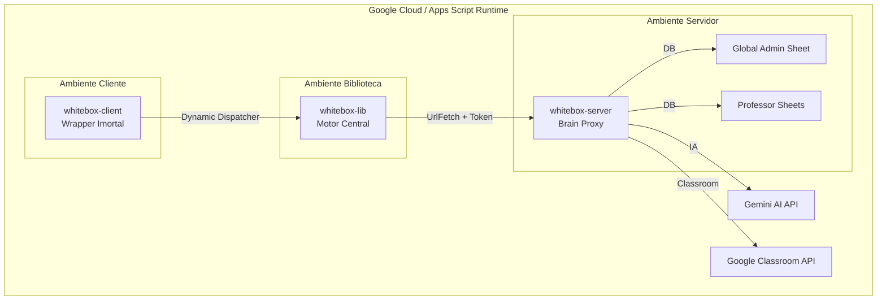

You are an Acceptance Auditor. Review this diff against the spec and context docs. Check for: violations of acceptance criteria, deviations from spec intent, missing implementation of specified behavior, contradictions between spec constraints and actual code. Output findings as a Markdown list. Each finding: one-line title, which AC/constraint it violates, and evidence from the diff.

CONTEXT DOCS:

==== Admin.md ====

# Whitebox Client - Guia Administrativo

Este documento é destinado a administradores de TI e desenvolvedores que gerenciam a implantação do Add-on Whitebox Client.

## ⚙️ Propriedades de Configuração
O comportamento do ecossistema é governado por uma hierarquia de configurações:

### 1. Auto-Configuração (DeveloperMetadata) [NOVO]
O servidor agora injeta automaticamente a configuração no documento durante a distribuição. O Add-on tenta ler estes dados primeiro:
- `WHITEBOX_CONFIG`: JSON contendo `proxyUrl` e `sharedToken`.

### 2. Script Properties (Globais do Cliente)
Usadas como fallback se os metadados estiverem ausentes:
- `BRAIN_PROXY_URL`: A URL do Web App `whitebox-server` implantado.
- `SHARED_TOKEN`: O segredo de autenticação compartilhado.

### 3. Vínculo de Biblioteca (whitebox-lib)
O cliente (`whitebox-client`) deve estar vinculado à biblioteca central:
- **Script ID**: O identificador único da `WhiteboxLib` (extraído da URL de implantação).
- **Identificador**: Deve ser obrigatoriamente **`WhiteboxLib`**.

## 🚀 Checklist de Implantação
1.  **Deploy da Lib**: Realize o push da `whitebox-lib` e crie uma versão de implantação.
2.  **Vínculo do Cliente**: No `whitebox-client`, adicione a biblioteca usando o Script ID e o identificador correto.
3.  **Configuração do Servidor**: Garanta que a `BRAIN_PROXY_URL` está configurada nas Script Properties do servidor para permitir a injeção correta de metadados.

## 🔍 Solução de Problemas
- **Erros de Rede**: Use o console do desenvolvedor do navegador para verificar chamadas `UrlFetch` que falharam para o proxy.
- **Permissão Negada**: Certifique-se de que os alunos autorizaram o Add-on a rodar em seu domínio.
- **Falhas de Sincronização**: Verifique os logs do servidor (Brain Proxy) para erros `UNAUTHORIZED`, que indicam uma incompatibilidade de `SHARED_TOKEN`.
- **Erro: ID do Documento Semente não configurado**: Ocorre ao tentar distribuir tarefas ou templates sem ter definido o Doc Semente no Dashboard Admin (Seção Configurações Globais).

## 📄 Distribuição de Templates para Professores
Administradores podem provisionar documentos modelo para os professores:
1.  **Pasta Central**: Coloque os arquivos Google Docs na pasta `GDrive Meus Documentos/Projetos/whitebox/templates` no Drive do Admin.
**Abrir o Dashboard Admin**: abra o app script `GDrive Meus Documentos/Projetos/whitebox/whitebox-server`, vá em 'Gerenciar Implatações' e copie a URL 'App da Web'.  
2. 🔗 Gerar Link de Inscrição Segura para que os professores preencham formulario de inscrição e sejam adicionados como usuários do sistema. **Abra a URL no navegador** para acessar o dashboard. Gere o link de 'onboarding de professores' e inscreva os professores no sistema.


3.  **Distribuição**: **Depois de inscritos** volte ate  o Dashboard Admin e em 'Professores & Licenças B2B'  distribua o template para cada professor. para enviar cópias para as pastas `whitebox/Distribucoes/[Email]` de cada professor.
4.  **Auditoria**: Todas as distribuições são registradas na aba `Assinaturas` da Planilha Global para fins de governança.

---
*Documentação gerada via metodologia BMAD.*


==== api-contracts.md ====

# Contratos de API - Protocolo de Comunicação Whitebox

## 1. Autenticação
Todas as requisições devem ser enviadas via `HTTP POST` para a URL do Web App e incluir o `SHARED_TOKEN`.

**Header**: `Content-Type: application/json`

---

## 2. Rotas do Servidor (`doPost`)

### 2.1. `analisar`
Solicita uma análise socrática de IA de um fragmento de texto.

**Payload**:
```json
{
  "token": "SHARED_TOKEN",
  "route": "analisar",
  "professorEmail": "prof@escola.edu",
  "alunoEmail": "aluno@escola.edu",
  "fragmento": "Texto do aluno para análise...",
  "metricas": {
    "editRatio": 0.5,
    "pasteEvents": 1
  }
}
```

**Resposta**:
```json
{
  "modoIA": true,
  "riskScore": 25,
  "justification": "Baixo risco, edição constante.",
  "suggestedQuestion": "Como você chegou a essa conclusão no segundo parágrafo?"
}
```

### 2.2. `logar_metricas`
Persiste a telemetria comportamental do aluno.

**Payload**:
```json
{
  "token": "SHARED_TOKEN",
  "route": "logar_metricas",
  "professorEmail": "prof@escola.edu",
  "turma": "Turma_A_123",
  "docId": "GOOGLE_DOC_ID",
  "alunoEmail": "aluno@escola.edu",
  "metricas": { ... },
  "analise": { ... },
  "isFinal": true
}
```

**Resposta**:
```json
{ "success": true }
```

### 2.3. `status_licenca`
Verifica se o professor está ativo e se o modo IA está disponível.

**Payload**:
```json
{
  "token": "SHARED_TOKEN",
  "route": "status_licenca",
  "professorEmail": "prof@escola.edu"
}
```

**Resposta**:
```json
{
  "status": "ATIVO",
  "escola": "Escola de Teste",
  "modoIA": true,
  "tipoChave": "individual"
}
```

### 2.4. `listar_templates` (Admin)
Lista templates de Docs na pasta central do Admin.

**Payload**:
```json
{ "token": "SHARED_TOKEN", "route": "listar_templates" }
```

### 2.5. `distribuir_template` (Admin)
Copia template para Drive do professor e compartilha.

**Payload**:
```json
{ 
  "token": "SHARED_TOKEN", 
  "route": "distribuir_template", 
  "templateId": "ID_DOC", 
  "destinatarios": ["prof1@edu.com"], 
  "notificarEmail": true 
}
```

### 2.6. `listar_turmas_professor` (Professor)
Lista turmas do Classroom onde o usuário é docente.

**Payload**:
```json
{ "token": "SHARED_TOKEN", "route": "listar_turmas_professor", "professorEmail": "prof@edu.com" }
```

### 2.7. `criar_leva_template` (Professor)
Cria atividade no Classroom com `STUDENT_COPY` do template.

**Payload**:
```json
{ 
  "token": "SHARED_TOKEN", 
  "route": "criar_leva_template", 
  "templateDocId": "ID_DOC", 
  "turmas": ["ID_TURMA"], 
  "titulo": "Atividade 01", 
  "executionId": "uuid-v4" 
}
```

### 2.8. `status_distribuicao` (Polling)
Consulta progresso de uma criação de leva em andamento.

**Payload**:
```json
{ "token": "SHARED_TOKEN", "route": "status_distribuicao", "executionId": "uuid-v4" }
```

### 2.9. `historico_templates` (Admin)
Retorna log de todas as distribuições Admin -> Professores.

**Payload**:
```json
{ "token": "SHARED_TOKEN", "route": "historico_templates" }
```

---

## 3. Utilitário do Cliente (`callProxy`)
O cliente usa uma função padronizada para interagir com o servidor.

```javascript
/**
 * Realiza chamada POST segura para o Brain Proxy.
 * @param {string} route Rota de destino
 * @param {object} payload Dados para o body
 */
function callProxy(route, payload) {
  const config = getProxyConfig(); // { url, token }
  const body = {
    token: config.token,
    route: route,
    ...payload
  };
  
  const options = {
    method: 'post',
    contentType: 'application/json',
    payload: JSON.stringify(body),
    muteHttpExceptions: true
  };
  
  const response = UrlFetchApp.fetch(config.url, options);
  return JSON.parse(response.getContentText());
}
```

```javascript
/**
 * Realiza chamada POST segura para o Brain Proxy via Biblioteca.
 * [ARCH-LIB] No modelo novo, o Wrapper chama 'WhiteboxLib.callProxy'
 */
function callLibrary(functionName, args) {
  // O Dynamic Dispatcher do whitebox-client encaminha para:
  return WhiteboxLib[functionName].apply(null, args);
}
```


==== architecture.md ====

# Arquitetura & Design - Whitebox

## 1. Visão Geral do Sistema
O Whitebox é arquitetado como um ecossistema desacoplado que consiste em um Add-on de cliente (Google Docs) e um Web App/Proxy de API no lado do servidor. Este design garante que a lógica sensível (como prompts de IA e acesso a bancos de dados) permaneça protegida no servidor, enquanto o cliente foca na interação com o usuário e telemetria.

## 2. Diagrama de Arquitetura de Alto Nível



## 3. Detalhamento dos Componentes

### 3.1. Whitebox Client (Wrapper Imortal)
- **Papel**: Ponto de entrada leve e persistente vinculado aos documentos.
- **Arquivos Chave**:
    - `Código.gs`: Implementa o **Dynamic Dispatcher** que encaminha chamadas para a `WhiteboxLib`.
    - `appsscript.json`: Gerencia a dependência da biblioteca.
- **Vantagem**: Uma vez distribuído, o código do cliente nunca precisa ser alterado.

### 3.2. Whitebox Lib (Motor Central)
- **Papel**: Contém toda a lógica de negócio, UI da Sidebar e utilitários de comunicação.
- **Arquivos Chave**:
    - `Logic.gs`: Lógica de auditoria e manipulação de UI.
    - `Sidebar.html`: Interface visual do Add-on.
    - `Utils.gs`: Gerenciamento de auto-configuração via metadados.

### 3.3. Whitebox Server (Proxy)
- **Papel**: Gateway seguro, gerenciador de licenças e hub de integração.
- **Arquivos Chave**:
    - `BrainProxy.gs`: Roteador principal (`doPost`) e lógica de IA.
    - `ClassroomService.gs`: Integração com Google Classroom.
    - `SchemaManager.gs`: Integridade do banco de dados baseado em planilhas.
    - `AdminSetup.gs`: Provisionamento automatizado de recursos.
    - `TemplateService.gs`: Orquestração de cópias (Admin -> Prof) e integração Classroom STUDENT_COPY.

## 4. Fluxo de Distribuição Pedagógica
O sistema utiliza um modelo de dois níveis para distribuição de recursos:
1.  **Nível Administrativo**: O Administrador distribui "Doc Templates" para as pastas dos professores. Este fluxo gera cópias físicas no Drive do professor e registra o envio no `Historico_Templates`.
2.  **Nível Docente**: O professor, a partir de um template recebido, utiliza a aba **Distribuir** na Sidebar para criar tarefas no Classroom. 
    - O sistema utiliza o modo `STUDENT_COPY` nativo da API, o que garante que cada aluno receba sua própria cópia editável.
    - O progresso de criação em múltiplas turmas é monitorado via **Polling** (cliente consulta o servidor a cada 1.5s usando um `executionId` armazenado no `CacheService`).

## 5. Mecanismos de Segurança

### 5.1. O Protocolo SHARED_TOKEN
Toda comunicação do cliente para o servidor requer um `SHARED_TOKEN` passado no corpo do JSON.
- **Geração**: Gerado automaticamente durante a primeira execução do servidor (`auto-provisioning`).
- **Armazenamento**: Armazenado em `ScriptProperties` no servidor e `DocumentProperties` no cliente.

### 5.2. Marca d'Água Anti-LLM (Tags Invisíveis)
Para evitar que os alunos copiem perguntas de quiz diretamente para LLMs como o ChatGPT, o Whitebox implementa uma camada de ofuscação:
- **Caracteres de Largura Zero**: Injeta caracteres ocultos (ex: `\u200B`) entre as letras.
- **Blocos de Tags Unicode**: Usa o bloco `Tag` (`\uE0000-\uE007F`) para incorporar metadados ocultos que apenas LLMs podem "ler".
- **Comportamento**: Enquanto os humanos veem o texto normal, as LLMs interpretam os códigos ocultos, o que pode desencadear respostas de "não posso responder a isso" ou identificar a origem como um prompt autorizado.

### 5.3. Chaves de API Hierárquicas
- **Nível 1 (Professor)**: Professores podem fornecer sua própria chave de API Gemini via um "Cofre" (arquivo de texto no Drive).
- **Nível 2 (Institucional)**: Se um professor não tiver uma chave, o sistema pode recorrer a uma chave institucional global se autorizado.
- **Fallback (Offline)**: Se nenhuma chave estiver disponível, os recursos de IA são desativados, mas o registro de telemetria continua.

### 5.4. Detecção Dinâmica de Papéis (Student vs. Teacher)
Para evitar o vazamento da interface do professor (e do Auditor de IA) para os alunos, o sistema de role-detection implementa dupla validação:
- **Desafio**: Como o Google Classroom duplica o template e torna o aluno proprietário da cópia gerada e da pasta da turma em seu próprio Drive, checagens ingênuas de posse de arquivo (`isOwner` ou `isProfessor`) avaliam como verdadeiro para o aluno.
- **Mecanismo**: A função `getContext` valida se o usuário possui propriedade do arquivo, mas também realiza uma consulta síncrona ao Brain Proxy (`/status_licenca`). O papel de `'teacher'` só é concedido se o usuário estiver ativamente cadastrado na tabela de `Assinaturas` de professores (ou se a URL do proxy ainda não estiver configurada no documento, permitindo o provisionamento inicial).
- **Segurança**: Caso o e-mail não esteja cadastrado na planilha global, o usuário é rebaixado a `'student'`, bloqueando a renderização da aba do professor e a rota de IA no backend.

## 6. Fluxo de Dados: Persistência de Telemetria
1. O cliente coleta métricas a cada 30 segundos (or ao fechar o documento).
2. O cliente chama `/logar_metricas` no Servidor.
3. O servidor identifica o ID da planilha dedicada do professor na tabela `Assinaturas`.
4. O servidor anexa a entrada de log à aba `Logs` da planilha do professor.


==== data-schema.md ====

# Esquema de Dados - Camada de Persistência Whitebox

O Whitebox usa o Google Sheets como seu banco de dados relacional primário. Os dados são particionados em uma única **Planilha Admin Global** e múltiplas **Planilhas de Log de Professores Individuais**.

## 1. Planilha Admin Global
Gerencia todo o ecossistema, licenciamento e registro global de tarefas.

### 1.1. Aba: `Assinaturas` (Professores)
| Coluna | Descrição |
| :--- | :--- |
| **Email** | Identificador único (PK) para o professor. |
| **Instituicao** | Nome da escola ou organização. |
| **Status** | `Ativo` ou `Inativo`. |
| **UsaChaveGlobal** | `Sim` se autorizado a usar a chave Gemini global do servidor. |
| **ChaveIndividual** | Link/ID do "Cofre" no Google Drive. |
| **SpreadsheetId** | ID da planilha de log dedicada para este professor. |
| **DataCadastro** | Timestamp ISO 8601 do registro. |

### 1.2. Aba: `Tarefas_Globais` (Auditoria Classroom)
| Coluna | Descrição |
| :--- | :--- |
| **ID_Tarefa** | ID da tarefa no Classroom. |
| **Professor** | Email do proprietário. |
| **Instituicao** | Nome da escola. |
| **Titulo** | Nome da atividade. |
| **Course_ID** | ID do curso no Classroom. |
| **Data_Criacao** | Timestamp. |

### 1.3. Aba: `Historico_Templates`
| Coluna | Descrição |
| :--- | :--- |
| **ID_Distribuicao** | Código único da remessa Admin (ex: DIST-XXXX). |
| **Admin_Email** | Quem realizou a distribuição. |
| **Template_ID** | ID do Doc original. |
| **Template_Nome** | Nome do documento na data do envio. |
| **Destinatarios** | Lista de e-mails (professores) separados por vírgula. |
| **Docs_Criados** | Qtd de cópias geradas com sucesso. |
| **Falhas** | Qtd de falhas no processamento. |
| **Mensagem** | Texto enviado na notificação. |
| **Data_Criacao** | Timestamp ISO 8601. |

---

## 2. Planilha Individual do Professor
Armazena dados sensíveis dos alunos e configurações locais.

### 2.1. Aba: `Logs` (Telemetria)
| Coluna | Descrição |
| :--- | :--- |
| **Timestamp** | Hora do evento. |
| **Turma** | ID do curso no Classroom. |
| **DocId** | ID do Google Doc do aluno. |
| **Email_Aluno** | Identificador do aluno. |
| **Palavras** | Contagem total de palavras. |
| **Tempo_Ativo_Min** | Minutos gastos editando ativamente. |
| **Colar_Eventos** | Contagem de acionadores de colagem (paste). |
| **RiscoScore** | Risco calculado de 0-100. |
| **Entrega_Final** | `Sim` se o log corresponde à entrega final. |

### 2.2. Aba: `Config_Pedagogica`
| Coluna | Descrição |
| :--- | :--- |
| **Course_ID** | Link para classe específica do Classroom. |
| **Assignment_ID** | Link para atividade específica. |
| **Instrucoes_IA** | Instruções de prompt personalizadas (ex: "Foco em fatos históricos"). |
| **Nivel_Rigor_IA** | `Baixo`, `Médio` ou `Alto`. |

### 2.3. Aba: `Levas` (Distribuição Classroom)
| Coluna | Descrição |
| :--- | :--- |
| **ID_Leva** | Identificador da remessa (ex: LEVA-XXXX). |
| **Template_ID** | Doc usado como base. |
| **Template_Nome** | Nome do modelo mestre. |
| **Titulo_Atividade** | Nome da tarefa no Classroom. |
| **Course_ID** | ID da turma destino. |
| **Course_Nome** | Nome legível da turma. |
| **Assignment_ID** | ID da tarefa criada. |
| **Total_Alunos** | Qtd de alunos na turma. |
| **Prazo** | Data de entrega (ISO). |
| **Instrucoes** | Corpo do texto da tarefa. |
| **Data_Criacao** | Timestamp. |

---

## 3. Gestão de Esquema
O módulo `SchemaManager.gs` garante a consistência:
- **Versionamento**: A aba `Config` na Planilha Global rastreia a `VersaoSchema`.
- **Migrações**: Lógica automatizada para adicionar colunas ausentes sem perder dados existentes.
- **Validação**: Os cabeçalhos são resolvidos por nome (`indexOf`) em vez de índices fixos para evitar a corrupção de dados quando as colunas são reordenadas.


==== development-guide.md ====

# Manual do Desenvolvedor - Operações Whitebox

## 1. Ambiente de Desenvolvimento Local

O Whitebox é gerenciado usando `clasp` (Command Line Apps Script Projects) para permitir controle de versão e edição local.

### 1.1. Instalação
```bash
npm install -g @google/clasp
clasp login
```

### 1.2. Estrutura do Projeto
- `/whitebox-lib`: Motor central (Biblioteca). **Lógica principal aqui.**
- `/whitebox-client`: Wrapper imortal para os documentos.
- `/whitebox-server`: Web App Proxy e Gateway de IA.

---

## 2. Fluxo de Deploy

### 2.1. Server Proxy
1.  Navegue até `whitebox-server/`.
2.  `clasp push` para sincronizar o código.
3.  Implantar como **Web App**.

### 2.2. Whitebox Lib (Central)
1.  Navegue até `whitebox-lib/`.
2.  `clasp push`.
3.  No console do Apps Script, clique em **Implantar > Nova Implantação > Biblioteca**.
4.  Anote o **Script ID** para o cliente.

### 2.3. Client Wrapper
1.  Navegue até `whitebox-client/`.
2.  No `appsscript.json`, verifique se o ID da biblioteca está correto.
3.  `clasp push`.
4.  **Auto-Config**: O cliente agora busca `WHITEBOX_CONFIG` no documento antes de recorrer às Script Properties.

---

## 3. Procedimentos de Teste

### 3.1. Test Runner Automatizado
O Whitebox inclui um framework de testes customizado e leve em `TestRunner.gs`.
- **Execução**: Execute a função `runAllTests()` a partir da IDE do Apps Script.
- **Cobertura**: Inclui validação de e-mail, parsing de JSON, lógica de limite de taxa (rate limit) e integridade de esquema.

### 3.2. Testes de Fumaça Manuais
1.  **Auto-Provisionamento**: Visite a URL do Web App do servidor pela primeira vez (*); ele deve criar a Planilha Admin Global e mostrar o token.

(*) Se for solicitado um token vá nas Configurações do Script server; No menu lateral esquerdo, clique no ícone de engrenagem (Configurações do Projeto). Desça até a seção Propriedades do Script. Localize a propriedade chamada SHARED_TOKEN. O valor ao lado dela é o token que você deve inserir na tela.

2.  **Sincronização de Telemetria**: Abra um Doc com Whitebox ativado, digite algum texto e verifique se uma nova linha aparece na planilha de log do professor.
3.  **Análise de IA**: Use o botão de análise da barra lateral e verifique a resposta socrática.

---

## 4. Manutenção

### 4.1. Migrações de Esquema
Se você adicionar uma nova coluna a qualquer planilha do banco de dados:
1.  Incremente `SCHEMA_VERSION_ATUAL` em `Constants.gs`.
2.  Adicione uma função de migração em `SchemaManager.gs`.
3.  Execute `executarMigracoes(token)` a partir do Painel Admin.

### 4.2. Rotação de Log & Cache
- O sistema usa `CacheService` para tarefas do Classroom (TTL de 6h).
- `LockService` é usado durante o provisionamento para evitar condições de corrida.


==== Hardening.md ====

# Whitebox Server - Auditoria de Hardening & Segurança

Este documento detalha as camadas de segurança e os patches de robustez implementados para proteger a infraestrutura Whitebox.

## 🛡️ Hardening de API & Autenticação
- **`validateAdminAccess`**: Todas as funções administrativas (licenciamento, seeding, distribuição) são protegidas por uma verificação obrigatória de `SHARED_TOKEN`. Tentativas não autorizadas disparam um erro 401.
- **Handshake do Cliente**: O Painel Admin captura o token na primeira sessão bem-sucedida e impõe seu uso para todas as operações subsequentes que alteram o estado do sistema.
- **Validação de Papel (Role Detection)**: O papel de professor (`'teacher'`) exige dupla validação. O e-mail do usuário ativo é verificado síncronamente contra a lista de `Assinaturas` do servidor, mitigando a vulnerabilidade onde alunos eram promovidos a professor por serem donos da cópia do documento gerada pelo Google Classroom.

## 🧵 Proteção de Concorrência & Condição de Corrida
- **`LockService`**: Implementação de travas (locks) em nível de script nas rotas `doGet` (provisionamento) e `onProfessorFormSubmit` (onboarding). Isso evita a corrupção de dados ou a criação de recursos duplicados durante requisições simultâneas.
- **Operações Atômicas**: Garantia de que o registro do professor e a criação da planilha sejam tratados como blocos atômicos para manter a integridade do banco de dados.

## 🏗️ Robustez & Integridade do Sistema
- **Gestão de Esquema**: O módulo `SchemaManager.gs` realiza a validação de cabeçalhos antes de cada leitura/escrita, garantindo que edições manuais nas planilhas não quebrem o sistema.
- **Inicialização Segura**: A lógica de provisionamento agora reutiliza planilhas e estruturas existentes, permitindo re-implantações seguras ou reinicializações do servidor.
- **Parsing de JSON Robusto**: Implementação de multi-estratégia para extração de JSON para lidar com respostas do Gemini que podem conter formatação Markdown ou texto adicional.

## 📡 Limite de Taxa (Rate Limiting) & Gestão de Cotas
- **Emulação de Token Bucket**: O sistema limita as requisições de análise por aluno/hora usando `CacheService` para evitar o esgotamento da cota da API Gemini.
- **Validação de E-mail**: Validação estrita baseada em regex para todas as entradas de e-mail para evitar injeção ou corrupção de planilhas.

---
*Documentação gerada via metodologia BMAD.*


==== index.md ====

# Índice da Documentação Whitebox

Bem-vindo à Base de Conhecimento Whitebox. Esta suíte de documentação fornece uma visão abrangente do sistema autônomo de auditoria pedagógica.

## 🚀 Guia de Início Rápido
Documentação voltada para os usuários finais e administradores do sistema.
- [Manual do Professor](Teacher.md): Como gerenciar turmas, distribuir atividades e auditar.
- [Manual do Administrador](Admin.md): Configuração do ecossistema, licenciamento e gestão global.
- [Guia do Aluno](Student.md): Visão do aluno sobre a telemetria e o painel de transparência.
- [⚙️ Configuração de Conexão](setup-conexao.md): Resolver erro de BRAIN_PROXY_URL e configurar o servidor.

## 🏗️ Arquitetura & Segurança
Detalhes técnicos sobre o funcionamento interno e proteções do sistema.
- [Arquitetura do Sistema](architecture.md): Divisão Cliente-Servidor e diagramas de sequência.
- [Hardening & Segurança](Hardening.md): Práticas de segurança aplicadas ao servidor e banco de dados.
- [Segurança Anti-LLM](architecture.md#42-anti-llm-watermarking-invisible-tags): Olhar detalhado sobre a marca d'água de caracteres invisíveis.

## 🔌 Especificações Técnicas
Protocolos de comunicação e persistência de dados.
- [Contratos de API](api-contracts.md): Documentação detalhada das rotas `doPost`.
- [Esquema de Dados](data-schema.md): Estrutura do banco de dados em Google Sheets.

## 📋 Planejamento & Estratégia
*Documentação de gestão (Gerado via Metodologia BMAD)*
- [Documento de Requisitos (PRD)](file:///c:/Users/jmarc/Documents/whitebox/_bmad-output/planning-artifacts/prd.md): Visão e requisitos.
- [Épicos do Projeto](file:///c:/Users/jmarc/Documents/whitebox/_bmad-output/planning-artifacts/epics.md): Roteiro de desenvolvimento.
- [Histórias de Usuário](file:///c:/Users/jmarc/Documents/whitebox/_bmad-output/planning-artifacts/stories.md): Detalhamento das funcionalidades.

## 🛠️ Operações & Desenvolvimento
Recursos para manutenção e conformidade.
- [Manual do Desenvolvedor](development-guide.md): Configuração, deploy e testes.
- [Termos de Uso - Aluno](Termos%20de%20Uso%20-%20Aluno.md): Política de privacidade e uso de dados.
- [Relatório de Varredura](../docs/project-scan-report.json): Auditoria técnica automatizada.

---
*Última Atualização: 05/05/2026*


==== setup-conexao.md ====

# ⚙️ Configuração de Conexão — Whitebox

Este guia descreve como configurar a conexão entre o **Add-on Whitebox** (instalado no Google Docs) e o **servidor Whitebox** (BrainProxy). Siga estas instruções se você ver o erro:

> ❌ `BRAIN_PROXY_URL não configurada nas Script Properties`

---

## O que é a `BRAIN_PROXY_URL`?

O Whitebox funciona em dois componentes:

| Componente | Onde roda | O que faz |
|---|---|---|
| **Add-on (whitebox-client)** | Google Docs do professor | Interface lateral, rastreamento de alunos |
| **Servidor (whitebox-server / BrainProxy)** | Google Apps Script standalone | IA, Classroom, banco de dados global |

A `BRAIN_PROXY_URL` é o endereço do servidor. Sem ela, o Add-on não sabe como se comunicar com o servidor, e a aba **Distribuir** (e outras funções de IA) ficam inativas.

---

## ✅ Método 1 — Assistente de Configuração (Recomendado)

A partir da versão com `setupWhitebox()`, o professor pode configurar com **2 cliques** diretamente no documento:

### Passo a Passo

1. **Abra o documento** onde o Whitebox está instalado
2. No menu superior, clique em **`Whitebox`**
3. Clique em **`⚙️ Configurar Conexão`**
4. Uma caixa de diálogo aparecerá pedindo a **URL do servidor**:
   ```
   https://script.google.com/macros/s/AKfycbw.../exec
   ```
   > Obtenha esta URL com o administrador do sistema ou no painel do [Apps Script do servidor](https://script.google.com).

5. Em seguida, outra caixa pedirá o **SHARED_TOKEN**:
   ```
   WBX-xxxxxxxx-xxxx-xxxx-xxxx-xxxxxxxxxxxx
   ```
   > Este token foi gerado automaticamente na primeira vez que o servidor foi acessado.

6. O sistema fará um **ping de validação** para confirmar que a URL e o token estão corretos
7. Se tudo estiver correto: `✅ Whitebox Configurado!`

> [!TIP]
> Feche e reabra o Painel Whitebox após a configuração para carregar com as novas credenciais.

---

## 🔧 Método 2 — Script Properties Manual (Alternativo)

Se o menu não estiver disponível (ex: primeiro acesso antes do `onOpen` rodar):

1. No documento, vá em **Extensões > Apps Script**
2. No editor, clique em **⚙️ Configurações do Projeto** (ícone de engrenagem à esquerda)
3. Clique na aba **Propriedades do script**
4. Clique em **+ Adicionar propriedade** e adicione:

| Propriedade | Valor |
|---|---|
| `BRAIN_PROXY_URL` | `https://script.google.com/macros/s/.../exec` |
| `SHARED_TOKEN` | `WBX-...` |

5. Clique **Salvar**
6. Feche e reabra o documento

---

## 🔍 Onde encontrar a URL e o Token

### URL do Servidor
O administrador do sistema pode encontrá-la em:
- [Dashboard Admin](https://script.google.com/macros/s/AKfycbwAzIlfKhJ2zoX7NV1jCzuGU8gb7PeNtXHE3evj1-X5ebcI2oiMbKUhrqrSWhL73uqg/exec) → O endereço na barra do browser é a URL
- Ou: Apps Script do `whitebox-server` → **Implantar** → **Gerenciar implantações** → URL da implantação ativa

### SHARED_TOKEN
- Foi exibido uma única vez na **primeira vez que o servidor foi acessado** (mensagem de auto-provisionamento)
- Se perdido: acesse Apps Script do `whitebox-server` → **Configurações** → **Propriedades do script** → procure `SHARED_TOKEN`

---

## 🩺 Diagnóstico: Hierarquia de Configuração

O `getProxyConfig()` da biblioteca busca `BRAIN_PROXY_URL` nesta ordem:

```
1. DeveloperMetadata do documento   ← Configurado via Criar Leva (automático)
2. DocumentProperties do documento  ← Configurado manualmente por documento  
3. ScriptProperties do projeto      ← Configurado pelo assistente (setupWhitebox)
```

Se nenhum dos três tiver o valor, o erro é exibido.

---

## 📋 Checklist de Resolução

- [ ] O servidor Whitebox está deployado? (acesse a URL e veja se mostra o Dashboard)
- [ ] O `SHARED_TOKEN` bate com o configurado no servidor?
- [ ] As Script Properties foram salvas no projeto **whitebox-client** (não no servidor)?
- [ ] Após salvar, o documento foi fechado e reaberto?

---

*Documentação técnica — Whitebox v2.x*
*Relacionado: [Teacher.md](Teacher.md) | [Admin.md](Admin.md) | [architecture.md](architecture.md)*


==== Student.md ====

# Whitebox Client - Guia do Aluno

O Whitebox é um assistente pedagógico que ajuda você a refletir sobre seu processo de escrita e garante a integridade acadêmica.

## 📝 Como Funciona
O Whitebox opera através de uma **Biblioteca Central** que garante que todos os alunos tenham acesso à mesma tecnologia de transparência. Quando você trabalha em um Google Doc ativado:
- **Tempo de Edição Ativa**: O sistema reconhece o tempo que você gasta trabalhando ativamente no documento.
- **Ritmo de Escrita**: Ele rastreia sua velocidade de digitação (CPM) para ajudar a identificar fluxos de escrita naturais.
- **Consciência de Colagem**: Pesquisas legítimas são aceitáveis, mas colagens massivas são sinalizadas para discussão pedagógica.

## 🤖 Interagindo com o Auditor de IA
A barra lateral do Whitebox fornece orientação socrática:
1.  **Analisar**: Você pode solicitar uma "Análise Pedagógica" do seu rascunho atual.
2.  **Feedback Socrático**: Em vez de apenas corrigir você, a IA fará perguntas sobre suas escolhas e fontes.
3.  **Refletir**: Use essas perguntas para melhorar a profundidade e a originalidade do seu trabalho.

## 🔒 Privacidade e Transparência
- **Coleta de Dados**: O Whitebox apenas rastreia métricas relacionadas ao processo de escrita no documento específico fornecido pelo seu professor.
- **Propósito**: Todos os dados são usados pelo seu professor para fornecer melhor feedback e garantir a justiça em toda a classe.
- **Segurança**: Todos os dados são criptografados e gerenciados através do servidor proxy institucional.

---
*Documentação gerada via metodologia BMAD.*


==== Teacher.md ====

# Whitebox Client - Guia do Professor

Este guia detalha como os professores interagem com o Add-on Whitebox para gerenciar tarefas e monitorar o progresso dos alunos.

## 📋 Configuração Inicial

1.  **Auto-Configuração**: Na maioria dos casos, o Add-on se auto-configurará usando metadados invisíveis injetados pelo servidor durante a criação do documento.
2.  **Abrir Barra Lateral**: Vá ao menu `Whitebox` > `Abrir Painel Whitebox`.
3.  **Configuração Manual (primeiro uso)**: Se aparecer o erro `BRAIN_PROXY_URL não configurada`, use o assistente:
    - No menu `Whitebox` > **`⚙️ Configurar Conexão`**
    - Siga as instruções em 2 passos: URL do servidor e SHARED_TOKEN
    - O sistema valida a conexão automaticamente antes de salvar

> 📖 Guia completo: [Configuração de Conexão](setup-conexao.md)

## 🚀 Integração com o Classroom
O Add-on permite que você publique o "Doc Mestre" (Modelo Mestre) atual diretamente em um curso do Classroom.
- **Publicação**: Selecione um curso e um título para a tarefa. O sistema criará cópias individuais para cada aluno, cada uma automaticamente "ativada com Whitebox".
- **Rastreabilidade**: O `assignmentId` e o `courseId` são incorporados nos novos documentos para garantir que a telemetria seja registrada no contexto correto.

## 🧠 Autonomia Pedagógica
Os professores podem personalizar o Auditor de IA para cada tarefa:
- **Nível de Rigor**: Defina a estrita conformidade da IA (`Baixo`, `Médio`, `Alto`).
- **Instruções Personalizadas**: Forneça contexto específico (ex: "Analise o uso de fontes históricas neste texto").
- **Perguntas Socráticas**: As perguntas geradas pela IA são projetadas para desafiar o pensamento do aluno com base em seu processo de escrita específico.

## 📊 Monitorando o Progresso do Aluno
- **Status em Tempo Real**: Veja quais alunos têm foco ativo em seus documentos.
- **Indicadores de Risco**: Monitore o CPM (Caracteres por Minuto) e as contagens de eventos de colagem diretamente da barra lateral ou do painel institucional.

## 📤 Distribuição de Modelos (Levas)
A aba **Distribuir** permite que você envie o documento atual como uma tarefa para seus alunos:
1.  **Título e Instruções**: Defina como a tarefa aparecerá no Classroom.
2.  **Prazo**: Defina data e hora limite para a entrega.
3.  **Seleção de Turmas**: O sistema lista suas turmas ativas. Você pode selecionar múltiplas turmas simultaneamente.
4.  **Acompanhamento**: Após clicar em "Distribuir Levas", uma barra de progresso mostrará o status da criação em cada turma.
5.  **Cópia Individual**: Cada aluno receberá sua própria cópia (modo `STUDENT_COPY`), já vinculada ao sistema de auditoria Whitebox.

---
*Documentação gerada via metodologia BMAD.*


==== Termos de Uso - Aluno.md ====

# 🎓 Whitebox: Seu Espaço de Criação e Transparência

E aí! Bem-vindo ao **Whitebox**. 

Esta ferramenta foi criada para valorizar o que realmente importa: **o seu processo de criação**. Mais do que apenas a nota final, queremos mostrar ao seu professor todo o esforço, as pesquisas e a dedicação que você colocou em cada parágrafo.

Ao escrever neste documento com o Whitebox ativo, você faz parte de um ambiente de aprendizado ético e moderno. Confira como funciona:

---

### 1. 🚀 Por que usar o Whitebox?
O Whitebox funciona como um "mapa da sua jornada". Ele prova que o texto foi construído por você, passo a passo. Isso permite que seu professor reconheça seu trabalho real e te dê orientações muito mais úteis para o seu crescimento.

### 2. 📊 O que o sistema observa?
Para garantir que seu esforço seja registrado, o sistema acompanha alguns detalhes técnicos (metadados) de forma silenciosa:
*   **Seu Ritmo**: O tempo que você dedica ao texto e como você revisa suas ideias.
*   **Sua Voz**: Como o seu texto evolui organicamente, diferenciando o que você escreveu do que foi pesquisado.

### 3. 🛡️ Sua Privacidade em Primeiro Lugar (LGPD)
Fique tranquilo, seus dados estão seguros:
*   **Transparência Total**: Você pode ver suas próprias métricas (tempo de escrita e progresso) na barra lateral do Whitebox a qualquer momento.
*   **Só para a Escola**: Seus dados de escrita só podem ser vistos pelo seu professor e pela coordenação da escola.
*   **Foco no Trabalho**: O Whitebox só funciona **dentro deste documento**. Ele não tem acesso às suas outras abas, redes sociais ou arquivos pessoais.
*   **Segurança**: Tudo é protegido por criptografia, seguindo as regras da LGPD (Lei Geral de Proteção de Dados).

### 4. 🧠 O Desafio de Autonomia
Às vezes, o professor pode enviar um **Desafio de Autonomia**. É um mini-quiz rápido sobre o *seu próprio texto*. É a sua chance de "defender" sua autoria e mostrar que você domina o que escreveu. 

### 5. 🤝 Nosso Combinado Ético
Usar o Whitebox é um compromisso com a sua própria aprendizagem. A ideia é usar a tecnologia (incluindo IAs) como uma ferramenta de apoio para o *seu* pensamento, e não para substituir a sua criatividade e inteligência.

---
**Ao continuar escrevendo aqui, você mostra que está pronto para documentar sua evolução e valorizar sua autoria!**

***Trabalhos escritos fora do google docs ou com a estensão WhiteBox desabilitada não serão considerados pelo seu Professor e não valerão nota.*** ✍️✨


CODE TO REVIEW:

==== .clasp.json ====
{
  "scriptId": "1vGcyooljMaUVRPoN1gkkDfKNUb-oi65p0x1PODqnN006249US_P6iilp",
  "rootDir": "",
  "scriptExtensions": [
    ".js",
    ".gs"
  ],
  "htmlExtensions": [
    ".html"
  ],
  "jsonExtensions": [
    ".json"
  ],
  "filePushOrder": [],
  "skipSubdirectories": false
}

==== AdminSetup.gs ====
/**
 * ========================================================
 *  Whitebox - Setup da Planilha Global do Administrador
 * ========================================================
 * COMO USAR O AUTO-PROVISIONAMENTO:
 * 1. O código do BrainProxy.gs possui a rota doGet() embutida.
 * 2. Após publicar o projeto como um Web App (App da Web), visite a URL do Web App no seu navegador.
 * 3. O próprio proxy detectará a primeira execução e chamará a setupPlanilhaGlobal() automaticamente,
 *    criando o banco no seu Drive e salvando a propriedade ADMIN_SPREADSHEET_ID no Script sozinho.
 * 4. Ele também irá gerar automaticamente um SHARED_TOKEN seguro e exibir na sua tela!
 */

function setupPlanilhaGlobal() {
  const ss = SpreadsheetApp.create('Whitebox - Painel Global Admin');
  const targetFolder = getOrCreateTargetFolder();
  DriveApp.getFileById(ss.getId()).moveTo(targetFolder);
  Logger.log('[AdminSetup] Planilha Global criada: ' + ss.getId());

  // ---- Aba de Assinaturas (Professores) ----
  let assinaturas = ss.getSheets()[0];
  assinaturas.setName('Assinaturas');
  assinaturas.appendRow([
    'Email', 'Instituicao', 'Status', 'UsaChaveGlobal', 'ChaveIndividual', 'SpreadsheetId', 'DataCadastro'
  ]);
  assinaturas.getRange('1:1').setFontWeight('bold').setBackground('#1a73e8').setFontColor('#ffffff');

  // ---- Aba de Tarefas Globais (Visão Admin) ----
  let tarefas = ss.insertSheet('Tarefas_Globais');
  tarefas.appendRow(['ID_Tarefa', 'Professor', 'Instituicao', 'Titulo', 'Course_ID', 'Data_Criacao']);
  tarefas.getRange('1:1').setFontWeight('bold').setBackground('#8e24aa').setFontColor('#ffffff');

  // ---- Aba de Heatmap & Rankings (Visão Admin) ----
  let rankings = ss.insertSheet('Ranking_Instituicao');
  rankings.appendRow(['Instituicao', 'Total_Professores', 'Total_Alunos', 'Media_Autonomia_IA', 'Ultima_Atualizacao']);
  rankings.getRange('1:1').setFontWeight('bold').setBackground('#f59e0b').setFontColor('#ffffff');

  // ---- Aba de Configurações Globais ----
  let config = ss.getSheetByName('Config') || ss.insertSheet('Config');
  config.appendRow(['Parametro', 'Valor', 'Descricao']);
  config.getRange('1:1').setFontWeight('bold').setBackground('#444444').setFontColor('#ffffff');
  config.appendRow(['VersaoSchema',    SCHEMA_VERSION_ATUAL,  'Versão do schema da Planilha Global (ARCH-05)']);
  config.appendRow(['versao_addon',    '2.1',                 'Versão com Integração Classroom']);
  config.appendRow(['gemini_model',    'gemini-1.5-flash',    'Modelo Gemini']);
  config.appendRow(['seed_document_id', '',                   'Doc Semente Master']);

  return { id: ss.getId(), url: ss.getUrl() };
}

/**
 * ⚠️ OPERAÇÃO DESTRUTIVA — Regenera a Planilha Global do Admin.
 *
 * Fluxo de segurança:
 *  1. Faz backup do ID antigo em ADMIN_SPREADSHEET_ID_BACKUP
 *  2. Remove ADMIN_SPREADSHEET_ID das Script Properties
 *  3. Chama setupPlanilhaGlobal() para criar uma nova planilha
 *  4. Registra o novo ID e retorna as informações
 *
 * ⚠️ TODOS OS DADOS DA PLANILHA ANTIGA (professores, logs, rankings)
 *    serão perdidos. A planilha antiga NÃO é excluída do Drive —
 *    apenas desvinculada do sistema.
 *
 * @returns {{ success: boolean, newId: string, newUrl: string, backupId: string }}
 */
function resetPlanilhaGlobal() {
  const props = PropertiesService.getScriptProperties();

  // 1. Salvar backup do ID antigo
  const oldId = props.getProperty(PROP_ADMIN_SPREADSHEET_ID) || '';
  if (oldId) {
    props.setProperty('ADMIN_SPREADSHEET_ID_BACKUP', oldId);
    Logger.log('[AdminSetup] Backup do ID antigo salvo: ' + oldId);
  }

  // 2. Remover o ID atual para forçar nova criação
  props.deleteProperty(PROP_ADMIN_SPREADSHEET_ID);
  Logger.log('[AdminSetup] ADMIN_SPREADSHEET_ID removido. Iniciando re-provisionamento...');

  // 3. Criar nova planilha
  const result = setupPlanilhaGlobal();

  // 4. Registrar novo ID e executar migração de schema
  props.setProperty(PROP_ADMIN_SPREADSHEET_ID, result.id);
  migrarSchemaSeNecessario(result.id);

  Logger.log('[AdminSetup] Nova planilha criada: ' + result.id);

  return {
    success:  true,
    newId:    result.id,
    newUrl:   result.url,
    backupId: oldId
  };
}

/**
 * Cria a planilha individual de um professor onde ele terá autonomia de IA e logs locais.
 */
function criarPlanilhaProfessor(email, instituicao) {
  const ss = SpreadsheetApp.create('Whitebox - Log Professor (' + email + ')');
  const targetFolder = getOrCreateTargetFolder();
  DriveApp.getFileById(ss.getId()).moveTo(targetFolder);
  Logger.log('[AdminSetup] Planilha do professor criada: ' + email + ' | ID: ' + ss.getId());

  // 1. Aba de Configuração Pedagógica (Autonomia da IA)
  let configPedagogica = ss.getSheets()[0];
  configPedagogica.setName('Config_Pedagogica');
  configPedagogica.appendRow(['Course_ID', 'Assignment_ID', 'Titulo_Tarefa', 'Instrucoes_IA', 'Nivel_Rigor_IA']);
  configPedagogica.getRange('1:1').setFontWeight('bold').setBackground('#4285f4').setFontColor('#ffffff');

  // 2. Aba de Logs de Atividades (Unified Headers)
  let logs = ss.insertSheet('Logs');
  logs.appendRow([
    'Timestamp', 'Turma', 'DocId', 'Email_Aluno',
    'Palavras', 'Tempo_Ativo_Min', 'Colar_Eventos',
    'Taxa_Edicao', 'Alteracoes_Estrutura',
    'Chars_Adicionados', 'Chars_Deletados', 'Colagem_Massiva',
    'Cpm_Medio', 'Cpm_Pico',
    'RiscoScore', 'Whitebox_Risco', 'Conselho_Pedagogico',
    'Pergunta_Socratica', 'Modo_IA', 'Entrega_Final'
  ]);
  logs.getRange('1:1').setFontWeight('bold').setBackground('#34a853').setFontColor('#ffffff');

  // 3. Aba de Dashboard do Professor (Snapshot Heatmap)
  let dash = ss.insertSheet('Dashboard_Professor');
  dash.appendRow(['Nivel', 'Identificador', 'Media_Esforco', 'Media_IA_Score', 'Alertas_Criticos']);
  dash.getRange('1:1').setFontWeight('bold').setBackground('#ea4335').setFontColor('#ffffff');

  // Dar permissão ao professor
  ss.addEditor(email);

  return ss.getId();
}
/**
 * Adiciona um professor manualmente à planilha global (para uso via painel ou form)
 */
function adicionarProfessor(email, escola, usaChaveGlobal, chaveIndividual = '') {
  const cfg   = getConfig();
  const sheet = getPlanilhaGlobal(cfg.adminSpreadsheetId);
  sheet.appendRow([
    email,
    escola || 'Não informada',
    'Ativo',
    usaChaveGlobal ? 'Sim' : 'Não',
    chaveIndividual, // ChaveIndividual (ID do Cofre Drive)
    '',              // SpreadsheetId (provisionado automaticamente)
    new Date().toISOString()
  ]);
  Logger.log('[AdminSetup] Professor adicionado: ' + email);
}

/**
 * Ativar/Desativar um professor
 */
function alterarStatusProfessor(email, novoStatus) {
  const cfg   = getConfig();
  const sheet = getPlanilhaGlobal(cfg.adminSpreadsheetId);
  const data  = sheet.getDataRange().getValues();
  const h     = data[0];
  const emailCol  = h.indexOf('Email');
  const statusCol = h.indexOf('Status');

  for (let i = 1; i < data.length; i++) {
    if (data[i][emailCol] === email) {
      sheet.getRange(i + 1, statusCol + 1).setValue(novoStatus);
      Logger.log('[Admin] Status de ' + email + ' alterado para: ' + novoStatus);
      return true;
    }
  }
  return false;
}

/**
 * Conceder ou revogar acesso à Chave Global para um professor
 */
function configurarChaveGlobal(email, usar) {
  const cfg   = getConfig();
  const sheet = getPlanilhaGlobal(cfg.adminSpreadsheetId);
  const data  = sheet.getDataRange().getValues();
  const h     = data[0];
  const emailCol  = h.indexOf('Email');
  const globalCol = h.indexOf('UsaChaveGlobal');

  for (let i = 1; i < data.length; i++) {
    if (data[i][emailCol] === email) {
      sheet.getRange(i + 1, globalCol + 1).setValue(usar ? 'Sim' : 'Não');
      Logger.log('[Admin] Acesso à chave global para ' + email + ': ' + (usar ? 'Concedido' : 'Revogado'));
      return true;
    }
  }
  return false;
}

/**
 * Utilitário: Garante a criação ou navegação para a pasta raiz do projeto.
 * Caminho: Meu Drive → GDrive Meus Documentos → Projetos → whitebox
 *
 * [LOW-01 FIX] Substituída iteração manual O(n) por getFoldersByName(),
 * que usa a API de busca do Drive internamente — muito mais eficiente
 * em drives com muitas pastas.
 */
function getOrCreateTargetFolder() {
  const path = ['GDrive Meus Documentos', 'Projetos', 'whitebox'];
  let folder = DriveApp.getRootFolder();

  for (let i = 0; i < path.length; i++) {
    const name    = path[i];
    const results = folder.getFoldersByName(name);

    if (results.hasNext()) {
      folder = results.next(); // Pasta encontrada diretamente
    } else {
      folder = folder.createFolder(name);
      Logger.log('[AdminSetup] Pasta criada: ' + name);
    }
  }
  return folder;
}

==== appsscript.json ====
{
  "timeZone": "America/New_York",
  "dependencies": {
    "enabledAdvancedServices": [
      {
        "userSymbol": "Classroom",
        "serviceId": "classroom",
        "version": "v1"
      }
    ]
  },
  "exceptionLogging": "STACKDRIVER",
  "runtimeVersion": "V8",
  "oauthScopes": [
    "https://www.googleapis.com/auth/classroom.courses.readonly",
    "https://www.googleapis.com/auth/classroom.coursework.students",
    "https://www.googleapis.com/auth/classroom.rosters.readonly",
    "https://www.googleapis.com/auth/spreadsheets",
    "https://www.googleapis.com/auth/drive",
    "https://www.googleapis.com/auth/script.external_request",
    "https://www.googleapis.com/auth/userinfo.email",
    "https://www.googleapis.com/auth/forms",
    "https://www.googleapis.com/auth/script.send_mail",
    "https://www.googleapis.com/auth/script.scriptapp"
  ],
  "webapp": {
    "access": "ANYONE_ANONYMOUS",
    "executeAs": "USER_DEPLOYING"
  }
}

==== BrainProxy.gs ====
/**
 * ========================================================
 *  Whitebox — Brain Proxy (Script Standalone Protegido)
 *  Deploy como Web App: "Executar como: Eu", "Acesso: Qualquer pessoa"
 * ========================================================
 *
 * ATENÇÃO: Este é o núcleo protegido da solução Whitebox.
 * NÃO compartilhe este arquivo. Ele contém a lógica de licenciamento,
 * os prompts do Gemini e o acesso à Planilha Global.
 *
 * CONFIGURAÇÃO INICIAL (Script Properties deste script):
 *   SHARED_TOKEN        — Token secreto exigido em toda chamada (você define)
 *   ADMIN_SPREADSHEET_ID — ID da sua Planilha Global de administração
 *   GEMINI_GLOBAL_KEY   — (Opcional) Chave Gemini global para professores autorizados
 */

// =====================================================
//  CONFIGURAÇÃO: lê das Script Properties (seguro)
// =====================================================

// getConfig() → ver Utils.gs
// [ARCH-02] Movida para Utils.gs (Utilitários Compartilhados)


// =====================================================
//  ROTEADOR WEB (doGet) - AUTO-PROVISIONAMENTO
// =====================================================

function doGet(e) {
  const props = PropertiesService.getScriptProperties();
  const adminId = props.getProperty('ADMIN_SPREADSHEET_ID');
  
  if (!adminId) {
    const lock = LockService.getScriptLock();
    try {
      // Tentar obter o lock por até 30 segundos
      lock.waitLock(30000);
      
      // Checar novamente se foi provisionado por outro processo simultâneo
      const reCheckAdminId = props.getProperty('ADMIN_SPREADSHEET_ID');
      if (reCheckAdminId) return serveDashboard();

      const result = setupPlanilhaGlobal(); 
      props.setProperty('ADMIN_SPREADSHEET_ID', result.id);
      
      // [ARCH-05] Registrar VersaoSchema imediatamente após o provisionamento
      migrarSchemaSeNecessario(result.id);
      
      let generatedToken = props.getProperty('SHARED_TOKEN');
      if (!generatedToken) {
        generatedToken = 'WBX-' + Utilities.getUuid();
        props.setProperty('SHARED_TOKEN', generatedToken);
      }
      
      const msg = '✅ SUCESSO: Whitebox Auto-Provisionado!\n\n' +
                  'O Banco de Dados Admin foi criado no seu Google Drive.\n' +
                  'URL: ' + result.url + '\n\n' +
                  '🔐 SHARED_TOKEN = ' + generatedToken + '\n\n' +
                  '⚠️ COPIE ESTE TOKEN! Ele é exigido no "Documento Modelo" (Cliente).\n\n' +
                  '🔄 RECARREGUE PARA ACESSAR O DASHBOARD.';
      return ContentService.createTextOutput(msg);
    } catch (err) {
      return ContentService.createTextOutput('❌ Falha no Provisionamento (Lock/Exec): ' + err.toString());
    } finally {
      lock.releaseLock();
    }
  }
  
  // [ARCH-05] Verificar schema em cada acesso — detecta divergências
  // introduzidas por edições manuais na planilha global antes de servir o Dashboard.
  try {
    const adminId = props.getProperty(PROP_ADMIN_SPREADSHEET_ID);
    if (adminId) {
      const schemaCheck = verificarSchemaGlobal(adminId);
      if (!schemaCheck.ok) {
        Logger.log('[BrainProxy] AVISO SCHEMA: ' + schemaCheck.mensagem);
      }
    }
  } catch (schemaErr) {
    Logger.log('[BrainProxy] Erro na verificação de schema: ' + schemaErr);
  }
  return serveDashboard();
}

/** Serve o Dashboard Administrativo */
function serveDashboard() {
  return HtmlService.createHtmlOutputFromFile('Dashboard')
    .setTitle('Whitebox Admin')
    .setXFrameOptionsMode(HtmlService.XFrameOptionsMode.ALLOWALL);
}

// validateAdminAccess() → ver Utils.gs
// [ARCH-02] Movida para Utils.gs (Utilitários Compartilhados)


// =====================================================
//  ADMIN API: Funções para o Dashboard HTML
// =====================================================

/**
 * Ponto de entrada para análise via IA.
 * Agora considera os critérios personalizados do professor definidos na aba Config_Pedagogica.
 */
function realizarAuditoriaIA(texto, contexto, courseId, assignmentId) {
  const cfg = getConfig();
  
  // 1. Buscar Instruções Personalizadas
  let instrucoesProfessor = '';
  let rigorIA = 'Médio';
  let professorEmail = null;
  
  // Vamos buscar na Planilha Global pela tarefa.
  const infoTarefa = buscarInfoTarefa(assignmentId);
  
  if (infoTarefa) {
    professorEmail = infoTarefa.professorEmail;
    const configLocal = buscarConfigPedagogicaLocal(professorEmail, courseId, assignmentId);
    if (configLocal) {
      instrucoesProfessor = configLocal.instrucoes;
      rigorIA = configLocal.rigor;
    }
  }

  // 2. Resolver API Key (Hierarquia)
  const registro = professorEmail ? buscarRegistroProfessor(professorEmail, cfg.adminSpreadsheetId) : null;
  const apiKey = resolverChaveApi(registro, cfg.geminiGlobalKey);

  if (!apiKey) {
    return { 
      error: 'NO_API_KEY', 
      message: 'Análise indisponível: nenhuma chave API encontrada para este professor ou globalmente.' 
    };
  }

  // 3. Construir o Prompt Dinâmico
  const systemPrompt = `Você é o Auditor Pedagógico Whitebox. Sua missão é analisar a originalidade e o esforço do aluno.
Critérios Adicionais do Professor: ${instrucoesProfessor || 'Nenhum específico.'}
Rigor: ${rigorIA}

Analise o texto abaixo e retorne um JSON com:
- nota_integridade: (0-100)
- justificativa: (texto sucinto)
- alertas: (array de strings)`;

  const promptFinal = `${systemPrompt}\n\nTexto do Aluno:\n${texto}\n\nContexto:\n${contexto}`;
  return analisarComGemini(promptFinal, {}, apiKey);
}

/** 
 * Busca as configurações pedagógicas na planilha individual do professor 
 */
function buscarConfigPedagogicaLocal(profEmail, courseId, assignmentId) {
  try {
    const adminSheet = getPlanilhaGlobal(PropertiesService.getScriptProperties().getProperty('ADMIN_SPREADSHEET_ID'));
    const dataProf = adminSheet.getDataRange().getValues();
    const headersProf = dataProf[0];

    // [HIGH-03 FIX] Resolver coluna por nome, nunca por índice posicional
    const ssColIdx = headersProf.indexOf('SpreadsheetId');
    if (ssColIdx === -1) {
      Logger.log('[BrainProxy] CRÍTICO: Coluna "SpreadsheetId" não encontrada na aba Assinaturas.');
      return null;
    }

    let profSSId = '';
    for (let i = 1; i < dataProf.length; i++) {
      if (dataProf[i][0] === profEmail) {
        profSSId = dataProf[i][ssColIdx];
        break;
      }
    }

    if (!profSSId) return null;

    const ss = SpreadsheetApp.openById(profSSId);
    const sheet = ss.getSheetByName('Config_Pedagogica');
    const data = sheet.getDataRange().getValues();

    // Buscar por Course e Assignment usando headers para robustez
    const h = data[0];
    const courseCol      = h.indexOf('Course_ID');
    const assignmentCol  = h.indexOf('Assignment_ID');
    const instrucoesCol  = h.indexOf('Instrucoes_IA');
    const rigorCol       = h.indexOf('Nivel_Rigor_IA');

    for (let i = 1; i < data.length; i++) {
      if (data[i][courseCol] == courseId && data[i][assignmentCol] == assignmentId) {
        return {
          instrucoes: instrucoesCol !== -1 ? data[i][instrucoesCol] : '',
          rigor:      rigorCol !== -1     ? data[i][rigorCol]      : 'Médio'
        };
      }
    }
  } catch (e) {
    Logger.log('[BrainProxy] Erro ao buscar config local: ' + e);
  }
  return null;
}

function buscarInfoTarefa(assignmentId) {
  const adminId = PropertiesService.getScriptProperties().getProperty('ADMIN_SPREADSHEET_ID');
  const sheet = SpreadsheetApp.openById(adminId).getSheetByName('Tarefas_Globais');
  const data = sheet.getDataRange().getValues();
  for(let i=1; i<data.length; i++) {
    if(data[i][0] == assignmentId) {
      return { professorEmail: data[i][1], instituicao: data[i][2] };
    }
  }
  return null;
}

function getAdminUIData(token) {
  validateAdminAccess(token);
  
  const cfg = getConfig();
  const sheet = getPlanilhaGlobal(cfg.adminSpreadsheetId);
  const data = sheet.getDataRange().getValues();
  const headers = data[0];
  
  const professores = [];
  const emailCol  = headers.indexOf('Email');
  const escolaCol = headers.indexOf('Instituicao');
  const statusCol = headers.indexOf('Status');
  
  if (emailCol === -1) throw new Error('Estrutura da planilha inválida: Coluna "Email" não encontrada.');

  for (let i = 1; i < data.length; i++) {
    const email = data[i][emailCol];
    if (email) {
      professores.push({
        email: email,
        escola: escolaCol !== -1 ? data[i][escolaCol] : 'N/A',
        status: statusCol !== -1 ? data[i][statusCol] : 'Status N/A'
      });
    }
  }

  // Buscar Seed ID na aba Config
  const ss = SpreadsheetApp.openById(cfg.adminSpreadsheetId);
  let configSheet = ss.getSheetByName('Config');
  let seedId = '';
  if (configSheet) {
    const configData = configSheet.getDataRange().getValues();
    for (let i = 1; i < configData.length; i++) {
      if (configData[i][0] === 'seed_document_id') {
        seedId = configData[i][1];
        break;
      }
    }
  }

  return {
    sharedToken: cfg.sharedToken,
    seedId: seedId,
    professores: professores
  };
}

/**
 * Função chamada pelo Dashboard (google.script.run) para regenerar a Planilha Global.
 * Valida o token admin antes de executar a operação destrutiva.
 *
 * @param {string} token - SHARED_TOKEN do admin (validação)
 * @returns {{ success: boolean, newId: string, newUrl: string, backupId: string }}
 */
function resetPlanilhaGlobalAdmin(token) {
  validateAdminAccess(token);
  return resetPlanilhaGlobal();
}

function salvarSeedId(id, token) {
  validateAdminAccess(token);
  const cfg = getConfig();
  const ss = SpreadsheetApp.openById(cfg.adminSpreadsheetId);
  let sheet = ss.getSheetByName('Config');
  if (!sheet) {
    sheet = ss.insertSheet('Config');
    sheet.appendRow(['Parametro', 'Valor', 'Descricao']);
  }
  
  const data = sheet.getDataRange().getValues();
  let found = false;
  for (let i = 1; i < data.length; i++) {
    if (data[i][0] === 'seed_document_id') {
      sheet.getRange(i + 1, 2).setValue(id);
      found = true;
      break;
    }
  }
  
  if (!found) {
    sheet.appendRow(['seed_document_id', id, 'ID do Google Doc que serve de modelo (Semente)']);
  }
  
  return { success: true };
}

function distribuirMestreParaProfessor(email, token) {
  validateAdminAccess(token);

  // [MED-06 FIX] Validar email antes de qualquer operação com ele
  validarEmail(email);

  const uiData = getAdminUIData(token);
  const seedId = uiData.seedId;

  if (!seedId) throw new Error('ID do Documento Semente não configurado.');

  try {
    // 1. Clonar o Documento Semente e colocar na pasta Admin
    const originalFile = DriveApp.getFileById(seedId);
    const newName = 'Whitebox - Modelo Mestre (' + email + ')';
    const targetFolder = getOrCreateTargetFolder();
    const copy = originalFile.makeCopy(newName, targetFolder);
    
    // 2. Injetar DeveloperMetadata de Auto-Configuração [ARCH-LIB]
    try {
      const cfg = getConfig();
      const configObj = {
        proxyUrl:    cfg.proxyUrl,
        sharedToken: cfg.sharedToken
      };
      
      const doc = DocumentApp.openById(copy.getId());
      doc.addDeveloperMetadata('WHITEBOX_CONFIG', JSON.stringify(configObj));
      Logger.log('[BrainProxy] Metadados injetados com sucesso no novo Mestre.');
    } catch (metaErr) {
      Logger.log('[BrainProxy] Erro (não-crítico) ao injetar metadados: ' + metaErr);
    }

    // 3. Dar permissão de editor ao professor
    copy.addEditor(email);
    
    // 4. Notificar via e-mail
    const subject = '📦 Seu Sistema Whitebox está pronto!';
    const body = `Olá!\n\nSeu Documento Mestre do Whitebox foi gerado e compartilhado com você.\n\n` +
                 `Link do Documento: ${copy.getUrl()}\n\n` +
                 `Equipe Whitebox`;
    MailApp.sendEmail(email, subject, body);
    
    return { success: true, url: copy.getUrl() };
  } catch (err) {
    Logger.log('[distribuirMestre] Erro: ' + err);
    throw new Error('Falha na distribuição: ' + err.toString());
  }
}

/**
 * Retorna os dados para os mapas de calor solicitados (Snapshot).
 * Abrande os níveis: Aluno, Turma, Professor e Instituição.
 */
function getHeatmapData(token, scope, identifier) {
  validateAdminAccess(token);
  
  if (scope === 'aluno_atividades') {
    return calcularHeatmapAluno(identifier); // identifier = email_aluno
  } else if (scope === 'turma_atividades') {
    return calcularHeatmapTurma(identifier); // identifier = course_id
  } else if (scope === 'instituicao') {
    return calcularHeatmapInstituicao(identifier); // identifier = nome_instituicao
  }
  
  throw new Error('Escopo de heatmap não suportado: ' + scope);
}

/**
 * [ARCH-04] calcularHeatmapAluno com cache CacheService (TTL 1 hora).
 *
 * O cálculo real é O(n_professores × n_logs) — potencialmente centenas de
 * chamadas à Spreadsheet API. O cache elimina esse custo para chamadas
 * repetidas dentro da janela de 1h, que é aceitável para heatmaps
 * pedagógicos (não requerem dados em tempo real).
 *
 * TODO [ARCH-07] ESCALABILIDADE (MIGRAÇÃO FUTURA):
 * À medida que o sistema escalar, as iterações `SpreadsheetApp.openById`
 * estourarão a cota de 6 minutos. No futuro, será estritamente necessário
 * utilizar uma infraestrutura de Data Warehouse, como o Google BigQuery ou
 * Data Studio (Looker), com ingestão assíncrona para análises globais.
 *
 * Para forçar recalculo antes do TTL, chame invalidarCacheHeatmap(email).
 *
 * @param {string} emailAluno
 * @returns {{ labels: string[], valores: number[], alertas: number[],
 *             _fromCache?: boolean, _cachedAt?: string, _calculatedAt?: string }}
 */
function calcularHeatmapAluno(emailAluno) {
  if (!emailAluno) return { labels: [], valores: [], alertas: [] };

  // ===== L1: Cache CacheService (1 hora) =====
  const cache    = CacheService.getScriptCache();
  const cacheKey = 'HEATMAP_ALUNO_' + emailAluno.toLowerCase().replace(/[^a-z0-9]/g, '_');

  const cached = cache.get(cacheKey);
  if (cached) {
    try {
      const parsed = JSON.parse(cached);
      Logger.log('[BrainProxy] calcularHeatmapAluno: cache HIT para ' + emailAluno);
      return Object.assign(parsed, { _fromCache: true });
    } catch (e) {
      Logger.log('[BrainProxy] calcularHeatmapAluno: cache inválido, recalculando...');
    }
  }

  Logger.log('[BrainProxy] calcularHeatmapAluno: cache MISS, varrendo planilhas...');
  const startMs = Date.now();

  // ===== Cálculo real: varre planilhas de todos os professores =====
  const cfg     = getConfig();
  const assSheet = getPlanilhaGlobal(cfg.adminSpreadsheetId);
  const assData    = assSheet.getDataRange().getValues();
  const assHeaders = assData[0];
  const ssColIdx   = assHeaders.indexOf(COL_SPREADSHEET_ID); // [HIGH-03] header-based
  const emailColIdx = assHeaders.indexOf(COL_EMAIL);

  if (ssColIdx === -1 || emailColIdx === -1) {
    Logger.log('[BrainProxy] calcularHeatmapAluno: colunas obrigatórias ausentes na aba Assinaturas.');
    return { labels: [], valores: [], alertas: [] };
  }

  // Índices estáveis da aba Logs (definidos em inicializarPlanilhaProfessor)
  // Timestamp | Turma | DocId | Email_Aluno | Palavras | Tempo_Ativo_Min | Colar_Eventos
  // Taxa_Edicao | Alteracoes_Estrutura | Chars_Adicionados | Chars_Deletados | Colagem_Massiva
  // Cpm_Medio | Cpm_Pico | RiscoScore | Whitebox_Risco | Conselho_Pedagogico
  // Pergunta_Socratica | Modo_IA | Entrega_Final
  const LOG_EMAIL_COL  = 3;   // Email_Aluno
  const LOG_DOC_COL    = 2;   // DocId
  const LOG_TURMA_COL  = 1;   // Turma
  const LOG_RISCO_COL  = 14;  // RiscoScore
  const LOG_ESFORCO_COL = 5;  // Tempo_Ativo_Min
  const LOG_FINAL_COL  = 19;  // Entrega_Final
  const RISCO_ALERT_THRESHOLD = 60; // Risco > 60 é alerta

  const aggregated = {}; // docId → { riscoTotal, esforcoTotal, count, alertas, turma }
  let   planilhasVarriadas = 0;

  for (let r = 1; r < assData.length; r++) {
    const profSSId = assData[r][ssColIdx];
    if (!profSSId || String(profSSId).trim() === '') continue;

    try {
      const profSS   = SpreadsheetApp.openById(profSSId);
      const logSheet = profSS.getSheetByName(SHEET_LOGS);
      if (!logSheet) continue;

      const logs = logSheet.getDataRange().getValues();
      planilhasVarriadas++;

      for (let i = 1; i < logs.length; i++) {
        if (logs[i][LOG_EMAIL_COL] !== emailAluno) continue;

        const docId   = String(logs[i][LOG_DOC_COL] || ('Doc_' + i));
        const risco   = parseFloat(logs[i][LOG_RISCO_COL]) || 0;
        const esforco = parseFloat(logs[i][LOG_ESFORCO_COL]) || 0;
        const isFinal = logs[i][LOG_FINAL_COL] === 'Sim';
        const turma   = String(logs[i][LOG_TURMA_COL] || '');

        if (!aggregated[docId]) {
          aggregated[docId] = { riscoTotal: 0, esforcoTotal: 0, count: 0, alertas: 0, turma: turma };
        }
        aggregated[docId].riscoTotal   += risco;
        aggregated[docId].esforcoTotal += esforco;
        aggregated[docId].count++;
        if (isFinal && risco > RISCO_ALERT_THRESHOLD) aggregated[docId].alertas++;
      }
    } catch (e) {
      Logger.log('[BrainProxy] calcularHeatmapAluno: erro na planilha ' + profSSId + ': ' + e);
    }
  }

  const elapsedMs = Date.now() - startMs;
  Logger.log('[BrainProxy] calcularHeatmapAluno: varreu ' + planilhasVarriadas +
             ' planilhas em ' + elapsedMs + 'ms para ' + emailAluno);

  const labels   = Object.keys(aggregated);
  const valores  = labels.map(l => {
    const { riscoTotal, count } = aggregated[l];
    // Invertemos: risco alto → score de integridade baixo (0-100)
    const mediaRisco = count > 0 ? riscoTotal / count : 0;
    return Math.round(100 - mediaRisco);
  });
  const alertas  = labels.map(l => aggregated[l].alertas);
  const esforcos = labels.map(l => {
    const { esforcoTotal, count } = aggregated[l];
    return count > 0 ? Math.round(esforcoTotal / count) : 0;
  });

  const resultado = {
    labels,
    valores,
    alertas,
    esforcos,              // Minutos médios de escrita por documento
    _calculatedAt: new Date().toISOString(),
    _elapsedMs:    elapsedMs,
    _fromCache:    false
  };

  // ===== Persistir no cache (excluindo _fromCache do payload armazenado) =====
  try {
    const payload = Object.assign({}, resultado, { _fromCache: false });
    // CacheService limita valores a 100KB; verificar tamanho antes
    const serialized = JSON.stringify(payload);
    if (serialized.length < 90000) {
      cache.put(cacheKey, serialized, 3600); // TTL: 1 hora (3600s)
      Logger.log('[BrainProxy] calcularHeatmapAluno: resultado em cache por 1h.');
    } else {
      Logger.log('[BrainProxy] calcularHeatmapAluno: resultado > 90KB, cache ignorado.');
    }
  } catch (e) {
    Logger.log('[BrainProxy] calcularHeatmapAluno: falha ao persistir no cache: ' + e);
  }

  return resultado;
}

/**
 * [ARCH-04] Invalida o cache do heatmap de um aluno específico.
 * Deve ser chamada quando novos logs são gravados para o aluno,
 * garantindo que o próximo getHeatmapData reflita os novos dados.
 *
 * @param {string} emailAluno
 */
function invalidarCacheHeatmap(emailAluno) {
  if (!emailAluno) return;
  const cache    = CacheService.getScriptCache();
  const cacheKey = 'HEATMAP_ALUNO_' + emailAluno.toLowerCase().replace(/[^a-z0-9]/g, '_');
  cache.remove(cacheKey);
  Logger.log('[BrainProxy] Cache heatmap invalidado para: ' + emailAluno);
}

/**
 * [ARCH-04] Stub defensivo para heatmap por instituição (implementação futura).
 * Documenta a intenção sem retornar dados falsos.
 */
function calcularHeatmapInstituicao(nomeInstituicao) {
  Logger.log('[BrainProxy] calcularHeatmapInstituicao: não implementado para ' + nomeInstituicao);
  return {
    _incomplete: true,
    _reason:    'Implementação pendente: requer índice de instituições na planilha global.',
    labels:     [],
    valores:    [],
    alertas:    []
  };
}


function calcularHeatmapTurma(courseId) {
  const profEmail = Session.getActiveUser().getEmail();
  const ssId = buscarSpreadsheetProfessor(profEmail);
  if (!ssId) return { labels: [], media_esforco: [], media_integridade: [] };

  const ss    = SpreadsheetApp.openById(ssId);
  const sheet = ss.getSheetByName('Logs');
  const data  = sheet.getDataRange().getValues();
  const h     = data[0];

  // Resolver colunas por header para robustez
  const courseCol      = h.indexOf('Turma');          // Coluna Turma (0-based)
  const assignmentCol  = h.indexOf('DocId');           // Agrupamos por DocId como proxy de Assignment
  const esforcoCol     = h.indexOf('Tempo_Ativo_Min');
  const integridadeCol = h.indexOf('RiscoScore');

  const stats = {};
  for (let i = 1; i < data.length; i++) {
    // Filtrar pelo courseId: comparamos com a coluna Turma
    if (data[i][courseCol] != courseId) continue;

    const aid = data[i][assignmentCol] || 'SEM_DOC';
    if (!stats[aid]) stats[aid] = { esforco: 0, integridade: 0, count: 0 };
    stats[aid].esforco      += parseFloat(data[i][esforcoCol])     || 0;
    stats[aid].integridade  += parseFloat(data[i][integridadeCol]) || 0;
    stats[aid].count++;
  }

  const labels = Object.keys(stats);
  return {
    labels,
    media_esforco:     labels.map(l => stats[l].count > 0 ? stats[l].esforco     / stats[l].count : 0),
    media_integridade: labels.map(l => stats[l].count > 0 ? stats[l].integridade / stats[l].count : 0)
  };
}

/**
 * [HIGH-03 FIX] Busca SpreadsheetId do professor por nome de coluna (não índice).
 */
function buscarSpreadsheetProfessor(email) {
  const adminId = PropertiesService.getScriptProperties().getProperty('ADMIN_SPREADSHEET_ID');
  const sheet   = SpreadsheetApp.openById(adminId).getSheetByName('Assinaturas');
  const data    = sheet.getDataRange().getValues();
  const headers = data[0];
  const emailIdx = headers.indexOf('Email');
  const ssIdx    = headers.indexOf('SpreadsheetId');
  if (emailIdx === -1 || ssIdx === -1) return null;
  for (let i = 1; i < data.length; i++) {
    if (data[i][emailIdx] === email) return data[i][ssIdx];
  }
  return null;
}

// =====================================================
//  ROTEADOR PRINCIPAL (doPost)
// =====================================================

function doPost(e) {
  try {
    let body;
    try {
      body = JSON.parse(e.postData.contents);
    } catch (parseErr) {
      return jsonResponse({ error: 'BAD_REQUEST', message: 'Payload JSON inválido.' }, 400);
    }
    const cfg  = getConfig();

    // 1. Validação do Token Compartilhado
    if (!cfg.sharedToken || body.token !== cfg.sharedToken) {
      return jsonResponse({ error: 'UNAUTHORIZED', message: 'Token inválido.' }, 401);
    }

    const route = body.route || '';

    // 2. Roteamento
    switch (route) {
      case ROUTE_REGISTRAR_CHAVE:
        return handleRegistrarChave(body, cfg);
      case ROUTE_ANALISAR:
        return handleAnalisar(body, cfg);
      case ROUTE_LOGAR_METRICAS:
        return handleLogarMetricas(body, cfg);
      case ROUTE_STATUS_LICENCA:
        return handleStatusLicenca(body, cfg);

      // ── Módulo de Distribuição de Templates ──────────────────────
      case ROUTE_LISTAR_TEMPLATES:
        return handleListarTemplates(body, cfg);
      case ROUTE_DISTRIBUIR_TEMPLATE:
        return handleDistribuirTemplate(body, cfg);
      case ROUTE_LISTAR_TURMAS_PROFESSOR:
        return handleListarTurmasProfessor(body, cfg);
      case ROUTE_CRIAR_LEVA_TEMPLATE:
        return handleCriarLevaTemplate(body, cfg);
      case ROUTE_HISTORICO_TEMPLATES:
        return handleHistoricoTemplates(body, cfg);
      case ROUTE_STATUS_DISTRIBUICAO:
        return handleStatusDistribuicao(body, cfg);

      // ── Health Check / Setup Validation ─────────────────────────
      case 'ping':
        return jsonResponse({ ok: true, message: 'Whitebox Server OK' });

      // ── Operações Administrativas ─────────────────────────────────
      case 'reset_planilha':
        return handleResetPlanilha(body, cfg);

      default:
        return jsonResponse({ error: 'ROUTE_NOT_FOUND' }, 404);
    }

  } catch (err) {
    Logger.log('[BrainProxy] Erro crítico: ' + err);
    return jsonResponse({ error: 'INTERNAL_ERROR', message: err.toString() }, 500);
  }
}

// =====================================================
//  HANDLER: Status de Licença
// =====================================================

function handleStatusLicenca(body, cfg) {
  const email = body.professorEmail;
  if (!email) return jsonResponse({ error: 'EMAIL_REQUIRED' }, 400);

  const registro = buscarRegistroProfessor(email, cfg.adminSpreadsheetId);
  if (!registro) {
    return jsonResponse({ status: 'NAO_CADASTRADO', modoIA: false });
  }

  const { status, usaChaveGlobal, chaveIndividual, escola } = registro;

  if (status !== 'Ativo') {
    return jsonResponse({ status: 'INATIVO', modoIA: false });
  }

  const usaGlobalBoolean = (usaChaveGlobal === 'Sim');
  const temChave = (usaGlobalBoolean && cfg.geminiGlobalKey) ? true : 
                   (chaveIndividual && chaveIndividual.trim().length > 0) ? true : false;

  return jsonResponse({
    status: 'ATIVO',
    escola: escola,
    modoIA: temChave,
    tipoChave: usaGlobalBoolean ? 'global' : (chaveIndividual ? 'individual' : 'nenhuma')
  });
}

// =====================================================
//  HANDLER: Reset da Planilha Global (Operação Destrutiva)
// =====================================================

/**
 * ⚠️ Requer confirmação explícita via campo 'confirmacao' = 'CONFIRMAR_RESET'
 * para evitar execução acidental pelo Dashboard.
 */
function handleResetPlanilha(body, cfg) {
  if (body.confirmacao !== 'CONFIRMAR_RESET') {
    return jsonResponse({
      error:   'CONFIRMACAO_NECESSARIA',
      message: 'Envie confirmacao: "CONFIRMAR_RESET" para executar esta operação.'
    }, 400);
  }

  try {
    const result = resetPlanilhaGlobal();
    return jsonResponse({
      success:  true,
      message:  'Planilha Global regenerada com sucesso.',
      newId:    result.newId,
      newUrl:   result.newUrl,
      backupId: result.backupId
    });
  } catch (err) {
    Logger.log('[BrainProxy] Erro no reset da planilha: ' + err);
    return jsonResponse({ error: 'RESET_FAILED', message: err.toString() }, 500);
  }
}

// =====================================================
//  HANDLER: Registrar / Atualizar Chave do Professor
// =====================================================

function handleRegistrarChave(body, cfg) {
  const { professorEmail, apiKey } = body;
  if (!professorEmail) return jsonResponse({ error: 'EMAIL_REQUIRED' }, 400);

  // [MED-06 FIX] Validar formato do email antes de gravar na planilha
  try {
    validarEmail(professorEmail);
  } catch (validationErr) {
    return jsonResponse({ error: 'EMAIL_INVALIDO', message: validationErr.message }, 400);
  }

  const sheet   = getPlanilhaGlobal(cfg.adminSpreadsheetId);
  const data    = sheet.getDataRange().getValues();
  const headers = data[0]; // Email | Instituicao | Status | UsaChaveGlobal | ChaveIndividual | SpreadsheetId

  const emailCol       = headers.indexOf('Email');
  const chaveCol       = headers.indexOf('ChaveIndividual');
  const spreadsheetCol = headers.indexOf('SpreadsheetId');

  // Buscar linha existente
  for (let i = 1; i < data.length; i++) {
    if (data[i][emailCol] === professorEmail) {
      // Atualizar chave
      sheet.getRange(i + 1, chaveCol + 1).setValue(apiKey || '');
      // Garantir que a planilha do professor existe
      const spreadsheetId = garantirPlanilhaProfessor(professorEmail, sheet, i, spreadsheetCol);
      return jsonResponse({ success: true, action: 'atualizado', spreadsheetId });
    }
  }

  // Professor não encontrado: cadastrar como novo (Status=Ativo, sem chave global)
  const newRow = new Array(headers.length).fill('');
  newRow[emailCol] = professorEmail;
  newRow[headers.indexOf('Instituicao')] = 'Não informada';
  newRow[headers.indexOf('Status')] = 'Ativo';
  newRow[headers.indexOf('UsaChaveGlobal')] = 'Não';
  newRow[chaveCol] = apiKey || '';
  sheet.appendRow(newRow);

  // Criar planilha do professor e salvar o ID
  const newRowIndex = sheet.getLastRow();
  const spreadsheetId = garantirPlanilhaProfessor(professorEmail, sheet, newRowIndex - 1, spreadsheetCol);
  return jsonResponse({ success: true, action: 'cadastrado', spreadsheetId });
}

// =====================================================
//  HANDLER: Analisar com Gemini
// =====================================================

function handleAnalisar(body, cfg) {
  const { professorEmail, alunoEmail, fragmento, metricas } = body;
  if (!professorEmail || !fragmento) {
    return jsonResponse({ error: 'PARAMS_REQUIRED' }, 400);
  }

  // [AUTH-03] Auditoria de Segurança: 
  // O Auditor de IA é uma ferramenta de uso exclusivo do Professor.
  // Alunos não devem ter acesso direto a esta rota via interface.

  // [ARCH-06] Rate Limiting: previne abuso da API Gemini (tokens)
  const usuario = alunoEmail || 'anonimo';
  if (!verificarRateLimit(professorEmail, usuario)) {
    return jsonResponse({
      error: 'RATE_LIMIT_EXCEEDED',
      message: 'Muitas análises solicitadas. Aguarde um momento antes de pedir novas análises.',
      modoIA: false,
      riskEvidence: null,
      pedagogicalAdvice: null
    }, 429); // Too Many Requests
  }

  const registro = buscarRegistroProfessor(professorEmail, cfg.adminSpreadsheetId);
  const apiKey   = resolverChaveApi(registro, cfg.geminiGlobalKey);

  // Modo Offline: sem chave disponível
  if (!apiKey) {
    return jsonResponse({
      modoIA: false,
      toneChangeDetected: false,
      riskEvidence: null,
      pedagogicalAdvice: null,
      message: 'Análise de IA não disponível (modo offline). Configure sua API Key nas configurações.'
    });
  }

  // Análise com Gemini
  const analise = analisarComGemini(fragmento, metricas, apiKey);
  return jsonResponse({ modoIA: true, ...analise });
}

// =====================================================
//  HANDLER: Logar Métricas na Planilha do Professor
// =====================================================

function handleLogarMetricas(body, cfg) {
  const { professorEmail, turma, docId, alunoEmail, metricas, analise, isFinal } = body;
  if (!professorEmail) return jsonResponse({ error: 'EMAIL_REQUIRED' }, 400);

  const registro = buscarRegistroProfessor(professorEmail, cfg.adminSpreadsheetId);
  if (!registro || !registro.spreadsheetId) {
    return jsonResponse({ error: 'PLANILHA_PROFESSOR_NAO_ENCONTRADA' }, 404);
  }

  logarNaPlanilhaProfessor({
    spreadsheetId: registro.spreadsheetId,
    turma:         turma || 'SEM_TURMA',
    docId:         docId || '',
    alunoEmail:    alunoEmail || '',
    metricas:      metricas || {},
    analise:       analise || null,
    isFinal:       isFinal || false
  });

  return jsonResponse({ success: true });
}

// =====================================================
//  LÓGICA: Resolver Chave API (Hierarquia e Cofre Drive)
// =====================================================

function resolverChaveApi(registro, geminiGlobalKey) {
  if (!registro) return null;

  // 1. Chave Global (se professor está autorizado a usá-la)
  if (registro.usaChaveGlobal === 'Sim' && geminiGlobalKey) {
    return geminiGlobalKey;
  }

  // 2. Chave Individual (Pode ser API Key direta ou ID/Link do Cofre no Drive)
  let chaveRaw = registro.chaveIndividual;
  if (chaveRaw && chaveRaw.trim().length > 0) {
    chaveRaw = chaveRaw.trim();
    
    // Se for uma chave direta do Gemini (padrão AIza...)
    if (chaveRaw.startsWith('AIza')) {
      return chaveRaw;
    }
    
    // Senão, assumimos que é um Cofre no Drive (Alternativa 2)
    try {
      let fileId = chaveRaw;
      // Extrair o ID caso o admin tenha colado a URL inteira
      const matchUrl = chaveRaw.match(/\/d\/([-\w]{25,})/);
      if (matchUrl) fileId = matchUrl[1];
      
      const file = DriveApp.getFileById(fileId);
      const chaveExtraida = file.getBlob().getDataAsString().trim();
      
      if (chaveExtraida.startsWith('AIza')) {
        Logger.log('[Cofre Drive] Chave API lida do cofre do professor com sucesso.');
        return chaveExtraida;
      } else {
        Logger.log('[Cofre Drive] O arquivo lido não contém uma chave Gemini válida.');
        return null; // Força modo offline
      }
    } catch (e) {
      Logger.log('[Cofre Drive] Erro ao acessar arquivo de cofre. Arquivo inacessível ou não compartilhado. Erro: ' + e.toString());
      return null; // Força modo offline
    }
  }

  // 3. Modo Offline
  return null;
}

// =====================================================
//  LÓGICA: Análise Socrática com Gemini Pro
// =====================================================

function analisarComGemini(fragmento, metricas, apiKey) {
  const prompt = construirPromptSocratico(fragmento, metricas);

  const url = 'https://generativelanguage.googleapis.com/v1beta/models/gemini-1.5-flash:generateContent?key=' + apiKey;

  const payload = {
    contents: [{ parts: [{ text: prompt }] }],
    generationConfig: {
      temperature: 0.4,
      maxOutputTokens: 512,
      responseMimeType: 'application/json'
    }
  };

  try {
    const response = UrlFetchApp.fetch(url, {
      method: 'post',
      contentType: 'application/json',
      payload: JSON.stringify(payload),
      muteHttpExceptions: true,
      deadline: 25  // [EDGE-02] Timeout estendido: SpreadsheetApp.create pode levar 3-8s + Gemini 2-5s
    });

    const code = response.getResponseCode();
    const content = response.getContentText();

    if (code !== 200) {
      Logger.log('[Gemini] Erro HTTP ' + code + ': ' + content);
      return { error: 'GEMINI_API_ERROR', code: code };
    }

    let result;
    try {
      result = JSON.parse(content);
    } catch (e) {
      Logger.log('[Gemini] Resposta da API não é um JSON válido: ' + content);
      return { error: 'GEMINI_INVALID_RESPONSE_FORMAT' };
    }

    const text = result?.candidates?.[0]?.content?.parts?.[0]?.text;

    if (!text) {
      return { error: 'GEMINI_EMPTY_RESPONSE' };
    }

    // O prompt pede JSON estruturado - uso do extrairJSON para robustez
    try {
      return extrairJSON(text);
    } catch (e) {
      Logger.log('[Gemini] Erro ao extrair JSON do texto: ' + text);
      return { error: 'GEMINI_PARSE_ERROR', message: e.toString() };
    }
  } catch (err) {
    Logger.log('[Gemini] Exceção: ' + err);
    return { error: 'GEMINI_EXCEPTION', message: err.toString() };
  }
}

/**
 * Utilitário para extrair JSON de strings que podem conter Markdown
 */
// extrairJSON() → ver Utils.gs
// [ARCH-02] Movida para Utils.gs (Utilitários Compartilhados)


// =====================================================
//  PROMPT SOCRÁTICO PEDAGÓGICO (Lógica Proprietária)
// =====================================================

function construirPromptSocratico(fragmento, metricas) {
  const editRatio  = metricas?.editRatio ?? 'desconhecido';
  const pasteCount = metricas?.pasteEvents?.count ?? 0;
  const activeMins = metricas?.activeFocusTimeMinutes ?? 0;
  const peakCpm    = metricas?.typingSpeed?.peakCharsPerMinute ?? 0;

  return `
Você é um auditor pedagógico socrático do sistema Whitebox. 
Analise o trecho de texto abaixo junto com as métricas comportamentais do aluno.
Identifique padrões que possam indicar falta de autoria própria (uso não declarado de IA, plágio ou cola).

TRECHO DO ALUNO:
"""
${fragmento}
"""

MÉTRICAS COMPORTAMENTAIS:
- Tempo ativo de escrita: ${activeMins} minutos
- Eventos de cola detectados: ${pasteCount}
- Taxa de edição (deleções/total): ${editRatio}
- Pico de digitação: ${peakCpm} caracteres/minuto

IDIOMA: Responda SEMPRE em português brasileiro, independentemente do idioma do trecho acima.

RESPONDA SOMENTE em JSON válido com a seguinte estrutura, sem qualquer texto adicional:
{
  "toneChangeDetected": true | false,
  "riskScore": 0 a 100,
  "riskEvidence": "Descrição objetiva dos indícios encontrados ou null se não houver",
  "pedagogicalAdvice": "Orientação socrática para o professor: o que perguntar ao aluno ou como intervir pedagogicamente",
  "suggestedQuestion": "Uma pergunta socrática específica que o professor pode fazer ao aluno sobre este trecho"
}
`;
}

// getPlanilhaGlobal() → ver Utils.gs
// [ARCH-02] Movida para Utils.gs (Utilitários Compartilhados)

// buscarRegistroProfessor() → ver Utils.gs
// [ARCH-02] Movida para Utils.gs (Utilitários Compartilhados)


// =====================================================
//  PLANILHA DO PROFESSOR (Logs Individuais)
// =====================================================

function garantirPlanilhaProfessor(email, adminSheet, rowIndex, spreadsheetCol) {
  // Verificar se já existe
  const existingId = adminSheet.getRange(rowIndex + 1, spreadsheetCol + 1).getValue();
  if (existingId && existingId.trim().length > 0) return existingId;

  // Criar nova planilha
  const nomePlanilha = 'Whitebox - ' + email;
  const ss = SpreadsheetApp.create(nomePlanilha);
  inicializarPlanilhaProfessor(ss);

  // Salvar ID na planilha global
  adminSheet.getRange(rowIndex + 1, spreadsheetCol + 1).setValue(ss.getId());
  Logger.log('[BrainProxy] Planilha criada para ' + email + ': ' + ss.getId());

  return ss.getId();
}

function inicializarPlanilhaProfessor(ss) {
  // Aba de Logs
  let logSheet = ss.getSheetByName('Logs');
  if (!logSheet) {
    logSheet = ss.insertSheet('Logs');
  }
  logSheet.clearContents();
  logSheet.appendRow([
    'Timestamp', 'Turma', 'DocId', 'Email_Aluno',
    'Palavras', 'Tempo_Ativo_Min', 'Colar_Eventos',
    'Taxa_Edicao', 'Alteracoes_Estrutura',
    'Chars_Adicionados', 'Chars_Deletados', 'Colagem_Massiva',
    'Cpm_Medio', 'Cpm_Pico',
    'RiscoScore', 'Whitebox_Risco', 'Conselho_Pedagogico',
    'Pergunta_Socratica', 'Modo_IA', 'Entrega_Final', 'Heatmap_Scores'
  ]);

  // Aba de Visualização do Heatmap
  let heatSheet = ss.getSheetByName('Visual_Heatmap');
  if (!heatSheet) {
    heatSheet = ss.insertSheet('Visual_Heatmap');
    setupVisualHeatmapTab(heatSheet);
  }

  // Aba de Turmas
  let turmaSheet = ss.getSheetByName('Turmas');
  if (!turmaSheet) {
    turmaSheet = ss.insertSheet('Turmas');
    turmaSheet.appendRow(['Nome_Turma', 'Total_Alunos', 'Ultima_Atividade']);
  }

  // [TEMPLATE-04] Aba de Levas (distribuições de template para alunos)
  let levasSheet = ss.getSheetByName('Levas');
  if (!levasSheet) {
    levasSheet = ss.insertSheet('Levas');
    levasSheet.appendRow([
      'ID_Leva', 'Template_ID', 'Template_Nome', 'Titulo_Atividade',
      'Course_ID', 'Course_Nome', 'Assignment_ID', 'Total_Alunos',
      'Docs_Criados', 'Prazo', 'Instrucoes', 'Data_Criacao'
    ]);
    levasSheet.getRange(1, 1, 1, 12).setFontWeight('bold');
  }
}

function logarNaPlanilhaProfessor(params) {
  const { spreadsheetId, turma, docId, alunoEmail, metricas, analise, isFinal } = params;

  const ss       = SpreadsheetApp.openById(spreadsheetId);
  const logSheet = ss.getSheetByName('Logs') || ss.insertSheet('Logs');

  // [AUTO-REPAIR] Garantir que a aba Visual_Heatmap existe (para planilhas legadas)
  if (!ss.getSheetByName('Visual_Heatmap')) {
    const heatSheet = ss.insertSheet('Visual_Heatmap');
    setupVisualHeatmapTab(heatSheet);
  }

  // [AUTO-REPAIR] Garantir que o cabeçalho de logs tem a nova coluna de Heatmap
  const headers = logSheet.getRange(1, 1, 1, logSheet.getLastColumn()).getValues()[0];
  if (headers.indexOf('Heatmap_Scores') === -1) {
    logSheet.getRange(1, headers.length + 1).setValue('Heatmap_Scores');
  }

  logSheet.appendRow([
    new Date().toISOString(),
    turma,
    docId,
    alunoEmail,
    metricas.wordCount        || 0,
    metricas.activeFocusTimeMinutes || 0,
    metricas.pasteEvents?.count || 0,
    metricas.editRatio        || 0,
    metricas.structureChanges || 0,
    metricas.charsAdded       || 0,
    metricas.charsDeleted     || 0,
    metricas.pasteEvents?.massiveInsertionsDetected ? 'Sim' : 'Não',
    metricas.typingSpeed?.avgCharsPerMinute || 0,
    metricas.typingSpeed?.peakCharsPerMinute || 0,
    analise?.riskScore        || '',
    analise?.riskEvidence     || '',
    analise?.pedagogicalAdvice || '',
    analise?.suggestedQuestion || '',
    analise ? 'Sim' : 'Não',
    isFinal ? 'Sim' : 'Não',
    metricas.auraMapScores     || ''
  ]);

  // [ARCH-04] Invalidar cache do heatmap do aluno após novo log.
  // Garante que a próxima chamada a getHeatmapData reflita os dados atuais.
  invalidarCacheHeatmap(alunoEmail);

  // Atualizar aba de Turmas
  atualizarTurma(ss, turma);
}

/**
 * [HIGH-04 FIX] Registra ou atualiza a turma no dashboard do professor.
 * Incrementa Total_Alunos a cada novo log registrado.
 */
function atualizarTurma(ss, turma) {
  const sheet = ss.getSheetByName('Turmas') || ss.insertSheet('Turmas');
  const data  = sheet.getDataRange().getValues();

  for (let i = 1; i < data.length; i++) {
    if (data[i][0] === turma) {
      // [HIGH-04 FIX] Incrementar Total_Alunos (coluna 2) em vez de manter sempre = 1
      const currentTotal = parseInt(data[i][1]) || 0;
      sheet.getRange(i + 1, 2).setValue(currentTotal + 1);
      sheet.getRange(i + 1, 3).setValue(new Date().toISOString());
      return;
    }
  }
  // Turma nova: inicializar com 1
  sheet.appendRow([turma, 1, new Date().toISOString()]);
}

/**
 * [HEATMAP-03] Configura a aba Visual_Heatmap com fórmulas e formatação condicional.
 */
function setupVisualHeatmapTab(sheet) {
  sheet.clear();
  sheet.getRange('A1').setValue('AUDITORIA VISUAL (HEATMAP)').setFontWeight('bold').setFontSize(14);
  
  sheet.getRange('A3').setValue('1. Selecione o Aluno (Email):');
  sheet.getRange('A4').setValue('2. Selecione o Trabalho (DocId):');
  
  sheet.getRange('A6').setValue('RADAR DE ESFORÇO (MAPA DE CALOR)').setFontWeight('bold');
  sheet.getRange('A7').setValue('Legenda: Verde (>70) | Amarelo (40-70) | Vermelho (<40)');

  // Instrução de uso das fórmulas
  sheet.getRange('C3').setValue('<- Cole o email do aluno aqui');
  sheet.getRange('C4').setValue('<- Cole o ID do documento aqui');
  
  // Fórmula principal para desmembrar o heatmap (Assume coluna C para Email e D para DocId em Logs)
  // Nota: Heatmap_Scores é a coluna 21 (U)
  const formula = '=IFERROR(TRANSPOSE(SPLIT(VLOOKUP(B4, Logs!C:U, 19, FALSE), ",")), "Dados não encontrados")';
  sheet.getRange('B7').setFormula(formula);

  // Formatação Condicional para a coluna B (Heatmap)
  const range = sheet.getRange('B7:B500');
  
  const ruleRed = SpreadsheetApp.newConditionalFormatRule()
    .whenNumberLessThanOrEqualTo(40)
    .setBackground('#F8D7DA')
    .setFontColor('#721C24')
    .setRanges([range])
    .build();

  const ruleYellow = SpreadsheetApp.newConditionalFormatRule()
    .whenNumberBetween(41, 70)
    .setBackground('#FFF3CD')
    .setFontColor('#856404')
    .setRanges([range])
    .build();

  const ruleGreen = SpreadsheetApp.newConditionalFormatRule()
    .whenNumberGreaterThan(70)
    .setBackground('#D4EDDA')
    .setFontColor('#155724')
    .setRanges([range])
    .build();

  sheet.setConditionalFormatRules([ruleRed, ruleYellow, ruleGreen]);
  sheet.setColumnWidth(2, 150); // Largura da barra de calor
}

// jsonResponse() → ver Utils.gs
// [ARCH-02] Movida para Utils.gs (Utilitários Compartilhados)
//
// LIMITAÇÃO: ContentService sempre retorna HTTP 200 no Apps Script.
// O status real é embutido em body._httpStatus quando != 200.
// Ref: https://issuetracker.google.com/issues/36759757

==== ClassroomService.gs ====
/**
 * ========================================================
 *  Whitebox - Serviço de Integração Google Classroom
 * ========================================================
 */

/**
 * Retorna as turmas onde o usuário atual é professor.
 */
function getClassroomCourses() {
  try {
    let allCourses = [];
    let pageToken = null;
    do {
      const response = Classroom.Courses.list({
        teacherId: 'me',
        courseStates: ['ACTIVE'],
        pageToken: pageToken
      });
      if (response.courses) {
        allCourses = allCourses.concat(response.courses);
      }
      pageToken = response.nextPageToken;
    } while (pageToken);
    
    return allCourses.map(c => ({
      id: c.id,
      name: c.name,
      section: c.section || ''
    }));
  } catch (err) {
    Logger.log('Erro ao buscar turmas: ' + err);
    throw new Error('Falha ao acessar o Google Classroom: ' + err.toString());
  }
}

/**
 * Cria uma atividade no Classroom com o "Doc Mestre" anexado como cópia para cada aluno.
 */
function publishToClassroom(courseId, seedDocId, title, description, token) {
  // 1. Validar acesso
  validateAdminAccess(token);
  
  if (!courseId || !seedDocId) throw new Error('Course ID e Seed ID são obrigatórios.');

  try {
    // 2. Definir a atividade (CourseWork)
    const resource = {
        title: title || 'Atividade Whitebox',
        description: description || 'Por favor, complete esta atividade usando o editor do Google Docs.',
        workType: 'ASSIGNMENT',
        state: 'PUBLISHED',
        materials: [
          {
            driveFile: {
              driveFile: {
                id: seedDocId
              },
              shareMode: 'STUDENT_COPY'
            }
          }
        ]
    };

    // 3. Criar no Classroom
    const assignment = Classroom.Courses.CourseWork.create(resource, courseId);
    
    // 4. Registrar na Planilha Global para rastro de auditoria
    registrarTarefaGlobal(assignment.id, title, courseId, token);

    return { 
      success: true, 
      assignmentId: assignment.id, 
      alternateLink: assignment.alternateLink 
    };
    
  } catch (err) {
    Logger.log('Erro ao publicar no Classroom: ' + err);
    throw new Error('Erro na publicação: ' + err.toString());
  }
}

/**
 * Registra a criação da tarefa na Planilha Global do Admin.
 */
function registrarTarefaGlobal(assignmentId, title, courseId, token) {
  const cfg = getConfig();
  const ss = SpreadsheetApp.openById(cfg.adminSpreadsheetId);
  const sheet = ss.getSheetByName('Tarefas_Globais');
  
  // Buscar nome da instituição do professor logado (simplificado para o e-mail logado)
  const professorEmail = Session.getActiveUser().getEmail();
  const instituicao = buscarInstituicaoProfessor(professorEmail);

  sheet.appendRow([
    assignmentId,
    professorEmail,
    instituicao,
    title,
    courseId,
    new Date().toISOString()
  ]);
}

/**
 * Busca a instituição vinculada ao professor na planilha de Assinaturas.
 */
function buscarInstituicaoProfessor(email) {
  const props = PropertiesService.getScriptProperties();
  const adminId = props.getProperty('ADMIN_SPREADSHEET_ID');
  if (!adminId) return 'N/A';
  
  const ss = SpreadsheetApp.openById(adminId);
  const sheet = ss.getSheetByName('Assinaturas');
  const data = sheet.getDataRange().getValues();
  const headers = data[0];
  const emailCol = headers.indexOf('Email');
  const instCol = headers.indexOf('Instituicao');
  
  for (let i = 1; i < data.length; i++) {
    if (data[i][emailCol] === email) {
      return data[i][instCol] || 'Não informada';
    }
  }
  return 'Não cadastrada';
}

/**
 * Tenta encontrar qual tarefa (Assignment) gerou este documento de aluno.
 * Cruza o docId com as submissões das turmas onde o aluno está inscrito.
 *
 * [MED-05 FIX] Cache via CacheService com TTL de 6 horas.
 * O mapeamento docId → assignmentId é estável (não muda durante o período escolar),
 * tornando o cache seguro e muito eficiente para reduzir chamadas à Classroom API.
 */
function findAssignmentIdByDocId(docId) {
  if (!docId) return null;

  // 1. Verificar cache
  const cache     = CacheService.getDocumentCache();
  const cacheKey  = CACHE_ASSIGNMENT_PREFIX + docId;
  const cached    = cache.get(cacheKey);
  if (cached) {
    try {
      const parsed = JSON.parse(cached);
      Logger.log('[ClassroomService] Cache hit para docId=' + docId);
      return parsed; // { assignmentId, courseId }
    } catch (e) {
      // Cache corrompido — prosseguir com busca real
      Logger.log('[ClassroomService] Cache inválido para ' + docId + ', rebuscando...');
    }
  }

  try {
    // 2. Listar turmas do aluno (paginado)
    let courses = [];
    let coursePageToken = null;
    do {
      const coursesResponse = Classroom.Courses.list({
        studentId:    'me',
        courseStates: ['ACTIVE'],
        pageToken:    coursePageToken
      });
      if (coursesResponse.courses) courses = courses.concat(coursesResponse.courses);
      coursePageToken = coursesResponse.nextPageToken;
    } while (coursePageToken);

    for (const course of courses) {
      // 3. Listar submissões do aluno nesta turma (paginado)
      let submissions = [];
      let subPageToken = null;
      do {
        const submissionsResponse = Classroom.Courses.CourseWork.StudentSubmissions.list(
          course.id, '-', { userId: 'me', pageToken: subPageToken }
        );
        if (submissionsResponse.studentSubmissions) {
          submissions = submissions.concat(submissionsResponse.studentSubmissions);
        }
        subPageToken = submissionsResponse.nextPageToken;
      } while (subPageToken);

      for (const sub of submissions) {
        if (sub.assignmentSubmission && sub.assignmentSubmission.attachments) {
          for (const att of sub.assignmentSubmission.attachments) {
            if (att.driveFile && att.driveFile.id === docId) {
              const result = { assignmentId: sub.courseWorkId, courseId: course.id };
              // 4. Armazenar no cache (TTL: 6h = 21600s)
              try { cache.put(cacheKey, JSON.stringify(result), 21600); } catch (e) {}
              Logger.log('[ClassroomService] Assignment encontrado e cacheado para docId=' + docId);
              return result;
            }
          }
        }
      }
    }
  } catch (e) {
    Logger.log('[ClassroomService] Erro ao buscar assignment via Classroom: ' + e);
  }
  return null;
}


==== Constants.gs ====
/**
 * =====================================================
 *  Whitebox — Constants.gs (Servidor)
 * =====================================================
 *
 * [ARCH-03] Fonte única da verdade para todos os literais de string
 * do whitebox-server. Se um nome de aba, campo ou chave precisar
 * mudar, altere APENAS aqui — o restante do código atualiza automaticamente.
 *
 * REGRA: Nenhuma lógica ou função aqui. Apenas `const`.
 *
 * ESCOPO: Estas constantes são compartilhadas entre todos os arquivos
 * do whitebox-server (BrainProxy.gs, AdminSetup.gs, FormOnboarding.gs,
 * ClassroomService.gs, Utils.gs, TestRunner.gs) pois o GAS compila
 * todos os .gs do projeto em um único escopo de execução (V8 runtime).
 */

// =====================================================
//  PLANILHA GLOBAL: Nomes de Abas
// =====================================================

/** Aba principal — registro de professores licenciados */
const SHEET_ASSINATURAS        = 'Assinaturas';

/** Aba de tarefas distribuídas globalmente */
const SHEET_TAREFAS_GLOBAIS    = 'Tarefas_Globais';

/** Aba de configurações da planilha do professor */
const SHEET_CONFIG             = 'Config';

/** Aba de ranking de instituições (futuro) */
const SHEET_RANKING            = 'Ranking_Instituicao';

/** Aba de logs de análise individual do aluno */
const SHEET_LOGS               = 'Logs';

/** Aba de critérios pedagógicos personalizados do professor */
const SHEET_CONFIG_PEDAGOGICA  = 'Config_Pedagogica';

/** Aba de turmas registradas pelo professor */
const SHEET_TURMAS             = 'Turmas';

/** Aba de dashboard individual do professor (futuro) */
const SHEET_DASHBOARD          = 'Dashboard_Professor';

// =====================================================
//  PLANILHA GLOBAL: Cabeçalhos / Colunas
// =====================================================

/** Coluna de email na aba Assinaturas */
const COL_EMAIL               = 'Email';

/** Coluna de instituição na aba Assinaturas */
const COL_INSTITUICAO         = 'Instituicao';

/** Coluna de status de licença */
const COL_STATUS              = 'Status';

/** Indica se o professor usa chave Gemini global */
const COL_USA_CHAVE_GLOBAL    = 'UsaChaveGlobal';

/** Chave API Gemini individual do professor (criptografada via cofre) */
const COL_CHAVE_INDIVIDUAL    = 'ChaveIndividual';

/** ID da planilha de logs individual do professor */
const COL_SPREADSHEET_ID      = 'SpreadsheetId';

// =====================================================
//  CONFIG: Chaves da aba Config da planilha do professor
// =====================================================

/**
 * ID do Google Doc que serve como Documento Modelo (semente).
 * Armazenado na aba Config da Planilha Global do admin.
 */
const CONFIG_KEY_SEED_DOC_ID  = 'seed_document_id';

/**
 * ID do Google Form de onboarding semente.
 * Armazenado na aba Config da planilha do professor.
 */
const CONFIG_KEY_SEED_FORM_ID = 'seed_form_id';

// =====================================================
//  SCRIPT PROPERTIES: Chaves do Servidor
// =====================================================

/** ID da Planilha Global de administração */
const PROP_ADMIN_SPREADSHEET_ID = 'ADMIN_SPREADSHEET_ID';

/** Token compartilhado para autenticar chamadas do Add-on ao Proxy */
const PROP_SHARED_TOKEN         = 'SHARED_TOKEN';

/** Chave API Gemini global (para professores que não têm chave própria) */
const PROP_GEMINI_GLOBAL_KEY    = 'GEMINI_GLOBAL_KEY';

/** URL pública deste Web App (Brain Proxy), usada para auto-configurar novos documentos */
const PROP_BRAIN_PROXY_URL      = 'BRAIN_PROXY_URL';

// =====================================================
//  SCRIPT PROPERTIES: Prefixos de deadline
// =====================================================

/**
 * Prefixo das Script Properties usadas para rastrear deadlines de formulários.
 * Formato: 'DEADLINE_' + triggerId → formId
 * Usado em FormOnboarding.gs para fechar formulários vencidos.
 */
const PROP_DEADLINE_PREFIX      = 'DEADLINE_';

// =====================================================
//  ROTAS DO PROXY (doPost switch)
// =====================================================

/** Rota para registrar / atualizar chave API Gemini do professor */
const ROUTE_REGISTRAR_CHAVE     = 'registrar_chave';

/** Rota para análise socrática de um trecho do aluno */
const ROUTE_ANALISAR            = 'analisar';

/** Rota para log de métricas comportamentais */
const ROUTE_LOGAR_METRICAS      = 'logar_metricas';

/** Rota para consulta de status de licença do professor */
const ROUTE_STATUS_LICENCA          = 'status_licenca';

// =====================================================
//  ROTAS: Distribuição de Templates
// =====================================================

/** [TEMPLATE-01] Rota para listar templates disponíveis (Admin) */
const ROUTE_LISTAR_TEMPLATES        = 'listar_templates';

/** [TEMPLATE-02] Rota para distribuir template do Admin para professores */
const ROUTE_DISTRIBUIR_TEMPLATE     = 'distribuir_template';

/** [TEMPLATE-03] Rota para listar turmas Classroom do professor */
const ROUTE_LISTAR_TURMAS_PROFESSOR = 'listar_turmas_professor';

/** [TEMPLATE-04] Rota para criar leva de atividade do professor para alunos */
const ROUTE_CRIAR_LEVA_TEMPLATE     = 'criar_leva_template';

/** [TEMPLATE-05] Rota para histórico de distribuições Admin */
const ROUTE_HISTORICO_TEMPLATES     = 'historico_templates';

/** [TEMPLATE-06] Rota para verificar status de uma distribuição em andamento */
const ROUTE_STATUS_DISTRIBUICAO     = 'status_distribuicao';

// =====================================================
//  FORMULÁRIO DE ONBOARDING: Títulos dos Campos
// =====================================================

/**
 * [MED-03 FIX] Títulos EXATOS dos campos do formulário de onboarding.
 * DEVEM corresponder exatamente ao que está em setupFormularioSemente()
 * e gerarLevaOnboarding(). Se alterar o título no formulário, altere aqui.
 */
const FORM_FIELD_NOME        = 'Seu Nome Completo';
const FORM_FIELD_INSTITUICAO = 'Instituição / Escola';
const FORM_FIELD_LINK_COFRE  = 'Link do arquivo de Cofre (Google Drive)';

// =====================================================
//  NOMES DE FORMULÁRIOS E PLANILHAS (Criação dinâmica)
// =====================================================

/** Nome base do formulário semente (fixo, único por servidor) */
const FORM_SEED_NAME            = 'Whitebox - Onboarding (Semente)';

/** Prefixo do nome de cada leva de onboarding */
const FORM_LEVA_PREFIX          = 'Whitebox - Onboarding: ';

/** Prefixo para planilhas individuais de professor */
const SPREADSHEET_PROF_PREFIX   = 'Whitebox - ';

/** Pasta raiz no Google Drive onde tudo é armazenado */
const DRIVE_ROOT_FOLDER_NAME    = 'whitebox';

// =====================================================
//  CACHE: Chaves do CacheService
// =====================================================

/**
 * Prefixo das chaves de cache para assignmentId do Classroom.
 * Formato: CACHE_ASSIGNMENT_PREFIX + docId → assignmentId
 * Definido em ClassroomService.gs.
 */
const CACHE_ASSIGNMENT_PREFIX   = 'ASSIGNMENT_FOR_DOC_';

/** TTL do cache de assignmentId (6h em segundos) */
const CACHE_ASSIGNMENT_TTL_SEC  = 21600;

// =====================================================
//  TOKEN: Prefixo do SHARED_TOKEN gerado automaticamente
// =====================================================

/** Prefixo do token gerado no auto-provisionamento (ex: 'WBX-<uuid>') */
const TOKEN_PREFIX              = 'WBX-';

// =====================================================
//  VERSIONING: Schema da Planilha Global
// =====================================================

/**
 * [ARCH-05] Versão atual do schema da Planilha Global.
 * Incrementar AQUI ao adicionar novas colunas obrigatórias.
 * O SchemaManager.gs usa esta constante para detectar planilhas desatualizadas
 * e executar migrações incrementais de forma automática.
 *
 * Histórico:
 *   v1 - Schema base (Assinaturas, Config, Tarefas_Globais, Ranking_Instituicao)
 *   v2 - Adicionado DataCadastro na aba Assinaturas
 */
const SCHEMA_VERSION_ATUAL      = 2;

/** Chave da aba Config que armazena a versão do schema */
const CONFIG_KEY_VERSAO_SCHEMA  = 'VersaoSchema';

==== Dashboard.html ====
<!DOCTYPE html>
<html>
<head>
  <base target="_top">
  <link href="https://fonts.googleapis.com/css2?family=Inter:wght@300;400;600&family=Outfit:wght@500;700&display=swap" rel="stylesheet">
  <style>
    :root {
      --primary: #1a73e8;
      --primary-dark: #1557b0;
      --bg-dark: #0f172a;
      --glass: rgba(255, 255, 255, 0.05);
      --glass-border: rgba(255, 255, 255, 0.1);
      --text: #f8fafc;
      --text-dim: #94a3b8;
      --success: #10b981;
      --warning: #f59e0b;
    }

    * { box-sizing: border-box; margin: 0; padding: 0; }

    body {
      font-family: 'Inter', sans-serif;
      background: linear-gradient(135deg, #0f172a 0%, #1e1b4b 100%);
      color: var(--text);
      min-height: 100vh;
      display: flex;
      flex-direction: column;
      align-items: center;
      padding: 2rem;
    }

    h1, h2 { font-family: 'Outfit', sans-serif; }

    .container {
      width: 100%;
      max-width: 1000px;
    }

    header {
      display: flex;
      justify-content: space-between;
      align-items: center;
      margin-bottom: 2rem;
      width: 100%;
    }

    .logo {
      font-size: 1.5rem;
      font-weight: 700;
      letter-spacing: -0.025em;
      background: linear-gradient(to right, #60a5fa, #a78bfa);
      -webkit-background-clip: text;
      -webkit-text-fill-color: transparent;
    }

    .card {
      background: var(--glass);
      backdrop-filter: blur(12px);
      border: 1px solid var(--glass-border);
      border-radius: 1rem;
      padding: 1.5rem;
      margin-bottom: 1.5rem;
      box-shadow: 0 4px 6px -1px rgba(0, 0, 0, 0.1);
    }

    .config-grid {
      display: grid;
      grid-template-columns: 1fr 1fr;
      gap: 1rem;
    }

    label {
      display: block;
      font-size: 0.875rem;
      color: var(--text-dim);
      margin-bottom: 0.5rem;
    }

    input {
      width: 100%;
      background: rgba(0,0,0,0.2);
      border: 1px solid var(--glass-border);
      color: white;
      padding: 0.75rem;
      border-radius: 0.5rem;
      font-family: inherit;
    }

    button {
      background: var(--primary);
      color: white;
      border: none;
      padding: 0.75rem 1.25rem;
      border-radius: 0.5rem;
      font-weight: 600;
      cursor: pointer;
      transition: all 0.2s;
      font-family: inherit;
    }

    button:hover { background: var(--primary-dark); transform: translateY(-1px); }
    button:active { transform: translateY(0); }
    button:disabled { opacity: 0.5; cursor: not-allowed; }

    table {
      width: 100%;
      border-collapse: collapse;
      margin-top: 1rem;
    }

    th {
      text-align: left;
      padding: 1rem;
      border-bottom: 1px solid var(--glass-border);
      color: var(--text-dim);
      font-weight: 500;
    }

    td {
      padding: 1rem;
      border-bottom: 1px solid var(--glass-border);
      font-size: 0.9375rem;
    }

    .badge {
      padding: 0.25rem 0.50rem;
      border-radius: 1rem;
      font-size: 0.75rem;
      font-weight: 600;
    }

    .badge-active { background: rgba(16, 185, 129, 0.1); color: var(--success); }
    
    .heatmap-bar {
      height: 8px;
      background: rgba(255,255,255,0.1);
      border-radius: 4px;
      margin-top: 0.5rem;
      overflow: hidden;
    }
    .heatmap-fill {
      height: 100%;
      background: linear-gradient(90deg, #10b981, #f59e0b, #ef4444);
      transition: width 0.5s ease-out;
    }

    select {
      width: 100%;
      background: rgba(0,0,0,0.3);
      border: 1px solid var(--glass-border);
      color: white;
      padding: 0.75rem;
      border-radius: 0.5rem;
      margin-bottom: 1rem;
    }

    .stat-grid {
      display: grid;
      grid-template-columns: repeat(auto-fit, minmax(200px, 1fr));
      gap: 1rem;
      margin-top: 1rem;
    }
    .stat-box {
      padding: 1rem;
      background: rgba(0,0,0,0.1);
      border-radius: 0.5rem;
      text-align: center;
    }
    .stat-val { font-size: 1.5rem; font-weight: 700; color: var(--success); }
    .stat-label { font-size: 0.75rem; color: var(--text-dim); }

    .loading-overlay {
      position: fixed;
      top: 0; left: 0; right: 0; bottom: 0;
      background: rgba(0,0,0,0.7);
      display: none;
      justify-content: center;
      align-items: center;
      z-index: 1000;
    }

    .spinner {
      width: 40px;
      height: 40px;
      border: 4px solid var(--glass-border);
      border-top: 4px solid var(--primary);
      border-radius: 50%;
      animation: spin 1s linear infinite;
    }

    @keyframes spin { 0% { transform: rotate(0deg); } 100% { transform: rotate(360deg); } }

    .toast {
      position: fixed;
      bottom: 2rem;
      right: 2rem;
      padding: 1rem 1.5rem;
      border-radius: 0.5rem;
      background: var(--success);
      color: white;
      display: none;
      animation: slideUp 0.3s ease-out;
      z-index: 1001;
    }

    @keyframes slideUp { from { transform: translateY(100%); opacity: 0; } to { transform: translateY(0); opacity: 1; } }

    /* ── Zona de Perigo ────────────────────────────────────────────── */
    .danger-card {
      border: 1px solid rgba(239, 68, 68, 0.4);
      background: rgba(239, 68, 68, 0.05);
    }
    .danger-card h2 { color: #f87171; }
    .btn-danger {
      background: transparent;
      color: #f87171;
      border: 1px solid rgba(239, 68, 68, 0.5);
    }
    .btn-danger:hover { background: rgba(239, 68, 68, 0.15); transform: translateY(-1px); }

    .modal-overlay {
      position: fixed;
      inset: 0;
      background: rgba(0,0,0,0.75);
      display: none;
      justify-content: center;
      align-items: center;
      z-index: 2000;
    }
    .modal-overlay.active { display: flex; }
    .modal-box {
      background: #1e293b;
      border: 1px solid rgba(239,68,68,0.5);
      border-radius: 1rem;
      padding: 2rem;
      max-width: 440px;
      width: 90%;
      box-shadow: 0 25px 50px rgba(0,0,0,0.5);
    }
    .modal-box h3 { color: #f87171; margin-bottom: 0.75rem; font-family: 'Outfit', sans-serif; }
    .modal-box p  { color: var(--text-dim); font-size: 0.9rem; margin-bottom: 1rem; line-height: 1.6; }
    .modal-confirm-input {
      width: 100%;
      background: rgba(0,0,0,0.3);
      border: 1px solid rgba(239,68,68,0.4);
      color: white;
      padding: 0.75rem;
      border-radius: 0.5rem;
      font-family: monospace;
      font-size: 1rem;
      margin-bottom: 1rem;
      letter-spacing: 0.05em;
    }
    .modal-confirm-input:focus { outline: none; border-color: #f87171; }
    .modal-actions { display: flex; gap: 0.75rem; justify-content: flex-end; }
    .modal-actions .btn-cancel {
      background: transparent;
      color: var(--text-dim);
      border: 1px solid var(--glass-border);
    }
    .modal-actions .btn-cancel:hover { background: rgba(255,255,255,0.05); transform: none; }
    .reset-result {
      margin-top: 1rem;
      padding: 1rem;
      background: rgba(16,185,129,0.1);
      border: 1px dashed var(--success);
      border-radius: 0.5rem;
      display: none;
      font-size: 0.85rem;
      word-break: break-all;
      line-height: 1.8;
    }
  </style>
</head>
<body>

<div class="loading-overlay" id="loader">
  <div class="spinner"></div>
</div>

<div class="toast" id="toast">Operação realizada com sucesso!</div>

<div class="container">
  <header>
    <div class="logo">WHITEBOX ADMIN</div>
    <div id="sharedTokenDisplay" style="font-size: 0.8rem; color: var(--text-dim);"></div>
  </header>

  <div class="card">
    <h2>⚙️ Configurações Globais</h2>
    <p style="color: var(--text-dim); margin-bottom: 1rem; font-size: 0.9rem;">
      Configure o ID do Documento Master que servirá de semente para todos os professores.
    </p>
    <div style="display: flex; gap: 1rem; align-items: flex-end;">
      <div style="flex-grow: 1;">
        <label>Google Doc ID (Semente)</label>
        <input type="text" id="seedIdInput" placeholder="Ex: 1abc123... (ID do Google Doc)">
      </div>
      <button onclick="saveSeed()">💾 Salvar</button>
    </div>
  </div>

  <div class="card">
    <h2>Integração Google Classroom</h2>
    <p style="color: var(--text-dim); margin-bottom: 1rem; font-size: 0.9rem;">
      Selecione uma turma e envie o "Modelo Mestre" como uma atividade. O Google criará cópias individuais automaticamente.
    </p>
    <div class="config-grid">
      <div>
        <label>Selecione a Turma</label>
        <select id="courseSelect">
          <option value="">Carregando turmas...</option>
        </select>
      </div>
      <div>
        <label>Título da Atividade</label>
        <input type="text" id="assignmentTitle" placeholder="Ex: Redação - A Revolução Industrial">
      </div>
    </div>
    <button onclick="deployClassroom()" style="margin-top: 1rem; width: 100%;">🚀 Publicar no Google Classroom</button>
  </div>

  <div class="card">
    <div style="display: flex; justify-content: space-between; align-items: center; margin-bottom: 1rem;">
      <h2>Inteligência & Mapas de Calor</h2>
      <select id="heatmapLevel" style="width: auto; margin-bottom: 0;" onchange="loadHeatmap()">
        <option value="instituicao">Visão Institucional</option>
        <option value="professor">Visão Total Professor</option>
        <option value="turma">Por Turma/Atividade</option>
      </select>
    </div>
    <div id="heatmapContent">
      <div class="stat-grid">
        <div class="stat-box">
          <div class="stat-val" id="avgIntegrity">--%</div>
          <div class="stat-label">Integridade Média</div>
        </div>
        <div class="stat-box">
          <div class="stat-val" id="activeStudents">--</div>
          <div class="stat-label">Alunos Ativos</div>
        </div>
      </div>
      <div id="heatmapList" style="margin-top: 1.5rem;">
        <!-- Graficos de barra serao injetados aqui -->
    </div>
    </div>
  </div>

  <div class="card">
    <h2>🚀 Gerar Onboarding de Professores</h2>
    <p style="color: var(--text-dim); margin-bottom: 1rem; font-size: 0.9rem;">
      Crie um link de cadastro para uma nova leva de professores. O link expirará automaticamente na data configurada.
    </p>
    <div class="config-grid">
      <div>
        <label>Nome da Leva</label>
        <input type="text" id="levaName" placeholder="Ex: Professores Ingressantes 2026/1">
      </div>
      <div>
        <label>Data Limite (Expiração do Link)</label>
        <input type="datetime-local" id="levaDeadline">
      </div>
    </div>
    <button onclick="gerarLeva()" style="margin-top: 1rem; background: #8b5cf6;">🔗 Gerar Link de Inscrição Segura</button>
    <div id="levaResult" style="margin-top: 1rem; display: none; padding: 1rem; background: rgba(16, 185, 129, 0.1); border: 1px dashed var(--success); border-radius: 0.5rem; text-align: center; word-break: break-all;">
      <p style="color: var(--success); font-weight: bold; margin-bottom: 0.5rem;">Link Gerado com Sucesso!</p>
      <a id="levaLink" href="#" target="_blank" style="color: var(--text); text-decoration: none; font-family: monospace;"></a>
    </div>
  </div>

  <div class="card">
    <h2>Professores & Licenças B2B</h2>
    <div id="profList">
      <table>
        <thead>
          <tr>
            <th>Email</th>
            <th>Escola</th>
            <th>Status</th>
            <th>Ações</th>
          </tr>
        </thead>
        <tbody id="profTableBody">
          <!-- Rows will be injected here -->
        </tbody>
      </table>
    </div>
  </div>

  <!-- ══ ZONA DE PERIGO ══ -->
  <div class="card danger-card">
    <h2>🚨 Zona de Perigo</h2>
    <p style="color: var(--text-dim); margin-bottom: 1.25rem; font-size: 0.9rem;">
      Operações irreversíveis. Prossiga somente se souber exatamente o que está fazendo.
    </p>

    <div style="display:flex; align-items:center; justify-content:space-between; padding: 1rem;
                background: rgba(239,68,68,0.05); border: 1px solid rgba(239,68,68,0.2);
                border-radius: 0.5rem;">
      <div>
        <p style="font-weight:600; margin-bottom:0.25rem;">Regenerar Planilha Global</p>
        <p style="font-size:0.8rem; color:var(--text-dim); margin:0;">
          Cria uma nova planilha vazia. Todos os professores e logs serão perdidos.
          A planilha antiga permanece no Drive (apenas desvinculada).
        </p>
      </div>
      <button class="btn-danger" onclick="abrirModalReset()" style="white-space:nowrap; margin-left:1rem;">
        ⚠️ Regenerar
      </button>
    </div>

    <div id="reset-result" class="reset-result"></div>
  </div>

</div><!-- /container -->

<!-- ══ MODAL DE CONFIRMAÇÃO ══ -->
<div class="modal-overlay" id="modal-reset">
  <div class="modal-box">
    <h3>🚨 Confirmar Regeneração</h3>
    <p>
      Esta ação irá <strong style="color:#f87171;">apagar todos os dados da Planilha Global</strong>
      (professores, licenças, logs e rankings) e criar uma nova vazia.<br><br>
      A planilha antiga <strong>não será excluída</strong> do Google Drive, apenas desvinculada.
      Seu ID será salvo em <code>ADMIN_SPREADSHEET_ID_BACKUP</code>.<br><br>
      Para confirmar, digite <code style="color:#f87171; background:rgba(239,68,68,0.1); padding:2px 6px; border-radius:4px;">CONFIRMAR</code> abaixo:
    </p>
    <input
      type="text"
      id="reset-confirm-input"
      class="modal-confirm-input"
      placeholder="Digite CONFIRMAR"
      autocomplete="off"
      oninput="validarInputReset(this)"
    />
    <div class="modal-actions">
      <button class="btn-cancel" onclick="fecharModalReset()">Cancelar</button>
      <button id="btn-confirmar-reset" class="btn-danger" onclick="executarReset()" disabled
              style="border-color:rgba(239,68,68,0.5);">
        Regenerar Planilha
      </button>
    </div>
  </div>
</div>

<script>
  let adminToken = null;

  function showLoader(show) {
    document.getElementById('loader').style.display = show ? 'flex' : 'none';
  }

  function showToast(msg, isError = false) {
    const t = document.getElementById('toast');
    t.innerText = msg;
    t.style.background = isError ? '#ef4444' : '#10b981';
    t.style.display = 'block';
    setTimeout(() => { t.style.display = 'none'; }, 4000);
  }

  function refreshData() {
    // [UI-05] Tentar recuperar token do localStorage antes de pedir ao usuário
    if (!adminToken) {
      adminToken = localStorage.getItem('wbx_admin_token');
    }

    showLoader(true);
    google.script.run
      .withSuccessHandler(data => {
        showLoader(false);
        adminToken = data.sharedToken; 
        // Salvar para o próximo refresh
        localStorage.setItem('wbx_admin_token', adminToken);
        renderData(data);
        loadClassrooms();
        loadHeatmap();
      })
      .withFailureHandler(err => {
        showLoader(false);
        if (err.message && err.message.includes('UNAUTHORIZED')) {
          const newToken = prompt('Por favor, insira o SHARED_TOKEN:');
          if (newToken) {
            adminToken = newToken;
            refreshData();
          }
        } else {
          showToast('Erro: ' + err, true);
        }
      })
      .getAdminUIData(adminToken);
  }

  function loadClassrooms() {
    google.script.run
      .withSuccessHandler(courses => {
        const select = document.getElementById('courseSelect');
        select.innerHTML = courses.length ? '' : '<option>Nenhuma turma encontrada</option>';
        courses.forEach(c => {
          select.innerHTML += `<option value="${c.id}">${c.name} (${c.section})</option>`;
        });
      })
      .getClassroomCourses();
  }

  function deployClassroom() {
    const cid = document.getElementById('courseSelect').value;
    const title = document.getElementById('assignmentTitle').value;
    const seedId = document.getElementById('seedIdInput').value;
    
    if(!cid || !title || !seedId) return showToast('Preencha Turma, Título e Seed ID', true);
    
    showLoader(true);
    google.script.run
      .withSuccessHandler(res => {
        showLoader(false);
        showToast('Atividade publicada com sucesso!');
        window.open(res.alternateLink, '_blank');
      })
      .withFailureHandler(err => {
        showLoader(false);
        showToast('Falha: ' + err, true);
      })
      .publishToClassroom(cid, seedId, title, '', adminToken);
  }

  function loadHeatmap() {
    const level = document.getElementById('heatmapLevel').value;
    const id = (level === 'turma') ? document.getElementById('courseSelect').value : 'global';
    
    showLoader(true);
    google.script.run
      .withSuccessHandler(data => {
        showLoader(false);
        const list = document.getElementById('heatmapList');
        list.innerHTML = '<h4>Distribuição de Esforço por Atividade</h4>';
        
        if (!data.labels || data.labels.length === 0) {
          list.innerHTML += '<p style="color: var(--text-dim); margin-top: 1rem;">Nenhum dado encontrado para este nível.</p>';
          return;
        }

        data.labels.forEach((label, i) => {
          const val = Math.round(data.media_integridade[i] || 0);
          list.innerHTML += `
            <div style="margin-bottom: 1rem;">
              <div style="display: flex; justify-content: space-between; font-size: 0.8rem;">
                <span>${label}</span>
                <span>${val}% Integridade</span>
              </div>
              <div class="heatmap-bar">
                <div class="heatmap-fill" style="width: ${val}%"></div>
              </div>
            </div>
          `;
        });
      })
      .withFailureHandler(err => {
        showLoader(false);
        showToast('Erro ao carregar heatmap: ' + err, true);
      })
      .getHeatmapData(adminToken, level === 'turma' ? 'turma_atividades' : 'instituicao', id);
  }

  function renderData(data) {
    document.getElementById('seedIdInput').value = data.seedId || '';
    document.getElementById('sharedTokenDisplay').innerText = 'Servidor Autenticado | Token: ' + data.sharedToken.substring(0, 8) + '...';

    const tbody = document.getElementById('profTableBody');
    tbody.innerHTML = '';

    data.professores.forEach(p => {
      const tr = document.createElement('tr');
      tr.innerHTML = `
        <td>${p.email}</td>
        <td>${p.escola}</td>
        <td><span class="badge badge-active">${p.status}</span></td>
        <td>
          <button onclick="distribute('${p.email}', this)">Distribuir Template</button>
        </td>
      `;
      tbody.appendChild(tr);
    });
  }

  function saveSeed() {
    const id = document.getElementById('seedIdInput').value;
    showLoader(true);
    google.script.run
      .withSuccessHandler(() => {
        showLoader(false);
        showToast('ID do Semente salvo com sucesso!');
      })
      .withFailureHandler(err => {
        showLoader(false);
        showToast('Erro ao salvar: ' + err, true);
      })
      .salvarSeedId(id, adminToken);
  }

  function distribute(email, btn) {
    if(!confirm('Deseja criar um Documento Mestre e enviar para ' + email + '?')) return;
    if (btn) btn.disabled = true;
    showLoader(true);
    google.script.run
      .withSuccessHandler(result => {
        showLoader(false);
        if (btn) btn.disabled = false;
        showToast('Template enviado para ' + email + '!');
      })
      .withFailureHandler(err => {
        showLoader(false);
        if (btn) btn.disabled = false;
        showToast('Falha na distribuição: ' + err, true);
      })
      .distribuirMestreParaProfessor(email, adminToken);
  }

  function gerarLeva() {
    const nome = document.getElementById('levaName').value;
    const dataLimite = document.getElementById('levaDeadline').value;
    
    if (!nome) {
      return showToast('Preencha o Nome da Leva', true);
    }
    
    showLoader(true);
    google.script.run
      .withSuccessHandler(res => {
        showLoader(false);
        if (res.success) {
          showToast('Leva criada com sucesso!');
          const resDiv = document.getElementById('levaResult');
          const resLink = document.getElementById('levaLink');
          resLink.href = res.url;
          resLink.innerText = res.url;
          resDiv.style.display = 'block';
        }
      })
      .withFailureHandler(err => {
        showLoader(false);
        showToast('Erro ao criar Leva: ' + err, true);
      })
      .gerarLevaOnboarding(adminToken, nome, dataLimite);
  }

  // ── Zona de Perigo: Reset da Planilha Global ──────────────────────

  function abrirModalReset() {
    document.getElementById('modal-reset').classList.add('active');
    document.getElementById('reset-confirm-input').value = '';
    document.getElementById('btn-confirmar-reset').disabled = true;
    setTimeout(() => document.getElementById('reset-confirm-input').focus(), 100);
  }

  function fecharModalReset() {
    document.getElementById('modal-reset').classList.remove('active');
    document.getElementById('reset-confirm-input').value = '';
    document.getElementById('btn-confirmar-reset').disabled = true;
  }

  function validarInputReset(input) {
    document.getElementById('btn-confirmar-reset').disabled = (input.value !== 'CONFIRMAR');
  }

  // Fechar modal ao clicar fora da caixa
  document.getElementById('modal-reset').addEventListener('click', function(e) {
    if (e.target === this) fecharModalReset();
  });

  function executarReset() {
    fecharModalReset();
    showLoader(true);

    google.script.run
      .withSuccessHandler(function(res) {
        showLoader(false);
        const resultEl = document.getElementById('reset-result');

        if (res.success) {
          resultEl.innerHTML =
            '✅ <strong>Planilha regenerada com sucesso!</strong><br><br>' +
            '📄 <strong>Nova Planilha:</strong> <a href="' + res.newUrl + '" target="_blank" ' +
            'style="color:var(--success);">' + res.newUrl + '</a><br>' +
            '🆔 <strong>Novo ID:</strong> ' + res.newId + '<br>' +
            (res.backupId ? '🗂️ <strong>ID Antigo (backup):</strong> ' + res.backupId : '');
          resultEl.style.display = 'block';
          showToast('Planilha regenerada! Todos os dados foram reiniciados.');
          // Recarregar a tabela de professores (agora vazia)
          setTimeout(refreshData, 2000);
        } else {
          resultEl.innerHTML = '❌ Falha: ' + (res.message || JSON.stringify(res));
          resultEl.style.background = 'rgba(239,68,68,0.1)';
          resultEl.style.borderColor = '#ef4444';
          resultEl.style.display = 'block';
          showToast('Erro na regeneração: ' + (res.message || res.error), true);
        }
      })
      .withFailureHandler(function(err) {
        showLoader(false);
        showToast('Falha crítica: ' + err, true);
      })
      .resetPlanilhaGlobalAdmin(adminToken);
  }

  // Initial load
  window.onload = refreshData;
</script>

</body>
</html>

==== DEPLOY.md ====
# Whitebox — Guia de Implantação

## Visão Geral da Arquitetura

```
[Documento Google do Aluno]
        |
        | UrlFetchApp (HTTPS + Token)
        v
[Brain Proxy — Script Standalone]  <-- código proprietário, só você tem acesso
        |
        |---> Planilha Global (Admin/Dev)  — Assinaturas de professores por escola
        |---> Planilha do Professor        — Logs das turmas
        |---> API do Gemini Pro            — Análise socrática
```

---

## PASSO 1: Criar o Brain Proxy

1. Acesse [script.google.com](https://script.google.com) e crie um **Novo Projeto** em branco.
2. Nomeie-o como **"Whitebox BrainProxy"**.
3. Copie o conteúdo de `BrainProxy.gs` e `AdminSetup.gs` para o editor.
4. Salve o projeto.

---


## PASSO 3: Publicar o Brain Proxy como Web App

1. No editor do BrainProxy, clique em **Implantar → Nova Implantação**.
2. Tipo: **Aplicativo da Web**.
3. Configuração:
   - **Executar como**: Eu (seu email de administrador)
   - **Quem tem acesso**: Qualquer pessoa
4. Clique em **Implantar** e copie a **URL do Web App gerada**.

---

## PASSO 4: Configurar o Add-on (Script do Google Docs)

1. Abra o Script Editor do Documento Modelo (ou crie um novo projeto vinculado).
2. Copie os arquivos de `addonAutonomo-apps-script/` para o editor.
3. Vá em **Configurações do Projeto → Propriedades do Script** e adicione:

| Propriedade       | Valor                                          |
|-------------------|------------------------------------------------|
| `BRAIN_PROXY_URL` | URL copiada no Passo 3                         |
| `SHARED_TOKEN`    | O mesmo token configurado no BrainProxy        |

---

## PASSO 5: Cadastrar Professores

Existem três formas de adicionar professores à base do Whitebox:

**Opção A — Onboarding Automático (Recomendado)**
1. No `Dashboard.html`, clique em **"Gerar Link de Inscrição Segura"**.
2. Defina o nome da leva e a data limite. O sistema criará um Google Form.
3. Envie o formulário aos professores. O robô validará a permissão do Drive deles em background e fará o cadastro automático!

**Opção B — Via Função (Programático)**
```javascript
// Execute no editor do BrainProxy:
// (email, escola, usaChaveGlobal, idArquivoDrive)
adicionarProfessor("professor@escola.com.br", "Escola XYZ", false, "1BxiMVs0XRY5..."); // Cofre Individual
adicionarProfessor("vip@escola.com.br", "Escola XYZ", true, ""); // Chave Global
```

**Opção C — Via Planilha (Manual)**
1. Abra a planilha Whitebox Admin.
2. Na aba "Assinaturas", adicione uma linha com:
   - `Email` | `Escola` | `Status: Ativo` | `UsaChaveGlobal: Sim/Não` | `ChaveIndividual: ID_DO_ARQUIVO_DRIVE`

---

## Hierarquia de Chaves API & Segurança de Dados

Para garantir que as chaves da API não fiquem vulneráveis no banco de dados, utilizamos a estratégia de **Cofre no Drive (Delegação de Acesso)**.

```
Para cada requisição de análise:

1. O professor está na lista? Se não → retorna "NAO_CADASTRADO" (modo offline).
2. Status == "Inativo"? → retorna "INATIVO".
3. UsaChaveGlobal == "Sim" E GEMINI_GLOBAL_KEY configurada? → usa a chave da instituição ✅
4. ChaveIndividual preenchida com um ID do Google Drive? 
   ↳ O Proxy tenta ler o arquivo no Drive do professor. 
   ↳ Se conseguiu ler e tem a chave válida → usa a chave privada do professor ✅
5. Nenhuma das anteriores → entra no MODO OFFLINE nativo.
   ↳ (As métricas pedagógicas são salvas na planilha do professor, mas o texto não é enviado para o Gemini).
```

---

## Distribuição via Link

1. Abra o Documento Modelo no Google Drive.
2. Clique com o botão direito → **Fazer uma cópia** para testar.
3. Para distribuir: **Compartilhar → Qualquer pessoa com o link pode visualizar**.
4. Oriente os professores a fazer uma cópia do documento template para sua turma.
   - O Add-on viaja junto com o script container-bound.
   - O Brain Proxy permanece separado e oculto.

---

## Segurança

- O código do Brain Proxy **nunca é copiado** junto com o documento.
- Mesmo que alguém inspecione o código do Add-on, só verá chamadas para uma URL com um token.
- O token garante que apenas o seu Add-on pode chamar o Proxy.
- Cada professor tem sua própria planilha criada automaticamente no primeiro uso.

==== FormOnboarding.gs ====
/**
 * ========================================================
 *  Whitebox - Módulo de Onboarding (Formulários Semente)
 * ========================================================
 */

/**
 * Cria o Formulário Semente original.
 * Esta função deve ser executada apenas 1 vez para gerar o template base.
 */
function setupFormularioSemente() {
  const form = FormApp.create('Whitebox - Onboarding (Semente)');
  
  form.setTitle('Cadastro de Professor - Whitebox')
      .setDescription('Seja bem-vindo ao ecossistema Whitebox. Preencha os dados abaixo para provisionar seu ambiente de auditoria pedagógica.')
      .setConfirmationMessage('Recebemos seus dados! Você receberá um e-mail em instantes com o link da sua planilha individual.')
      .setAllowResponseEdits(false)
      .setCollectEmail(true);

  // Itens obrigatórios
  form.addTextItem().setTitle('Seu Nome Completo').setRequired(true);
  form.addTextItem().setTitle('Instituição / Escola').setRequired(true);
  form.addTextItem().setTitle('Link do arquivo de Cofre (Google Drive)')
      .setHelpText('Crie um arquivo de texto no seu Drive com sua Chave API, compartilhe como "Leitor" e cole o link aqui. Se preferir usar a Chave Global da escola, deixe em branco.')
      .setRequired(false);

  // Forçar o Google a processar o formulário
  form.setAcceptingResponses(true);
  
  const formId = form.getId();
  const cfg    = getConfig();
  const ss     = SpreadsheetApp.openById(cfg.adminSpreadsheetId);
  let configTab = ss.getSheetByName('Config');

  if (!configTab) {
    configTab = ss.insertSheet('Config');
    // [LOW-03 FIX] Usar header canônico ['Parametro', 'Valor', 'Descricao']
    // consistente com AdminSetup.gs — evita conflito de schema na leitura.
    configTab.appendRow(['Parametro', 'Valor', 'Descricao']);
  }

  // Verificar se a linha já existe para não duplicar
  const data  = configTab.getDataRange().getValues();
  let found   = false;
  for (let i = 1; i < data.length; i++) {
    if (data[i][0] === 'seed_form_id') {
      configTab.getRange(i + 1, 2).setValue(formId);
      found = true;
      break;
    }
  }

  if (!found) {
    // [LOW-03] Terceira coluna obrigatória para manter schema ['Parametro', 'Valor', 'Descricao']
    configTab.appendRow(['seed_form_id', formId, 'ID do Form Semente para Onboarding']);
  }

  // Mover para a pasta alvo
  const targetFolder = getOrCreateTargetFolder();
  DriveApp.getFileById(formId).moveTo(targetFolder);

  Logger.log('Formulário Semente configurado com ID: ' + formId);
  return formId;
}

/**
 * Função executada via Dashboard para gerar uma nova Leva (Criação Direta)
 * @param {string} token Token do Admin
 * @param {string} nomeLeva Nome da Leva (ex: Turma 2026/1)
 * @param {string} dataLimite Data e hora limite no formato 'YYYY-MM-DDTHH:mm'
 */
function gerarLevaOnboarding(token, nomeLeva, dataLimite) {
  validateAdminAccess(token);
  
  // 1. Criar um NOVO Formulário do zero (Bypassa o erro de clonagem do Google)
  const novoForm = FormApp.create('Whitebox - Onboarding: ' + nomeLeva);
  
  novoForm.setTitle('Cadastro de Professor - ' + nomeLeva)
          .setDescription('Seja bem-vindo ao ecossistema Whitebox. Preencha os dados abaixo para provisionar seu ambiente de auditoria pedagógica.')
          .setConfirmationMessage('Recebemos seus dados! Você receberá um e-mail em instantes com o link da sua planilha individual.')
          .setAllowResponseEdits(false)
          .setCollectEmail(true)
          .setAcceptingResponses(true);

  // Itens do formulário
  novoForm.addTextItem().setTitle('Seu Nome Completo').setRequired(true);
  novoForm.addTextItem().setTitle('Instituição / Escola').setRequired(true);
  novoForm.addTextItem().setTitle('Link do arquivo de Cofre (Google Drive)')
          .setHelpText('Crie um arquivo de texto no seu Drive com sua Chave API, compartilhe como "Leitor" e cole o link aqui. Se preferir usar a Chave Global da escola, deixe em branco.')
          .setRequired(false);

  const formId = novoForm.getId();
  const formUrl = novoForm.getPublishedUrl();

  // 2. Mover para a pasta do Whitebox
  const targetFolder = getOrCreateTargetFolder();
  DriveApp.getFileById(formId).moveTo(targetFolder);

  // 3. Criar o gatilho onSubmit para este formulário específico
  ScriptApp.newTrigger('onProfessorFormSubmit')
           .forForm(novoForm)
           .onFormSubmit()
           .create();
           
  // 4. Criar o gatilho temporal para fechar o formulário (Deadline)
  if (dataLimite) {
    const limitDate = new Date(dataLimite);
    const triggerId = ScriptApp.newTrigger('fecharFormulariosVencidos')
                               .timeBased()
                               .at(limitDate)
                               .create()
                               .getUniqueId();
                               
    const props = PropertiesService.getScriptProperties();
    props.setProperty(PROP_DEADLINE_PREFIX + triggerId, formId);
  }

  return {
    success: true,
    url: formUrl,
    id: formId
  };
}

/**
 * Função acionada pelo gatilho TimeBased na data limite.
 * Ela olha para as propriedades, acha qual Form venceu agora, e desativa as respostas.
 */
function fecharFormulariosVencidos(e) {
  // [HIGH-05 FIX] Guard explícito: sem triggerUid o lookup retorna 'DEADLINE_undefined'
  // e o formulário nunca seria fechado sem qualquer log de aviso.
  if (!e || !e.triggerUid) {
    Logger.log('[Onboarding] fecharFormulariosVencidos: e.triggerUid ausente. ' +
               'Essa função deve ser acionada apenas por um gatilho TimeBased — não manualmente.');
    return;
  }

  const triggerId = e.triggerUid;
  const props     = PropertiesService.getScriptProperties();
  const formId    = props.getProperty(PROP_DEADLINE_PREFIX + triggerId);

  if (formId) {
    try {
      const form = FormApp.openById(formId);
      form.setAcceptingResponses(false);
      form.setCustomClosedFormMessage('As inscrições para esta leva de professores foram encerradas.');
      Logger.log('[Onboarding] Formulário fechado automaticamente (Deadline): ' + formId);
    } catch (err) {
      Logger.log('[Onboarding] Erro ao fechar form ' + formId + ': ' + err);
    }
    // Limpeza da propriedade
    props.deleteProperty(PROP_DEADLINE_PREFIX + triggerId);
    // Remover o gatilho para evitar execuções futuras desnecessárias
    const triggers = ScriptApp.getProjectTriggers();
    for (let i = 0; i < triggers.length; i++) {
      if (triggers[i].getUniqueId() === triggerId) {
        ScriptApp.deleteTrigger(triggers[i]);
        break; // Encontrado — sair do loop
      }
    }
  } else {
    Logger.log('[Onboarding] fecharFormulariosVencidos: nenhum formId encontrado para triggerUid=' + triggerId);
  }
}

/**
 * Função acionada toda vez que um professor responde o formulário de Onboarding.
 */

// FORM_FIELD_* → ver Constants.gs
// [ARCH-03] Constantes dos campos do formulário movidas para Constants.gs.


function onProfessorFormSubmit(e) {
  if (!e || !e.response) return; // Segurança contra execuções manuais acidentais

  const email        = e.response.getRespondentEmail();
  const itemResponses = e.response.getItemResponses();

  let instituicao = 'Não informada';
  let linkDrive   = '';

  for (let i = 0; i < itemResponses.length; i++) {
    const title  = itemResponses[i].getItem().getTitle();
    const answer = itemResponses[i].getResponse();

    // [MED-03 FIX] Matching exato por constante — não por substring impreciso.
    // O bug anterior usava title.includes('Link do Cofre Drive') que nunca batia com
    // 'Link do arquivo de Cofre (Google Drive)', forçando todos ao modo offline.
    if (title === FORM_FIELD_INSTITUICAO) {
      instituicao = answer;
    } else if (title === FORM_FIELD_LINK_COFRE) {
      linkDrive = answer;
    }
  }

  // 1. Validar e Extrair o File ID do Link (se houver)

  let fileId = '';
  let chaveAprovada = false;
  let usouChaveGlobal = false;
  
  if (linkDrive && linkDrive.trim().length > 0) {
    fileId = linkDrive.trim();
    const matchUrl = linkDrive.match(/\/d\/([-\w]{25,})/);
    if (matchUrl) fileId = matchUrl[1];
    
    try {
      const file = DriveApp.getFileById(fileId);
      const textoChave = file.getBlob().getDataAsString().trim();
      
      if (textoChave.startsWith('AIza')) {
        chaveAprovada = true;
      }
    } catch (err) {
      Logger.log('[Onboarding] Erro de Permissão ao acessar Cofre de ' + email + ' - ' + err.toString());
    }
  } else {
    // Se o professor não enviou o link, aprovamos o cadastro em Modo Offline (sem IA)
    chaveAprovada = true;
    usouChaveGlobal = false; // Não libera a chave global automaticamente
  }
  
  // 2. Fluxo de Sucesso ou Falha
  if (chaveAprovada) {
    // [CR-03] Serializar registros simultâneos para evitar race condition no rowIndex
    const lock = LockService.getScriptLock();
    let spreadsheetId = '';
    try {
      lock.waitLock(30000); // Aguarda até 30s por uma submissão anterior

      // Registra na planilha Global com Status Ativo
      adicionarProfessor(email, instituicao, usouChaveGlobal, fileId);

      // [CR-03 FIX] Buscar o rowIndex REAL do professor por email, não por getLastRow()
      // Isso garante que dois professores submetendo simultaneamente não troquem suas planilhas.
      const cfg = getConfig();
      const sheet = getPlanilhaGlobal(cfg.adminSpreadsheetId);
      const data = sheet.getDataRange().getValues();
      const spreadsheetCol = data[0].indexOf('SpreadsheetId');

      let rowIndex = -1;
      for (let i = 1; i < data.length; i++) {
        if (data[i][0] === email) { rowIndex = i; break; }
      }

      if (rowIndex === -1) {
        throw new Error('[Onboarding] Professor ' + email + ' não encontrado após adicionarProfessor()');
      }

      spreadsheetId = garantirPlanilhaProfessor(email, sheet, rowIndex, spreadsheetCol);

    } catch (lockErr) {
      Logger.log('[Onboarding] Erro no lock/provisionamento para ' + email + ': ' + lockErr);
      MailApp.sendEmail({
        to: email,
        subject: '⚠️ Erro Temporário - Whitebox',
        body: 'Olá!\n\nOcorreu um erro temporário ao processar seu cadastro. Por favor, aguarde alguns minutos e tente novamente.\n\nDesculpe o inconveniente.\n\nEquipe Whitebox'
      });
      return;
    } finally {
      lock.releaseLock();
    }
    
    let msgBody = 'Olá!\n\nSeu cadastro foi aprovado com sucesso.\n\n';
    if (fileId) {
      msgBody += 'Seu Cofre do Drive foi validado com sucesso e sua chave privada será utilizada para a Inteligência Artificial.\n\n';
    } else {
      msgBody += 'Você não forneceu uma chave individual. Seu perfil foi configurado para o **Modo Offline**.\nVocê poderá utilizar o sistema normalmente para coleta e registro de métricas pedagógicas, mas sem as análises automatizadas da Inteligência Artificial. Se a sua instituição fornecer uma Chave Global no futuro, a IA será ativada automaticamente.\n\n';
    }
    msgBody += 'Sua Planilha de Logs e Configurações Pedagógicas já está pronta: https://docs.google.com/spreadsheets/d/' + spreadsheetId + '\n\nBem-vindo(a) ao Whitebox!';
    
    // Envia E-mail de Sucesso
    MailApp.sendEmail({
      to: email,
      subject: '✅ Cadastro Aprovado - Whitebox',
      body: msgBody
    });
    
  } else {
    // Falhou: Enviou um link mas ele não pôde ser validado
    MailApp.sendEmail({
      to: email,
      subject: '❌ Erro de Cadastro - Permissão do Cofre Drive (Whitebox)',
      body: 'Olá!\n\nRecebemos sua inscrição no Whitebox, porém NÃO conseguimos acessar a Chave de API através do Link do Cofre fornecido.\n\nPor favor, verifique se:\n1. O link está correto.\n2. O arquivo está compartilhado conosco com permissão de "Leitor".\n3. O arquivo contém apenas a sua chave Gemini (iniciada com AIza...).\n\nCorrija as permissões no Drive e preencha o formulário novamente para ativar sua conta.'
    });
  }
}

==== SchemaManager.gs ====
/**
 * =====================================================
 *  Whitebox — SchemaManager.gs (Servidor)
 * =====================================================
 *
 * [ARCH-05] Gerenciamento de versão e integridade do schema
 * da Planilha Global de Administração.
 *
 * MOTIVAÇÃO (HIGH-03):
 *   Um índice de coluna hardcoded `data[i][5]` causou leitura silenciosa
 *   do campo errado quando uma nova coluna foi inserida antes de
 *   'SpreadsheetId'. O sistema continuou funcionando com dados incorretos
 *   por tempo indeterminado.
 *
 * SOLUÇÃO:
 *   - Campo `VersaoSchema` na aba Config identifica a versão da estrutura.
 *   - `verificarSchemaGlobal()` valida que todas as colunas obrigatórias
 *     estão presentes com os nomes corretos.
 *   - `migrarSchemaSeNecessario()` executa migrações incrementais e
 *     atualiza a versão no Config.
 *
 * POLÍTICA DE VERSÕES:
 *   v1 - Schema base (Assinaturas, Config, Tarefas_Globais, Ranking_Instituicao)
 *   v2 - Adicionado DataCadastro na aba Assinaturas
 *   v3 - Adicionado Historico_Templates na Planilha Global (módulo Template Distribution)
 */

// SCHEMA_VERSION_ATUAL → ver Constants.gs
// [ARCH-03/05] Definida em Constants.gs para consistência com os demais literais.

// =====================================================
//  SCHEMA ESPERADO: Definição canônica de cada aba
// =====================================================

/**
 * Colunas obrigatórias de cada aba da Planilha Global.
 * Chave: nome da aba. Valor: array de nomes de colunas na ordem correta.
 *
 * REGRA: Sempre usar `.indexOf()` para resolver colunas em runtime.
 * Nunca assumir um índice numérico fixo.
 */
const SCHEMA_GLOBAL = {
  'Assinaturas': [
    'Email', 'Instituicao', 'Status',
    'UsaChaveGlobal', 'ChaveIndividual', 'SpreadsheetId', 'DataCadastro'
  ],
  'Config': [
    'Parametro', 'Valor', 'Descricao'
  ],
  'Tarefas_Globais': [
    'ID_Tarefa', 'Professor', 'Instituicao', 'Titulo', 'Course_ID', 'Data_Criacao'
  ],
  'Ranking_Instituicao': [
    'Instituicao', 'Total_Professores', 'Total_Alunos', 'Media_Autonomia_IA', 'Ultima_Atualizacao'
  ],
  // [TEMPLATE-01] v3: Aba adicionada pelo módulo TemplateService
  'Historico_Templates': [
    'ID_Distribuicao', 'Admin_Email', 'Template_ID', 'Template_Nome',
    'Destinatarios', 'Docs_Criados', 'Falhas', 'Mensagem', 'Data_Criacao'
  ]
};

/**
 * Colunas obrigatórias da aba Logs de cada professor.
 * Usadas por verificarSchemaProfessor() para validar planilhas individuais.
 */
const SCHEMA_LOGS_PROFESSOR = [
  'Timestamp', 'Turma', 'DocId', 'Email_Aluno',
  'Palavras', 'Tempo_Ativo_Min', 'Colar_Eventos',
  'Taxa_Edicao', 'Alteracoes_Estrutura',
  'Chars_Adicionados', 'Chars_Deletados', 'Colagem_Massiva',
  'Cpm_Medio', 'Cpm_Pico',
  'RiscoScore', 'Whitebox_Risco', 'Conselho_Pedagogico',
  'Pergunta_Socratica', 'Modo_IA', 'Entrega_Final'
];

// =====================================================
//  LEITURA DO SCHEMA: Versão atual na planilha
// =====================================================

/**
 * Lê a versão do schema armazenada na aba Config da Planilha Global.
 * Retorna 0 se a chave não existir (planilha pré-ARCH-05).
 *
 * @param {GoogleAppsScript.Spreadsheet.Spreadsheet} ss
 * @returns {number}
 */
function lerVersaoSchema(ss) {
  try {
    const configSheet = ss.getSheetByName(SHEET_CONFIG);
    if (!configSheet) return 0;

    const data = configSheet.getDataRange().getValues();
    const paramCol = data[0].indexOf('Parametro');
    const valorCol = data[0].indexOf('Valor');
    if (paramCol === -1 || valorCol === -1) return 0;

    for (let i = 1; i < data.length; i++) {
      if (data[i][paramCol] === 'VersaoSchema') {
        return parseInt(data[i][valorCol]) || 0;
      }
    }
    return 0;
  } catch (e) {
    Logger.log('[SchemaManager] Erro ao ler VersaoSchema: ' + e);
    return 0;
  }
}

/**
 * Grava (ou atualiza) a versão do schema na aba Config.
 *
 * @param {GoogleAppsScript.Spreadsheet.Spreadsheet} ss
 * @param {number} versao
 */
function gravarVersaoSchema(ss, versao) {
  const configSheet = ss.getSheetByName(SHEET_CONFIG);
  if (!configSheet) {
    Logger.log('[SchemaManager] Aba Config ausente — não foi possível gravar VersaoSchema.');
    return;
  }

  const data     = configSheet.getDataRange().getValues();
  const paramCol = data[0].indexOf('Parametro');
  const valorCol = data[0].indexOf('Valor');
  if (paramCol === -1 || valorCol === -1) return;

  // Atualizar linha existente
  for (let i = 1; i < data.length; i++) {
    if (data[i][paramCol] === 'VersaoSchema') {
      configSheet.getRange(i + 1, valorCol + 1).setValue(versao);
      Logger.log('[SchemaManager] VersaoSchema atualizada para: ' + versao);
      return;
    }
  }

  // Inserir nova linha
  configSheet.appendRow(['VersaoSchema', versao, 'Versão do schema da Planilha Global (ARCH-05)']);
  Logger.log('[SchemaManager] VersaoSchema inserida: ' + versao);
}

// =====================================================
//  VERIFICAÇÃO: Integridade das colunas
// =====================================================

/**
 * [ARCH-05] Verifica se todas as abas e colunas obrigatórias existem
 * na Planilha Global. Detecta inconsistências antes que causem bugs silenciosos.
 *
 * @param {string} adminSpreadsheetId
 * @returns {{
 *   ok: boolean,
 *   versaoAtual: number,
 *   versaoEsperada: number,
 *   abas: { nome: string, ok: boolean, colunasFaltando: string[], colunasExtras: string[] }[],
 *   mensagem: string
 * }}
 */
function verificarSchemaGlobal(adminSpreadsheetId) {
  const ss = SpreadsheetApp.openById(adminSpreadsheetId);
  const versaoAtual = lerVersaoSchema(ss);
  const resultado   = {
    ok:              true,
    versaoAtual:     versaoAtual,
    versaoEsperada:  SCHEMA_VERSION_ATUAL,
    abas:            [],
    mensagem:        ''
  };

  for (const nomeAba in SCHEMA_GLOBAL) {
    const sheet = ss.getSheetByName(nomeAba);
    const abaCheck = { nome: nomeAba, ok: true, colunasFaltando: [], colunasExtras: [] };

    if (!sheet) {
      abaCheck.ok = false;
      abaCheck.colunasFaltando = SCHEMA_GLOBAL[nomeAba];
      resultado.ok = false;
      resultado.abas.push(abaCheck);
      Logger.log('[SchemaManager] ABA AUSENTE: ' + nomeAba);
      continue;
    }

    const headersAtivos   = sheet.getRange(1, 1, 1, sheet.getLastColumn()).getValues()[0];
    const headersEsperados = SCHEMA_GLOBAL[nomeAba];

    // Colunas que deveriam existir mas não existem
    abaCheck.colunasFaltando = headersEsperados.filter(h => !headersAtivos.includes(h));

    // Colunas extras (informativo — não é erro, apenas rastreado)
    abaCheck.colunasExtras   = headersAtivos.filter(h => h !== '' && !headersEsperados.includes(h));

    if (abaCheck.colunasFaltando.length > 0) {
      abaCheck.ok  = false;
      resultado.ok = false;
    }

    resultado.abas.push(abaCheck);
  }

  // Verificar divergência de versão
  if (versaoAtual < SCHEMA_VERSION_ATUAL) {
    resultado.ok      = false;
    resultado.mensagem = 'Schema desatualizado: v' + versaoAtual + ' → v' + SCHEMA_VERSION_ATUAL +
                         '. Execute migrarSchemaSeNecessario() para atualizar.';
  } else if (resultado.ok) {
    resultado.mensagem = 'Schema v' + versaoAtual + ' ✅ Todas as colunas obrigatórias presentes.';
  } else {
    resultado.mensagem = 'Schema v' + versaoAtual + ' ⚠️ Inconsistências detectadas. Verifique as abas reportadas.';
  }

  Logger.log('[SchemaManager] verificarSchemaGlobal: ' + resultado.mensagem);
  return resultado;
}

/**
 * [ARCH-05] Verifica a aba Logs de uma planilha individual de professor.
 * Útil após migrations que adicionam novas colunas ao schema de logs.
 *
 * @param {string} profSpreadsheetId
 * @returns {{ ok: boolean, colunasFaltando: string[], email: string }}
 */
function verificarSchemaProfessor(profSpreadsheetId) {
  try {
    const ss        = SpreadsheetApp.openById(profSpreadsheetId);
    const logSheet  = ss.getSheetByName(SHEET_LOGS);
    if (!logSheet) return { ok: false, colunasFaltando: SCHEMA_LOGS_PROFESSOR };

    const headers = logSheet.getRange(1, 1, 1, logSheet.getLastColumn()).getValues()[0];
    const faltando = SCHEMA_LOGS_PROFESSOR.filter(h => !headers.includes(h));

    return {
      ok:              faltando.length === 0,
      colunasFaltando: faltando,
      spreadsheetId:   profSpreadsheetId
    };
  } catch (e) {
    Logger.log('[SchemaManager] Erro ao verificar schema do professor ' + profSpreadsheetId + ': ' + e);
    return { ok: false, colunasFaltando: [], error: e.toString() };
  }
}

// =====================================================
//  MIGRAÇÃO: Schema incremental
// =====================================================

/**
 * [ARCH-05] Ponto de entrada para migrações de schema.
 * Executa migrações em sequência da versão atual até SCHEMA_VERSION_ATUAL.
 * Idempotente: seguro para executar múltiplas vezes.
 *
 * @param {string} adminSpreadsheetId
 * @returns {{ migracoes: string[], versaoFinal: number }}
 */
function migrarSchemaSeNecessario(adminSpreadsheetId) {
  const ss          = SpreadsheetApp.openById(adminSpreadsheetId);
  const versaoAtual = lerVersaoSchema(ss);
  const migracoes   = [];

  if (versaoAtual >= SCHEMA_VERSION_ATUAL) {
    Logger.log('[SchemaManager] Nenhuma migração necessária (v' + versaoAtual + ' = atual).');
    return { migracoes: [], versaoFinal: versaoAtual };
  }

  Logger.log('[SchemaManager] Iniciando migração v' + versaoAtual + ' → v' + SCHEMA_VERSION_ATUAL);

  // ---- Migração v0 → v1: schema base (criado pelo setupPlanilhaGlobal) ----
  if (versaoAtual < 1) {
    // Nada a migrar estruturalmente: schema v1 é criado pelo setup.
    // Apenas registrar a versão em planilhas pré-ARCH-05.
    migracoes.push('v0→v1: VersaoSchema registrada (schema base existente).');
    gravarVersaoSchema(ss, 1);
  }

  // ---- Migração v1 → v2: Adicionar 'DataCadastro' se ausente ----
  if (versaoAtual < 2) {
    migracoes.push(..._migrarV1ParaV2(ss));
    gravarVersaoSchema(ss, 2);
  }

  // ---- Migração v2 → v3: Criar aba Historico_Templates ----
  if (versaoAtual < 3) {
    migracoes.push(..._migrarV2ParaV3(ss));
    gravarVersaoSchema(ss, 3);
  }

  const versaoFinal = lerVersaoSchema(ss);
  Logger.log('[SchemaManager] Migração concluída. Versão final: v' + versaoFinal);
  return { migracoes, versaoFinal };
}

/**
 * Migração v1 → v2: Adiciona a coluna 'DataCadastro' na aba Assinaturas
 * para planilhas criadas antes do ARCH-05 (que não tinham esse campo).
 *
 * @param {GoogleAppsScript.Spreadsheet.Spreadsheet} ss
 * @returns {string[]} Log das ações executadas
 */
function _migrarV1ParaV2(ss) {
  const log   = [];
  const sheet = ss.getSheetByName(SHEET_ASSINATURAS);
  if (!sheet) {
    log.push('v1→v2: Aba Assinaturas ausente — migração pulada.');
    return log;
  }

  const headers = sheet.getRange(1, 1, 1, sheet.getLastColumn()).getValues()[0];
  if (headers.includes('DataCadastro')) {
    log.push('v1→v2: DataCadastro já presente — nada a fazer.');
    return log;
  }

  // Adicionar coluna ao final dos headers
  const novaColuna = sheet.getLastColumn() + 1;
  sheet.getRange(1, novaColuna).setValue('DataCadastro').setFontWeight('bold');

  // Preencher linhas existentes com 'N/A (pré-ARCH-05)' como valor sentinel
  const numRows = sheet.getLastRow() - 1;
  if (numRows > 0) {
    const filler = Array(numRows).fill(['N/A (pré-ARCH-05)']);
    sheet.getRange(2, novaColuna, numRows, 1).setValues(filler);
  }

  log.push('v1→v2: Coluna DataCadastro adicionada à aba Assinaturas (' + numRows + ' linhas preenchidas).');
  Logger.log('[SchemaManager] ' + log[log.length - 1]);
  return log;
}

/**
 * Migração v2 → v3: Cria a aba 'Historico_Templates' na Planilha Global
 * para planilhas criadas antes do módulo TemplateService (TEMPLATE-01).
 *
 * @param {GoogleAppsScript.Spreadsheet.Spreadsheet} ss
 * @returns {string[]} Log das ações executadas
 */
function _migrarV2ParaV3(ss) {
  const log = [];

  // Verificar se aba já existe (idempotente)
  if (ss.getSheetByName('Historico_Templates')) {
    log.push('v2→v3: Aba Historico_Templates já existente — nada a fazer.');
    Logger.log('[SchemaManager] ' + log[0]);
    return log;
  }

  const sheet = ss.insertSheet('Historico_Templates');
  const headers = [
    'ID_Distribuicao', 'Admin_Email', 'Template_ID', 'Template_Nome',
    'Destinatarios', 'Docs_Criados', 'Falhas', 'Mensagem', 'Data_Criacao'
  ];
  sheet.appendRow(headers);
  sheet.getRange(1, 1, 1, headers.length).setFontWeight('bold');

  log.push('v2→v3: Aba Historico_Templates criada com ' + headers.length + ' colunas.');
  Logger.log('[SchemaManager] ' + log[0]);
  return log;
}

// =====================================================
//  EXPOSIÇÃO ADMIN: Para Dashboard e doGet
// =====================================================

/**
 * [ARCH-05] Retorna o resultado de verificarSchemaGlobal para o Dashboard Admin.
 * Chamado via google.script.run pelo HTML do Dashboard.
 *
 * @param {string} token - SHARED_TOKEN para autenticação
 * @returns {object} Resultado de verificarSchemaGlobal()
 */
function getSchemaStatus(token) {
  validateAdminAccess(token);
  const cfg = getConfig();
  return verificarSchemaGlobal(cfg.adminSpreadsheetId);
}

/**
 * [ARCH-05] Executa migrações pendentes via Dashboard Admin.
 * Chamado via google.script.run pelo HTML do Dashboard.
 *
 * @param {string} token - SHARED_TOKEN para autenticação
 * @returns {object} Resultado de migrarSchemaSeNecessario()
 */
function executarMigracoes(token) {
  validateAdminAccess(token);
  const cfg = getConfig();
  return migrarSchemaSeNecessario(cfg.adminSpreadsheetId);
}

==== TemplateService.gs ====
/**
 * ========================================================
 *  Whitebox — TemplateService.gs (Servidor)
 *  Módulo de Distribuição de Doc Templates
 * ========================================================
 *
 * RESPONSABILIDADES:
 *   1. Admin → Professor: distribuir um Doc Template para
 *      um ou mais professores cadastrados (makeCopy + share).
 *   2. Professor → Turma/Aluno: criar "Levas" de cópias do
 *      template para alunos via Google Classroom (STUDENT_COPY).
 *
 * SEGURANÇA:
 *   - Funções Admin exigem validateAdminAccess(token).
 *   - Funções Professor exigem professorEmail registrado na
 *     planilha global (buscarRegistroProfessor).
 *   - Alunos nunca chegam a este módulo (bloqueio na Sidebar).
 *
 * PERSISTÊNCIA:
 *   - Distribuições Admin → aba "Historico_Templates" na Planilha Global.
 *   - Levas Professor → aba "Levas" na planilha individual do professor.
 *
 * LIMITES DO APPS SCRIPT:
 *   - Execuções limitadas a ~6 min; levas grandes são processadas
 *     em batches de MAX_ALUNOS_POR_EXECUCAO para não estourar.
 *   - O cliente pode fazer polling via ROUTE_STATUS_LEVA.
 */

// =====================================================
//  CONSTANTES LOCAIS DO MÓDULO
// =====================================================

/** Máximo de docs de alunos criados por execução (limite seguro Apps Script) */
const MAX_ALUNOS_POR_EXECUCAO = 30;

/** Nome da aba de histórico de distribuições Admin na Planilha Global */
const SHEET_HISTORICO_TEMPLATES = 'Historico_Templates';

/** Nome da aba de levas na planilha individual do professor */
const SHEET_LEVAS = 'Levas';

/** Cabeçalhos da aba Historico_Templates */
const HEADERS_HISTORICO_TEMPLATES = [
  'ID_Distribuicao', 'Admin_Email', 'Template_ID', 'Template_Nome',
  'Destinatarios', 'Docs_Criados', 'Falhas', 'Mensagem', 'Data_Criacao'
];

/** Cabeçalhos da aba Levas do professor */
const HEADERS_LEVAS = [
  'ID_Leva', 'Template_ID', 'Template_Nome', 'Titulo_Atividade',
  'Course_ID', 'Course_Nome', 'Assignment_ID', 'Total_Alunos',
  'Docs_Criados', 'Prazo', 'Instrucoes', 'Data_Criacao'
];


// =====================================================
//  HANDLER: Listar Templates Disponíveis (Admin)
// =====================================================

/**
 * Retorna a lista de templates disponíveis no Drive do Admin.
 * Busca arquivos Google Docs na pasta "whitebox/templates".
 *
 * Chamado via doPost com route = ROUTE_LISTAR_TEMPLATES.
 *
 * @param {object} body  - { token }
 * @param {object} cfg   - getConfig()
 */
function handleListarTemplates(body, cfg) {
  validateAdminAccess(body.token);

  try {
    const folder = getOrCreateTemplatesFolder();
    const files  = folder.getFilesByType(MimeType.GOOGLE_DOCS);
    const templates = [];

    while (files.hasNext()) {
      const f = files.next();
      templates.push({
        id:          f.getId(),
        nome:        f.getName(),
        url:         f.getUrl(),
        dataCriacao: f.getDateCreated().toISOString(),
        tamanho:     f.getSize()
      });
    }

    return jsonResponse({ success: true, templates });

  } catch (err) {
    Logger.log('[TemplateService] handleListarTemplates erro: ' + err);
    return jsonResponse({ error: 'LISTAR_TEMPLATES_FALHOU', message: err.toString() }, 500);
  }
}


// =====================================================
//  HANDLER: Distribuir Template Admin → Professores
// =====================================================

/**
 * Copia um Doc Template para o Drive de cada professor destinatário.
 * Registra o resultado no Historico_Templates da Planilha Global.
 *
 * Chamado via doPost com route = ROUTE_DISTRIBUIR_TEMPLATE.
 *
 * Payload esperado:
 * {
 *   token:         string,
 *   templateId:    string,          // Google Doc ID do template
 *   destinatarios: string[],        // emails dos professores
 *   mensagem:      string,          // mensagem opcional no e-mail
 *   notificarEmail: boolean         // true para enviar e-mail de notificação
 * }
 */
function handleDistribuirTemplate(body, cfg) {
  validateAdminAccess(body.token);

  const { templateId, destinatarios, mensagem, notificarEmail } = body;

  if (!templateId) {
    return jsonResponse({ error: 'TEMPLATE_ID_OBRIGATORIO' }, 400);
  }
  if (!Array.isArray(destinatarios) || destinatarios.length === 0) {
    return jsonResponse({ error: 'DESTINATARIOS_OBRIGATORIOS' }, 400);
  }

  // Validar cada email antes de executar qualquer ação
  for (const email of destinatarios) {
    try {
      validarEmail(email);
    } catch (e) {
      return jsonResponse({ error: 'EMAIL_INVALIDO', email, message: e.message }, 400);
    }
  }

  let templateFile;
  try {
    templateFile = DriveApp.getFileById(templateId);
  } catch (e) {
    return jsonResponse({ error: 'TEMPLATE_NAO_ENCONTRADO', message: e.toString() }, 404);
  }

  const templateNome  = templateFile.getName();
  const adminEmail    = Session.getActiveUser().getEmail();
  const resultados    = [];
  let   docsCriados   = 0;
  let   falhas        = 0;
  const pastaDestino  = getOrCreateTemplatesFolder(); // pasta admin para referência

  const TIME_LIMIT_MS = 4.5 * 60 * 1000; // 4.5 minutos
  const startTime = Date.now();
  const pendentes = [];

  for (const email of destinatarios) {
    if (Date.now() - startTime > TIME_LIMIT_MS) {
      pendentes.push(email);
      continue;
    }

    try {
      // 1. Copiar template para pasta do professor no Drive
      const pastaProfessor = _getOrCreatePastaProfessor(email);
      const nomeCopia      = templateNome + ' — ' + email;
      const copia          = templateFile.makeCopy(nomeCopia, pastaProfessor);

      // 2. Injetar DeveloperMetadata de Auto-Configuração [ARCH-LIB]
      try {
        const configObj = {
          proxyUrl:       cfg.proxyUrl,
          sharedToken:    cfg.sharedToken,
          professorEmail: email // [AUTH-01 FIX] Designa explicitamente o professor
        };
        const doc = DocumentApp.openById(copia.getId());
        doc.addDeveloperMetadata('WHITEBOX_CONFIG', JSON.stringify(configObj));
      } catch (metaErr) {
        Logger.log('[TemplateService] Erro ao injetar metadados: ' + metaErr);
      }

      // 3. Compartilhar com o professor como editor
      copia.addEditor(email);

      // 4. Notificar por e-mail (opcional)
      if (notificarEmail !== false) {
        _enviarEmailTemplate(email, templateNome, copia.getUrl(), mensagem);
      }

      docsCriados++;
      resultados.push({ email, status: 'ok', url: copia.getUrl(), docId: copia.getId() });
      Logger.log('[TemplateService] Template distribuído para: ' + email);

    } catch (err) {
      falhas++;
      resultados.push({ email, status: 'erro', message: err.toString() });
      Logger.log('[TemplateService] Falha ao distribuir para ' + email + ': ' + err);
    }
  }

  // 4. Registrar no histórico da Planilha Global
  const idDistribuicao = _registrarHistoricoDistribuicao({
    adminEmail,
    templateId,
    templateNome,
    destinatarios: destinatarios.filter(e => !pendentes.includes(e)), // apenas os processados
    docsCriados,
    falhas,
    mensagem: mensagem || '',
    cfg
  });

  return jsonResponse({
    success:       true,
    idDistribuicao,
    templateNome,
    docsCriados,
    falhas,
    resultados,
    hasMore: pendentes.length > 0,
    pendentes
  });
}


// =====================================================
//  HANDLER: Listar Turmas do Professor (via Classroom)
// =====================================================

/**
 * Retorna as turmas do Google Classroom onde o professor é docente.
 * Inclui contagem de alunos por turma.
 *
 * Chamado via doPost com route = ROUTE_LISTAR_TURMAS_PROFESSOR.
 *
 * Payload: { token, professorEmail }
 */
function handleListarTurmasProfessor(body, cfg) {
  const { professorEmail } = body;
  if (!professorEmail) {
    return jsonResponse({ error: 'EMAIL_OBRIGATORIO' }, 400);
  }

  // Verificar professor registrado
  const registro = buscarRegistroProfessor(professorEmail, cfg.adminSpreadsheetId);
  if (!registro) {
    return jsonResponse({ error: 'PROFESSOR_NAO_CADASTRADO' }, 403);
  }

  try {
    // Buscar turmas onde o professor é owner/teacher (executa como: o Add-on)
    const turmas = getClassroomCourses(); // reutiliza ClassroomService.gs

    // Enriquecer com contagem de alunos (paginado)
    const turmasEnriquecidas = turmas.map(turma => {
      let totalAlunos = 0;
      try {
        let pageToken = null;
        do {
          const resp = Classroom.Courses.Students.list(turma.id, {
            pageSize: 100,
            pageToken
          });
          totalAlunos += (resp.students || []).length;
          pageToken = resp.nextPageToken;
        } while (pageToken);
      } catch (e) {
        Logger.log('[TemplateService] Erro ao contar alunos da turma ' + turma.id + ': ' + e);
      }
      return { ...turma, totalAlunos };
    });

    return jsonResponse({ success: true, turmas: turmasEnriquecidas });

  } catch (err) {
    Logger.log('[TemplateService] handleListarTurmasProfessor erro: ' + err);
    return jsonResponse({ error: 'LISTAR_TURMAS_FALHOU', message: err.toString() }, 500);
  }
}


// =====================================================
//  HANDLER: Criar Leva — Professor → Turma(s)/Alunos
// =====================================================

/**
 * Cria uma atividade no Google Classroom a partir de um template,
 * gerando cópia individual por aluno (STUDENT_COPY).
 * Registra a leva na planilha individual do professor.
 *
 * Chamado via doPost com route = ROUTE_CRIAR_LEVA_TEMPLATE.
 *
 * Payload:
 * {
 *   token:           string,
 *   professorEmail:  string,
 *   templateDocId:   string,
 *   turmas:          string[],
 *   titulo:          string,
 *   instrucoes:      string,
 *   prazo:           string,
 *   executionId:     string           // Opcional, para polling
 * }
 */
function handleCriarLevaTemplate(body, cfg) {
  const { professorEmail, templateDocId, turmas, titulo, instrucoes, prazo, executionId } = body;

  if (!professorEmail) return jsonResponse({ error: 'EMAIL_OBRIGATORIO' }, 400);
  if (!templateDocId)  return jsonResponse({ error: 'TEMPLATE_ID_OBRIGATORIO' }, 400);
  if (!Array.isArray(turmas) || turmas.length === 0) {
    return jsonResponse({ error: 'TURMAS_OBRIGATORIAS' }, 400);
  }
  if (!titulo || titulo.trim().length === 0) {
    return jsonResponse({ error: 'TITULO_OBRIGATORIO' }, 400);
  }

  // Helper para atualizar status no cache
  const updateStatus = (pct, msg) => {
    if (!executionId) return;
    try {
      CacheService.getUserCache().put('WB_DIST_' + executionId, JSON.stringify({ pct, msg }), 600);
    } catch (e) {}
  };

  updateStatus(5, 'Validando professor...');

  // Verificar professor registrado
  const registro = buscarRegistroProfessor(professorEmail, cfg.adminSpreadsheetId);
  if (!registro) {
    return jsonResponse({ error: 'PROFESSOR_NAO_CADASTRADO' }, 403);
  }

  updateStatus(10, 'Acessando template...');

  // Verificar template acessível
  let templateFile;
  try {
    templateFile = DriveApp.getFileById(templateDocId);
  } catch (e) {
    return jsonResponse({ error: 'TEMPLATE_NAO_ENCONTRADO', message: e.toString() }, 404);
  }
  const templateNome = templateFile.getName();

  const resultadosPorTurma = [];
  let   totalDocsCriados   = 0;

  for (let i = 0; i < turmas.length; i++) {
    const courseId = turmas[i];
    const progressoAtual = 15 + Math.floor((i / turmas.length) * 80);
    updateStatus(progressoAtual, 'Processando turma ' + (i + 1) + ' de ' + turmas.length + '...');

    try {
      // Montar objeto de tarefa para o Classroom
      const courseWorkResource = _buildCourseWorkResource(
        titulo, instrucoes, templateDocId, prazo
      );

      // Criar atividade no Classroom
      const assignment = Classroom.Courses.CourseWork.create(courseWorkResource, courseId);

      // Buscar nome da turma para log legível
      let courseNome = courseId;
      try {
        const course = Classroom.Courses.get(courseId);
        courseNome = course.name + (course.section ? ' — ' + course.section : '');
      } catch (e) {}

      // Registrar na Planilha Global (Tarefas_Globais) para heatmap e auditoria
      registrarTarefaGlobal(assignment.id, titulo, courseId, body.token);

      // Registrar na planilha individual do professor (aba Levas)
      const idLeva = _registrarLevasProfessor({
        registro,
        templateDocId,
        templateNome,
        titulo,
        courseId,
        courseNome,
        assignmentId:   assignment.id,
        prazo:          prazo || '',
        instrucoes:     instrucoes || ''
      });

      // Contar alunos na turma (para relatório)
      let totalAlunos = 0;
      try {
        const resp = Classroom.Courses.Students.list(courseId, { pageSize: 100 });
        totalAlunos = (resp.students || []).length;
      } catch (e) {}

      totalDocsCriados += totalAlunos;
      resultadosPorTurma.push({
        courseId,
        courseNome,
        assignmentId:  assignment.id,
        assignmentUrl: assignment.alternateLink,
        totalAlunos,
        status:        'ok'
      });

      Logger.log('[TemplateService] Leva criada. Course: ' + courseId +
                 ', Assignment: ' + assignment.id + ', Alunos: ' + totalAlunos);

    } catch (err) {
      Logger.log('[TemplateService] Erro ao criar leva para turma ' + courseId + ': ' + err);
      resultadosPorTurma.push({ courseId, status: 'erro', message: err.toString() });
    }
  }

  updateStatus(100, 'Distribuição concluída.');

  return jsonResponse({
    success:            true,
    titulo,
    templateNome,
    turmasProcessadas:  resultadosPorTurma.length,
    docsCriados:        totalDocsCriados,
    resultadosPorTurma
  });
}

// =====================================================
//  HANDLER: Status da Distribuição (Polling)
// =====================================================

/**
 * Retorna o status de uma execução de distribuição a partir do CacheService.
 * Chamado via doPost com route = ROUTE_STATUS_DISTRIBUICAO.
 *
 * Payload: { executionId: string }
 */
function handleStatusDistribuicao(body, cfg) {
  const { executionId } = body;
  if (!executionId) {
    return jsonResponse({ error: 'EXECUTION_ID_OBRIGATORIO' }, 400);
  }

  try {
    const statusRaw = CacheService.getUserCache().get('WB_DIST_' + executionId);
    if (!statusRaw) {
      return jsonResponse({ success: true, pct: 0, msg: 'Aguardando início...' });
    }
    const status = JSON.parse(statusRaw);
    return jsonResponse({ success: true, pct: status.pct, msg: status.msg });
  } catch (err) {
    return jsonResponse({ error: 'FALHA_CACHE', message: err.toString() }, 500);
  }
}


// =====================================================
//  HANDLER: Histórico de Distribuições (Admin)
// =====================================================

/**
 * Retorna o histórico de distribuições de templates feitas pelo Admin.
 * Chamado via doPost com route = ROUTE_HISTORICO_TEMPLATES.
 *
 * @param {object} body - { token }
 */
function handleHistoricoTemplates(body, cfg) {
  validateAdminAccess(body.token);

  try {
    const ss    = SpreadsheetApp.openById(cfg.adminSpreadsheetId);
    const sheet = ss.getSheetByName(SHEET_HISTORICO_TEMPLATES);

    if (!sheet || sheet.getLastRow() < 2) {
      return jsonResponse({ success: true, historico: [] });
    }

    const data    = sheet.getDataRange().getValues();
    const headers = data[0];
    const historico = [];

    for (let i = 1; i < data.length; i++) {
      const row = {};
      headers.forEach((h, idx) => { row[h] = data[i][idx]; });
      historico.push(row);
    }

    return jsonResponse({ success: true, historico: historico.reverse() }); // mais recente primeiro

  } catch (err) {
    Logger.log('[TemplateService] handleHistoricoTemplates erro: ' + err);
    return jsonResponse({ error: 'HISTORICO_FALHOU', message: err.toString() }, 500);
  }
}


// =====================================================
//  HELPERS INTERNOS
// =====================================================

/**
 * Constrói o objeto CourseWork para criação no Classroom.
 * @private
 */
function _buildCourseWorkResource(titulo, instrucoes, templateDocId, prazo) {
  const resource = {
    title:       titulo,
    description: instrucoes || 'Abra o documento e trabalhe diretamente nele com o add-on Whitebox ativo.',
    workType:    'ASSIGNMENT',
    state:       'PUBLISHED',
    materials: [
      {
        driveFile: {
          driveFile: { id: templateDocId },
          shareMode: 'STUDENT_COPY'  // cada aluno recebe sua cópia privada
        }
      }
    ]
  };

  // Prazo (dueDate/dueTime) — opcional
  if (prazo) {
    try {
      const dt = new Date(prazo);
      resource.dueDate = {
        year:  dt.getFullYear(),
        month: dt.getMonth() + 1,
        day:   dt.getDate()
      };
      resource.dueTime = {
        hours:   dt.getHours(),
        minutes: dt.getMinutes(),
        seconds: 0,
        nanos:   0
      };
    } catch (e) {
      Logger.log('[TemplateService] Prazo inválido ignorado: ' + prazo);
    }
  }

  return resource;
}

/**
 * Registra uma distribuição Admin no Historico_Templates da Planilha Global.
 * Cria a aba se ainda não existir.
 * @private
 */
function _registrarHistoricoDistribuicao({ adminEmail, templateId, templateNome,
                                           destinatarios, docsCriados, falhas,
                                           mensagem, cfg }) {
  try {
    const ss    = SpreadsheetApp.openById(cfg.adminSpreadsheetId);
    let   sheet = ss.getSheetByName(SHEET_HISTORICO_TEMPLATES);

    // Criar aba se necessário
    if (!sheet) {
      sheet = ss.insertSheet(SHEET_HISTORICO_TEMPLATES);
      sheet.appendRow(HEADERS_HISTORICO_TEMPLATES);
      sheet.getRange(1, 1, 1, HEADERS_HISTORICO_TEMPLATES.length).setFontWeight('bold');
    }

    const idDistribuicao = 'DIST-' + Utilities.getUuid().substring(0, 8).toUpperCase();

    sheet.appendRow([
      idDistribuicao,
      adminEmail,
      templateId,
      templateNome,
      destinatarios.join(', '),
      docsCriados,
      falhas,
      mensagem,
      new Date().toISOString()
    ]);

    return idDistribuicao;

  } catch (err) {
    Logger.log('[TemplateService] _registrarHistoricoDistribuicao erro: ' + err);
    return 'ERRO_AO_REGISTRAR';
  }
}

/**
 * Registra uma Leva criada pelo professor na aba Levas da sua planilha individual.
 * Cria a aba se ainda não existir.
 * @private
 */
function _registrarLevasProfessor({ registro, templateDocId, templateNome,
                                    titulo, courseId, courseNome, assignmentId,
                                    prazo, instrucoes }) {
  try {
    if (!registro || !registro.spreadsheetId) {
      Logger.log('[TemplateService] _registrarLevasProfessor: planilha do professor não encontrada.');
      return null;
    }

    const ss    = SpreadsheetApp.openById(registro.spreadsheetId);
    let   sheet = ss.getSheetByName(SHEET_LEVAS);

    // Criar aba se necessário
    if (!sheet) {
      sheet = ss.insertSheet(SHEET_LEVAS);
      sheet.appendRow(HEADERS_LEVAS);
      sheet.getRange(1, 1, 1, HEADERS_LEVAS.length).setFontWeight('bold');
    }

    const idLeva = 'LEVA-' + Utilities.getUuid().substring(0, 8).toUpperCase();

    sheet.appendRow([
      idLeva,
      templateDocId,
      templateNome,
      titulo,
      courseId,
      courseNome,
      assignmentId,
      '',          // Total_Alunos — preenchido após confirmação
      '',          // Docs_Criados — preenchido pelo Classroom (STUDENT_COPY é assíncrono)
      prazo,
      instrucoes,
      new Date().toISOString()
    ]);

    return idLeva;

  } catch (err) {
    Logger.log('[TemplateService] _registrarLevasProfessor erro: ' + err);
    return null;
  }
}

/**
 * Retorna (ou cria) a pasta "whitebox/templates" no Drive do Admin.
 * @private
 */
function getOrCreateTemplatesFolder() {
  const rootFolders = DriveApp.getFoldersByName(DRIVE_ROOT_FOLDER_NAME);
  let root;
  if (rootFolders.hasNext()) {
    root = rootFolders.next();
  } else {
    root = DriveApp.createFolder(DRIVE_ROOT_FOLDER_NAME);
  }

  const subFolders = root.getFoldersByName('templates');
  if (subFolders.hasNext()) {
    return subFolders.next();
  }
  return root.createFolder('templates');
}

/**
 * Retorna (ou cria) a pasta "whitebox/templates" no Drive do professor.
 * Se o professor não tiver a pasta, ela é criada no root do seu Drive.
 * @private
 */
function _getOrCreatePastaProfessor(email) {
  // Tentamos colocar na pasta root "whitebox" — a execução é feita como Admin
  // então DriveApp.createFolder cria na raiz do Drive do Admin.
  // O arquivo é compartilhado com o professor via addEditor().
  // Esta é a limitação do Apps Script: não é possível criar no Drive de outro usuário.
  const rootFolders = DriveApp.getFoldersByName(DRIVE_ROOT_FOLDER_NAME);
  let root;
  if (rootFolders.hasNext()) {
    root = rootFolders.next();
  } else {
    root = DriveApp.createFolder(DRIVE_ROOT_FOLDER_NAME);
  }

  const nomePasta    = 'Distribucoes';
  const subFolders   = root.getFoldersByName(nomePasta);
  let   pastaDistrib = subFolders.hasNext()
    ? subFolders.next()
    : root.createFolder(nomePasta);
  // Sub-pasta por professor (usa o e-mail exato)
  const profFolders = pastaDistrib.getFoldersByName(email);
  return profFolders.hasNext()
    ? profFolders.next()
    : pastaDistrib.createFolder(email);
}

/**
 * Envia e-mail de notificação ao professor quando recebe um template.
 * @private
 */
function _enviarEmailTemplate(email, templateNome, templateUrl, mensagemAdmin) {
  try {
    const subject = '📄 [Whitebox] Novo template disponível: ' + templateNome;
    let body = 'Olá!\n\n';

    if (mensagemAdmin && mensagemAdmin.trim().length > 0) {
      body += '💬 Mensagem do administrador:\n' + mensagemAdmin.trim() + '\n\n';
    }

    body += 'Um novo template foi disponibilizado para você no Whitebox:\n';
    body += '📄 ' + templateNome + '\n';
    body += '🔗 Link: ' + templateUrl + '\n\n';
    body += 'Para distribuir este template para suas turmas:\n';
    body += '1. Abra o documento no Google Docs\n';
    body += '2. Acesse o add-on Whitebox na barra lateral\n';
    body += '3. Clique na aba "📤 Distribuir"\n';
    body += '4. Selecione as turmas e clique em "Distribuir Levas"\n\n';
    body += 'Whitebox — Sistema de Auditoria de Autoria Pedagógica';

    MailApp.sendEmail(email, subject, body);
    Logger.log('[TemplateService] E-mail enviado para: ' + email);
  } catch (e) {
    Logger.log('[TemplateService] Falha ao enviar e-mail para ' + email + ': ' + e);
    // Não relançar — falha de e-mail não deve interromper a distribuição
  }
}

==== TestMetadata.gs ====
/**
 * Script de Teste E2E: Validação de Injeção de Metadados [ARCH-LIB]
 * Executar este teste no console do Apps Script do whitebox-server.
 */
function testarInjecaoMetadados() {
  const TEST_DOC_ID = '1-iOBoLbJ5JO2AdvHTnf4RUVV4WEup6KmaJVu8JbNkmM'; // ID fornecido pelo usuário
  const professorEmail = Session.getActiveUser().getEmail();
  
  Logger.log('🚀 Iniciando Teste E2E para o Doc: ' + TEST_DOC_ID);
  
  try {
    // 1. Simular a configuração do Proxy (garantir que temos URL e Token)
    const cfg = getConfig();
    if (!cfg.proxyUrl || !cfg.sharedToken) {
      throw new Error('Script Properties do Servidor incompleto: BRAIN_PROXY_URL ou SHARED_TOKEN ausente.');
    }
    
    // 2. Abrir o Documento
    const doc = DocumentApp.openById(TEST_DOC_ID);
    
    // 3. Limpar metadados antigos para o teste ser limpo
    const oldMeta = doc.getDeveloperMetadata().filter(m => m.getKey() === 'WHITEBOX_CONFIG');
    oldMeta.forEach(m => m.remove());
    Logger.log('🧹 Metadados antigos removidos.');

    // 4. Injetar novos metadados (Simulando o fluxo de distribuirMestreParaProfessor)
    const configObj = {
      proxyUrl:    cfg.proxyUrl,
      sharedToken: cfg.sharedToken
    };
    
    doc.addDeveloperMetadata('WHITEBOX_CONFIG', JSON.stringify(configObj));
    Logger.log('✅ Novos metadados injetados: ' + JSON.stringify(configObj));

    // 5. Verificação de Leitura
    const checkMeta = doc.getDeveloperMetadata().filter(m => m.getKey() === 'WHITEBOX_CONFIG');
    if (checkMeta.length > 0) {
      const valorRecuperado = checkMeta[0].getValue();
      Logger.log('🔍 Verificação de Leitura: OK! Valor: ' + valorRecuperado);
      
      if (valorRecuperado === JSON.stringify(configObj)) {
        Logger.log('🏆 TESTE SUCESSO: O documento está devidamente preparado para a auto-configuração do Cliente.');
      } else {
        Logger.log('❌ FALHA: O valor recuperado difere do injetado.');
      }
    } else {
      throw new Error('Falha crítica: Metadado não encontrado após a injeção.');
    }

  } catch (err) {
    Logger.log('❌ ERRO NO TESTE: ' + err.toString());
  }
}

==== TestRunner.gs ====
/**
 * =====================================================
 *  Whitebox — TestRunner.gs
 *  Testes Manuais das Funções Críticas
 * =====================================================
 *
 * [LOW-05] Como o GAS não suporta frameworks de teste nativos
 * (Jest, Jasmine), este arquivo implementa um runner manual
 * leve que pode ser executado via:
 *   - Apps Script IDE → Executar → selecionar função
 *   - clasp run <nomeDaFunção>
 *
 * COMO USAR:
 *   1. Execute runAllTests() para rodar todos os testes
 *   2. Execute funções individuais (test_*) para depurar casos específicos
 *   3. Verifique o Apps Script Dashboard (Execuções) para ver resultados
 *
 * CONVENÇÃO:
 *   - PASS: Função passou
 *   - FAIL: Função falhou com motivo
 *   - SKIP: Dependência externa ausente (ex: planilha não configurada)
 */

// =====================================================
//  RUNNER
// =====================================================

function runAllTests() {
  const results = [];
  const testFunctions = [
    test_validarEmail_valido,
    test_validarEmail_invalido,
    test_validarEmail_vazio,
    test_jsonResponse_comStatus,
    test_jsonResponse_status200,
    test_getProxyConfig_semProps,
    test_construirPromptSocratico_idiomaPtBR,
    test_getOrCreateTargetFolder_naoLancaErro,
    test_calcularHeatmapAluno_emailVazio,
    test_fecharFormulariosVencidos_semTriggerUid,
    test_getConfig_retorno
  ];

  Logger.log('[TestRunner] ========================================');
  Logger.log('[TestRunner] Iniciando suite: ' + testFunctions.length + ' testes');
  Logger.log('[TestRunner] ========================================');

  let passed = 0, failed = 0, skipped = 0;

  for (const fn of testFunctions) {
    const name = fn.name;
    try {
      const result = fn();
      if (result && result.skip) {
        Logger.log('[TestRunner] SKIP  | ' + name + ' | ' + result.reason);
        skipped++;
      } else {
        Logger.log('[TestRunner] PASS  | ' + name);
        passed++;
      }
    } catch (e) {
      Logger.log('[TestRunner] FAIL  | ' + name + ' | ' + e.message);
      failed++;
    }
  }

  Logger.log('[TestRunner] ========================================');
  Logger.log('[TestRunner] Resultado: ' + passed + ' PASS | ' + failed + ' FAIL | ' + skipped + ' SKIP');
  Logger.log('[TestRunner] ========================================');

  if (failed > 0) {
    throw new Error('[TestRunner] ' + failed + ' teste(s) falharam. Verifique os logs.');
  }
}

// =====================================================
//  HELPER: assert simples
// =====================================================

function assert(condition, message) {
  if (!condition) throw new Error(message || 'Assertion falhou');
}

function assertEquals(a, b, msg) {
  if (a !== b) throw new Error((msg || 'assertEquals') + ': esperado=' + b + ' obtido=' + a);
}

// =====================================================
//  TESTES: validarEmail (Utils.gs)
// =====================================================

function test_validarEmail_valido() {
  const result = validarEmail('professor@escola.edu.br');
  assertEquals(result, 'professor@escola.edu.br', 'Email válido deve ser retornado em lowercase');
}

function test_validarEmail_invalido() {
  let lancouErro = false;
  try {
    validarEmail('nao-eh-um-email');
  } catch (e) {
    lancouErro = true;
    assert(e.message.includes('Email inválido'), 'Mensagem de erro deve mencionar "Email inválido"');
  }
  assert(lancouErro, 'Deveria ter lançado Error para email inválido');
}

function test_validarEmail_vazio() {
  let lancouErro = false;
  try {
    validarEmail('');
  } catch (e) {
    lancouErro = true;
  }
  assert(lancouErro, 'Deveria ter lançado Error para string vazia');
}

// =====================================================
//  TESTES: jsonResponse (BrainProxy.gs)
// =====================================================

function test_jsonResponse_comStatus() {
  const resposta = jsonResponse({ error: 'NOT_FOUND' }, 404);
  const bodyText = resposta.getContent();
  const body     = JSON.parse(bodyText);
  assertEquals(body._httpStatus, 404, 'jsonResponse com 404 deve incluir _httpStatus=404');
  assertEquals(body.error, 'NOT_FOUND', 'jsonResponse deve preservar campos originais');
}

function test_jsonResponse_status200() {
  const resposta = jsonResponse({ success: true }, 200);
  const body     = JSON.parse(resposta.getContent());
  assert(!body._httpStatus, 'jsonResponse com 200 NÃO deve incluir _httpStatus');
  assertEquals(body.success, true, 'Campo success deve ser preservado');
}

// =====================================================
//  TESTES: getProxyConfig (whitebox-client)
//  NOTA: Requer acesso à Script Properties — roda no contexto do cliente
// =====================================================

function test_getProxyConfig_semProps() {
  // [FIX] Esta função é do whitebox-client. Se estivermos rodando no server, ignorar.
  if (typeof getProxyConfig !== 'function') {
    return { skip: true, reason: 'getProxyConfig() é uma função exclusiva do whitebox-client.' };
  }

  // Verificar que sem props configuradas lança erro descritivo
  // (funciona apenas se BRAIN_PROXY_URL e SHARED_TOKEN não estiverem definidas)
  const props     = PropertiesService.getScriptProperties();
  const savedUrl  = props.getProperty('BRAIN_PROXY_URL');
  const savedToken = props.getProperty('SHARED_TOKEN');

  if (savedUrl && savedToken) {
    return { skip: true, reason: 'Script Properties já configuradas — teste de ausência pulado.' };
  }

  let lancouErro = false;
  try {
    getProxyConfig();
  } catch (e) {
    lancouErro = true;
    assert(e.message.includes('[Whitebox]'), 'Erro deve ter prefixo [Whitebox]');
  }
  assert(lancouErro, 'getProxyConfig sem props deve lançar Error');
}

// =====================================================
//  TESTES: construirPromptSocratico (BrainProxy.gs)
// =====================================================

function test_construirPromptSocratico_idiomaPtBR() {
  const metricas = { editRatio: 0.3, pasteEvents: { count: 2 }, activeFocusTimeMinutes: 15 };
  const prompt   = construirPromptSocratico('Texto de teste do aluno.', metricas);
  assert(typeof prompt === 'string', 'Prompt deve ser string');
  assert(prompt.includes('português brasileiro'), 'Prompt deve conter instrução de idioma pt-BR');
  assert(prompt.includes('riskScore'), 'Prompt deve incluir campo riskScore no JSON');
  assert(prompt.includes('suggestedQuestion'), 'Prompt deve incluir campo suggestedQuestion');
}

// =====================================================
//  TESTES: getOrCreateTargetFolder (AdminSetup.gs)
// =====================================================

function test_getOrCreateTargetFolder_naoLancaErro() {
  // Smoke test: garante que a função não lança exceção ao ser chamada
  const folder = getOrCreateTargetFolder();
  assert(folder !== null && folder !== undefined, 'getOrCreateTargetFolder deve retornar um objeto Folder');
  assert(typeof folder.getName === 'function', 'Objeto retornado deve ser um Folder do Drive');
  assertEquals(folder.getName(), 'whitebox', 'Pasta retornada deve se chamar whitebox');
}

// =====================================================
//  TESTES: calcularHeatmapAluno (BrainProxy.gs)
// =====================================================

function test_calcularHeatmapAluno_emailVazio() {
  const result = calcularHeatmapAluno('');
  assert(Array.isArray(result.labels),  'Resultado deve ter labels[]');
  assert(Array.isArray(result.valores), 'Resultado deve ter valores[]');
  assert(Array.isArray(result.alertas), 'Resultado deve ter alertas[]');
  assertEquals(result.labels.length, 0, 'Email vazio deve retornar arrays vazios');
}

// =====================================================
//  TESTES: fecharFormulariosVencidos (FormOnboarding.gs)
// =====================================================

function test_fecharFormulariosVencidos_semTriggerUid() {
  // Deve retornar sem lançar exceção quando triggerUid está ausente
  // Verifica que o guard [HIGH-05] funciona corretamente
  let lancouErro = false;
  try {
    fecharFormulariosVencidos({}); // e sem triggerUid
  } catch (e) {
    lancouErro = true;
  }
  assert(!lancouErro, 'fecharFormulariosVencidos sem triggerUid NÃO deve lançar exceção — deve retornar silenciosamente');
}

// =====================================================
//  TESTES: getConfig (Utils.gs - Server)
// =====================================================

function test_getConfig_retorno() {
  const config = getConfig();
  assert(typeof config === 'object', 'getConfig deve retornar um objeto');
  // Se estiver configurado (em ambiente de prod/dev real), os campos devem existir
  // Não fazemos assert de valores específicos para não quebrar em ambientes limpos
}

==== Utils.gs ====
/**
 * =====================================================
 *  Whitebox — Utils.gs (Utilitários Compartilhados)
 * =====================================================
 *
 * [ARCH-02] Arquivo utilitário centralizado do whitebox-server.
 * Contém funções de infra-estrutura que eram duplicadas ou dispersas
 * em BrainProxy.gs e AdminSetup.gs.
 *
 * REGRA: Nenhuma lógica de negócio aqui. Apenas:
 *   - Constantes e configurações
 *   - Validação de inputs
 *   - Acesso padronizado a Script Properties
 *   - Construção de respostas HTTP
 *   - Acesso padronizado à Planilha Global
 */

// Constantes → ver Constants.gs
// [ARCH-03] Todos os literais (abas, props, rotas) foram movidos para Constants.gs.

// =====================================================
//  CONFIGURAÇÃO (Script Properties)
// =====================================================

/**
 * [ARCH-02] Lê as configurações centrais das Script Properties.
 * Extraído de BrainProxy.gs para que qualquer módulo possa chamar
 * sem depender do contexto do roteador.
 *
 * @returns {{ sharedToken: string, adminSpreadsheetId: string, geminiGlobalKey: string|null }}
 */
function getConfig() {
  const props = PropertiesService.getScriptProperties();
  return {
    sharedToken:        props.getProperty(PROP_SHARED_TOKEN),
    adminSpreadsheetId: props.getProperty(PROP_ADMIN_SPREADSHEET_ID),
    geminiGlobalKey:    props.getProperty(PROP_GEMINI_GLOBAL_KEY) || null,
    proxyUrl:           props.getProperty(PROP_BRAIN_PROXY_URL) || ScriptApp.getService().getUrl()
  };
}

// =====================================================
//  AUTENTICAÇÃO ADMIN
// =====================================================

/**
 * [ARCH-02] Guard de autenticação para funções Admin.
 * Chamado via google.script.run pelo Dashboard HTML.
 *
 * @param {string} token - Token passado pelo frontend
 * @throws {Error} Se o token for inválido ou ausente
 */
function validateAdminAccess(token) {
  const props  = PropertiesService.getScriptProperties();
  const shared = props.getProperty(PROP_SHARED_TOKEN);
  if (!shared || token !== shared) {
    throw new Error('UNAUTHORIZED: Token Administrativo inválido ou ausente.');
  }
}

// =====================================================
//  VALIDAÇÃO DE INPUTS
// =====================================================

/**
 * [MED-06] Valida formato de endereço de email.
 * Lança Error descritivo se o email for inválido.
 *
 * @param {string} email
 * @returns {string} Email normalizado (trim + lowercase)
 * @throws {Error}
 */
function validarEmail(email) {
  if (!email || typeof email !== 'string') {
    throw new Error('Email inválido: valor nulo ou não é string.');
  }
  const trimmed = email.trim().toLowerCase();
  const regex   = /^[^\s@]+@[^\s@]+\.[^\s@]{2,}$/;
  if (!regex.test(trimmed)) {
    throw new Error('Email inválido: "' + email + '". Formato esperado: usuario@dominio.com');
  }
  return trimmed;
}

// =====================================================
//  HTTP: Resposta JSON Padronizada
// =====================================================

/**
 * [CR-02 FIX / ARCH-02] Constrói resposta ContentService com código HTTP
 * embutido no corpo (campo _httpStatus) quando diferente de 200.
 *
 * LIMITAÇÃO: ContentService sempre retorna HTTP 200 no Apps Script.
 * O cliente DEVE checar body._httpStatus ou body.error em vez do HTTP status.
 * Ref: https://issuetracker.google.com/issues/36759757
 *
 * @param {object} data - Payload da resposta
 * @param {number} [httpCode=200] - Código HTTP lógico
 */
function jsonResponse(data, httpCode) {
  const statusCode = httpCode || 200;
  const body = (statusCode !== 200)
    ? Object.assign({ _httpStatus: statusCode }, data)
    : data;
  return ContentService
    .createTextOutput(JSON.stringify(body))
    .setMimeType(ContentService.MimeType.JSON);
}

// =====================================================
//  RATE LIMITING (Proteção de Quota)
// =====================================================

/**
 * [ARCH-06] Controle de Cota para evitar abuso da API Gemini.
 * Limita o número de análises (tokens) que um aluno pode solicitar ao
 * professor num período determinado.
 * Usa CacheService (Limite configurado: 15 chamadas por hora).
 *
 * @param {string} professorEmail
 * @param {string} alunoEmail
 * @returns {boolean} true se permitido, false se bloqueado por rate limit
 */
function verificarRateLimit(professorEmail, alunoEmail) {
  const cache = CacheService.getScriptCache();
  const rawKey = 'RATELIMIT_' + professorEmail + '_' + alunoEmail;
  const key = rawKey.replace(/[^a-zA-Z0-9_]/g, ''); // Remover chars especiais da chave
  
  let count = 0;
  const cached = cache.get(key);
  if (cached) {
    count = parseInt(cached, 10) || 0;
  }
  
  const LIMITE_POR_HORA = 15;
  if (count >= LIMITE_POR_HORA) {
    Logger.log(`[RateLimit] BLOQUEADO: ${alunoEmail} excedeu cota no professor ${professorEmail} (${count} chamadas).`);
    return false;
  }
  
  cache.put(key, (count + 1).toString(), 3600); // Expira em 1 hora (3600s)
  return true;
}


// =====================================================
//  PLANILHA GLOBAL: Acesso Padronizado
// =====================================================

/**
 * [ARCH-02] Retorna a aba 'Assinaturas' da Planilha Global.
 * Se a aba não existir mas a primeira aba tiver header 'Email',
 * usa-a como fallback. Caso contrário, lança erro crítico.
 *
 * @param {string} spreadsheetId
 * @returns {GoogleAppsScript.Spreadsheet.Sheet}
 */
function getPlanilhaGlobal(spreadsheetId) {
  const ss    = SpreadsheetApp.openById(spreadsheetId);
  let sheet   = ss.getSheetByName(SHEET_ASSINATURAS);
  if (!sheet) {
    sheet = ss.getSheets()[0];
    const firstHeader = sheet.getRange('A1').getValue();
    if (firstHeader !== 'Email') {
      throw new Error(
        'CRÍTICO: Aba "' + SHEET_ASSINATURAS + '" não encontrada e a primeira aba foi alterada. ' +
        'Os dados podem ter sido perdidos.'
      );
    }
  }
  return sheet;
}

/**
 * [ARCH-02] Busca o registro completo de um professor na Planilha Global.
 * Retorna null se não encontrado ou em caso de erro.
 *
 * @param {string} email
 * @param {string} adminSpreadsheetId
 * @returns {{ email, escola, status, usaChaveGlobal, chaveIndividual, spreadsheetId }|null}
 */
function buscarRegistroProfessor(email, adminSpreadsheetId) {
  try {
    const sheet   = getPlanilhaGlobal(adminSpreadsheetId);
    const data    = sheet.getDataRange().getValues();
    const h       = data[0];
    const emailCol  = h.indexOf('Email');
    const escolaCol = h.indexOf('Instituicao');
    const statusCol = h.indexOf('Status');
    const globalCol = h.indexOf('UsaChaveGlobal');
    const chaveCol  = h.indexOf('ChaveIndividual');
    const ssCol     = h.indexOf('SpreadsheetId');

    if (emailCol === -1) {
      throw new Error('Coluna "Email" não encontrada na aba Assinaturas.');
    }

    for (let i = 1; i < data.length; i++) {
      if (data[i][emailCol] === email) {
        return {
          email:           data[i][emailCol],
          escola:          escolaCol !== -1 ? data[i][escolaCol] : '',
          status:          statusCol !== -1 ? data[i][statusCol] : '',
          usaChaveGlobal:  globalCol !== -1 ? data[i][globalCol] : '',
          chaveIndividual: chaveCol  !== -1 ? data[i][chaveCol]  : '',
          spreadsheetId:   ssCol     !== -1 ? data[i][ssCol]     : ''
        };
      }
    }
    return null;
  } catch (err) {
    Logger.log('[Utils] Erro ao buscar professor "' + email + '": ' + err);
    return null;
  }
}

// =====================================================
//  PARSING: JSON Robusto
// =====================================================

/**
 * [ARCH-02] Extrai um objeto JSON de strings que podem conter Markdown.
 * Tenta 3 estratégias em cascata antes de lançar erro.
 *
 * @param {string} texto - Resposta da IA (pode conter ```json ... ```)
 * @returns {object}
 * @throws {Error} Se nenhuma estratégia funcionar
 */
function extrairJSON(texto) {
  // 1. Parse direto
  try { return JSON.parse(texto); } catch (e) {}

  // 2. Bloco Markdown: ```json { ... } ``` ou ``` { ... } ```
  const mdMatch = texto.match(/```(?:json)?\s*([\s\S]*?)\s*```/);
  if (mdMatch && mdMatch[1]) {
    try { return JSON.parse(mdMatch[1].trim()); } catch (e) {}
  }

  // 3. Fallback: primeira ocorrência de { ... }
  const braceMatch = texto.match(/\{[\s\S]*\}/);
  if (braceMatch) {
    try { return JSON.parse(braceMatch[0]); } catch (e) {}
  }

  Logger.log('[Utils] extrairJSON: falhou nas 3 estratégias. Texto: ' + texto.substring(0, 200));
  throw new Error('Não foi possível extrair um JSON válido da resposta da IA.');
}

// =====================================================
//  FORMATAÇÃO
// =====================================================

/**
 * Retorna a data/hora atual como ISO 8601 (UTC).
 * Centralizado para consistência nos logs da planilha.
 * @returns {string}
 */
function isoNow() {
  return new Date().toISOString();
}

