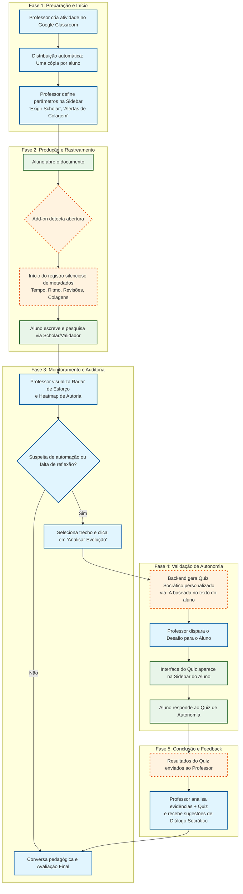
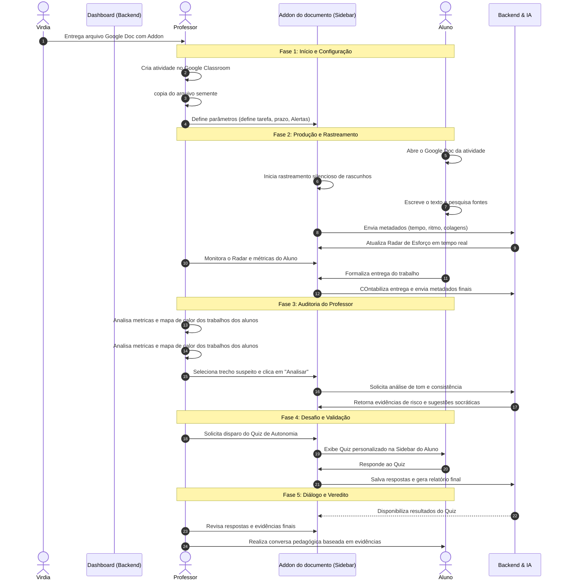
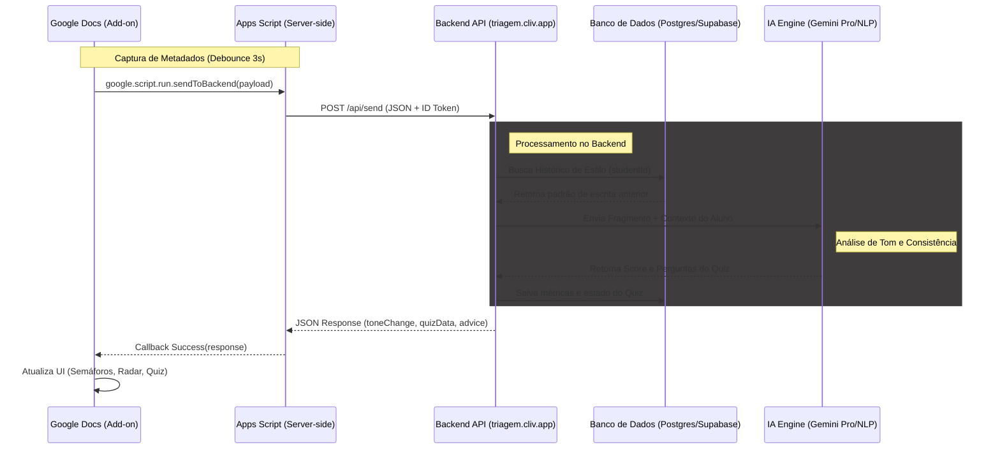

# Fluxograma de Processo - EvidencIA

Este documento detalha o fluxo de interação entre Aluno e Professor, baseado nas jornadas descritas no planejamento do MVP.

## Detalhamento dos Gatilhos (Itens 2 e 3)

### Para o Aluno
*   **Registro Silencioso**: Ativado no `onOpen` e mantido pelo polling de metadados. Gera o "historio de rascunhos".
*   **Validador de Fontes**: Ferramenta proativa para o aluno garantir a qualidade de suas citações.
*   **Desafio de Autonomia**: Interface bloqueante ou de destaque quando o professor solicita a validação.

### Para o Professor
*   **Radar de Esforço**: Visão macro da construção do documento (vertical/sincronizada).
*   **Análise de Trecho**: O "Raio-X" de fragmentos suspeitos para detecção de mudança de tom.
*   **Gerador de Quiz**: Ferramenta de intervenção baseada em evidências, não apenas em "score de IA".

---
*Documento gerado como suporte visual ao Planejamento EvidencIA.*

## Diagrama de Sequência: Jornada Pedagógica (MVP)

Este diagrama representa a interação entre os atores conforme descrito nos itens 2 e 3 do planejamento, focando na jornada de ensino e aprendizagem.

## Fluxo de Informação (Arquitetura de Dados)

Este diagrama detalha como os dados técnicos trafegam entre o Google Docs, o Backend e os motores de IA.

---
*Atualizado em 18/04/2026 para incluir o fluxo técnico de dados.*
