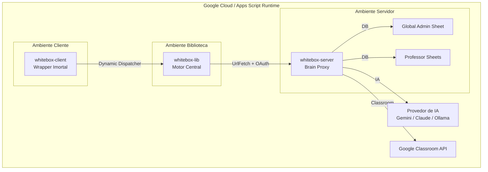

# Arquitetura & Design - Whitebox

## 1. Visão Geral do Sistema
O Whitebox é arquitetado como um ecossistema desacoplado que consiste em um Add-on de cliente (Google Docs) e um Web App/Proxy de API no lado do servidor. Este design garante que a lógica sensível (como prompts de IA e acesso a bancos de dados) permaneça protegida no servidor, enquanto o cliente foca na interação com o usuário e telemetria.

## 2. Diagrama de Arquitetura de Alto Nível

## 3. Detalhamento dos Componentes

### 3.1. Whitebox Client (Wrapper Imortal)
- **Papel**: Ponto de entrada leve e persistente vinculado aos documentos.
- **Arquivos Chave**:
    - `Código.gs`: Implementa o **Dynamic Dispatcher** que encaminha chamadas para a `WhiteboxLib`.
    - `appsscript.json`: Gerencia a dependência da biblioteca.
- **Vantagem**: O wrapper é mínimo, então raramente precisa mudar.
- **Limite**: O manifesto fixa a versão da biblioteca e é copiado com cada documento. Cópias já distribuídas não recebem versões novas; o modo de desenvolvimento só vale para quem edita a biblioteca.

### 3.2. Whitebox Lib (Motor Central)
- **Papel**: Contém toda a lógica de negócio, UI da Sidebar e utilitários de comunicação.
- **Arquivos Chave**:
    - `Logic.gs`: Lógica de auditoria e manipulação de UI.
    - `Sidebar.html`: Interface visual do Add-on.
    - `Constants.gs`: Inclui `BRAIN_PROXY_URL`, a URL do servidor, fixa no código.
    - `Utils.gs`: Professor designado (NamedRange `WHITEBOX_CONFIG`) e cliente HTTP do proxy.

### 3.3. Whitebox Server (Proxy)
- **Papel**: Gateway seguro, gerenciador de licenças e hub de integração.
- **Arquivos Chave**:
    - `BrainProxy.gs`: Roteador principal (`doPost`), prompt socrático e escolha da IA de cada professor.
    - `IAProviders.gs`: Provedores de IA configuráveis (Gemini, Claude, Ollama) e a chamada ao provedor.
    - `ClassroomService.gs`: Integração com Google Classroom.
    - `SchemaManager.gs`: Integridade do banco de dados baseado em planilhas.
    - `AdminSetup.gs`: Provisionamento automatizado de recursos.
    - `TemplateService.gs`: Orquestração de cópias (Admin -> Prof) e integração Classroom STUDENT_COPY.

## 4. Fluxo de Distribuição Pedagógica
O sistema utiliza um modelo de dois níveis para distribuição de recursos:
1.  **Nível Administrativo**: O Administrador distribui "Doc Templates" para as pastas dos professores. Este fluxo gera cópias físicas no Drive do professor e registra o envio no `Historico_Templates`.
2.  **Nível Docente**: O professor, a partir de um template recebido, utiliza a aba **Distribuir** na Sidebar para criar tarefas no Classroom. 
    - O sistema utiliza o modo `STUDENT_COPY` nativo da API, o que garante que cada aluno receba sua própria cópia editável.
    - O progresso de criação em múltiplas turmas é monitorado via **Polling** (cliente consulta o servidor a cada 1.5s usando um `executionId` armazenado no `CacheService`).

## 5. Mecanismos de Segurança

### 5.1. Autenticação: OAuth (cliente) e SHARED_TOKEN (Admin)
- **Cliente (professor/aluno)**: cada chamada envia o `oauthToken` do usuário no corpo do JSON. O servidor valida o token junto ao Google e obtém o e-mail verificado. Alunos só acessam `logar_metricas` e `ping`; nas demais rotas o e-mail verificado precisa ser o próprio `professorEmail` (ver matriz de papéis em 5.4).
- **Admin**: o `SHARED_TOKEN` autentica o Dashboard e as rotas administrativas. Fica apenas em `ScriptProperties` do servidor — nunca no cliente nem nos metadados do documento.
- **Rotação**: executar `rotacionarSharedToken()` (AdminSetup.gs) no Editor do Apps Script.
- **Destino do token**: o `oauthToken` só é enviado para `BRAIN_PROXY_URL`, constante da biblioteca. A URL não vem de propriedades nem do documento, porque quem controlasse a URL receberia os tokens. Limite conhecido: o script vinculado a cada cópia pertence ao aluno; um professor que autoriza o script de uma cópia adulterada executa código do aluno com a própria conta. Isso é inerente a scripts vinculados ao documento e não é resolvido pela URL fixa.

### 5.2. Marca d'Água Anti-LLM (Tags Invisíveis)
Para evitar que os alunos copiem perguntas de quiz diretamente para LLMs como o ChatGPT, o Whitebox implementa uma camada de ofuscação:
- **Caracteres de Largura Zero**: Injeta caracteres ocultos (ex: `\u200B`) entre as letras.
- **Blocos de Tags Unicode**: Usa o bloco `Tag` (`\uE0000-\uE007F`) para incorporar metadados ocultos que apenas LLMs podem "ler".
- **Comportamento**: Enquanto os humanos veem o texto normal, as LLMs interpretam os códigos ocultos, o que pode desencadear respostas de "não posso responder a isso" ou identificar a origem como um prompt autorizado.

### 5.3. IA Configurável e Chaves Hierárquicas
A análise socrática não está presa a um fornecedor. `IAProviders.gs` define um provedor por entrada (como montar a requisição e como ler a resposta); o prompt e o tratamento do JSON são os mesmos para todos.

| Provedor | `IA_PROVIDER` | Modelo padrão | Chave |
| :--- | :--- | :--- | :--- |
| Google Gemini | `gemini` (padrão) | `gemini-3.8-flash` | `AIza...` |
| Anthropic Claude | `claude` | `claude-opus-5-5` | `sk-ant-...` |
| Ollama (servidor próprio ou Ollama Cloud) | `ollama` | nenhum — `IA_MODEL` obrigatório | opcional |

A escolha é feita por professor, nesta ordem:
- **Nível 1 (Institucional)**: professor com `UsaChaveGlobal = Sim` usa a IA global, definida nas Script Properties do servidor (`IA_PROVIDER`, `IA_MODEL`, `IA_BASE_URL`, `IA_GLOBAL_KEY`).
- **Nível 2 (Professor)**: caso contrário, vale a chave individual do professor (salva pela barra lateral ou em um "Cofre" no Drive). O provedor é deduzido do formato da chave, independentemente do provedor global; o modelo é o padrão desse provedor.
- **Fallback (Offline)**: sem IA disponível, os recursos de IA são desativados, mas o registro de telemetria continua.

O trecho do aluno é enviado ao provedor escolhido. Com Ollama em servidor da instituição, o texto não sai da infraestrutura dela.

### 5.4. Detecção Dinâmica de Papéis (Student vs. Teacher)
Para evitar o vazamento da interface do professor (e do Auditor de IA) para os alunos, o sistema de role-detection implementa dupla validação:
- **Desafio**: Como o Google Classroom duplica o template e torna o aluno proprietário da cópia gerada e da pasta da turma em seu próprio Drive, checagens ingênuas de posse de arquivo (`isOwner` ou `isProfessor`) avaliam como verdadeiro para o aluno.
- **Professor designado**: na distribuição (Admin → Professor e Professor → Turma), o servidor grava `{ professorEmail }` no nome de um NamedRange `WHITEBOX_CONFIG:` do documento. O Google Docs não tem `DeveloperMetadata` (existe só no Sheets); o NamedRange faz parte do conteúdo e acompanha as cópias. A URL do proxy **não** vai no documento: o aluno é dono da cópia e poderia apontá-la para outro servidor, que receberia o OAuth token do professor.
- **Mecanismo (cliente)**: A função `getContext` consulta o Brain Proxy (`status_licenca`) e concede `'teacher'` em dois casos:
    1. o usuário é o professor designado no `WHITEBOX_CONFIG` do documento; ou
    2. o usuário é dono do arquivo (ou da pasta) **e** o servidor responde `ATIVO` ou `INATIVO` para o e-mail dele.
  Qualquer outra resposta (`NAO_CADASTRADO`, proxy não configurado, falha de rede) resulta em `'student'`.
- **Limite do cliente**: o papel calculado em `getContext` só decide qual interface aparece. O aluno é dono da cópia e do script vinculado a ela, então nada que rode no documento é tratado como garantia de segurança.
- **Autorização (servidor)**: quem autoriza é o `doPost`, com o e-mail verificado via OAuth:

| Rotas | Quem pode chamar |
| :--- | :--- |
| `ping`, `logar_metricas` | Qualquer conta Google autenticada (alunos logam em nome do professor da turma). |
| `status_licenca`, `status_distribuicao` | O próprio `professorEmail` (e-mail verificado = e-mail informado). |
| `analisar`, `registrar_chave`, `listar_turmas_professor`, `criar_leva_template` | O próprio `professorEmail`, com cadastro `Ativo` na aba `Assinaturas`. Caso contrário: `403 PROFESSOR_NAO_CADASTRADO` ou `403 PROFESSOR_INATIVO`. |
| `listar_templates`, `distribuir_template`, `historico_templates`, `reset_planilha` | Somente Admin (`SHARED_TOKEN`). |

- **Sem auto-cadastro**: `registrar_chave` apenas atualiza a chave de um professor já cadastrado. O cadastro é feito pelo Admin (formulário de onboarding, `adicionarProfessor()` ou edição da aba `Assinaturas`).

## 6. Fluxo de Dados: Persistência de Telemetria
1. O cliente coleta métricas a cada 30 segundos (or ao fechar o documento).
2. O cliente chama `/logar_metricas` no Servidor, informando o professor do documento: o **professor designado** no `WHITEBOX_CONFIG` (ver 5.4). O dono da pasta só é usado quando o documento não tem designação, porque na cópia gerada pelo Classroom o dono do arquivo e da pasta é o próprio aluno. O mesmo critério vale para a análise de IA e para o status de entrega.
3. O servidor identifica o ID da planilha dedicada do professor na tabela `Assinaturas`.
4. O servidor anexa a entrada de log à aba `Logs` da planilha do professor.
