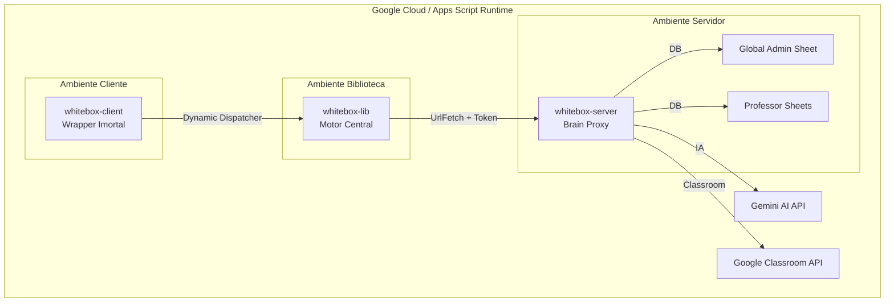

# Arquitetura & Design - Whitebox

## 1. Visão Geral do Sistema
O Whitebox é arquitetado como um ecossistema desacoplado que consiste em um Add-on de cliente (Google Docs) e um Web App/Proxy de API no lado do servidor. Este design garante que a lógica sensível (como prompts de IA e acesso a bancos de dados) permaneça protegida no servidor, enquanto o cliente foca na interação com o usuário e telemetria.

## 2. Diagrama de Arquitetura de Alto Nível

## 3. Detalhamento dos Componentes

### 3.1. Whitebox Client (Wrapper Imortal)
- **Papel**: Ponto de entrada leve e persistente vinculado aos documentos.
- **Arquivos Chave**:
    - `Código.gs`: Implementa o **Dynamic Dispatcher** que encaminha chamadas para a `WhiteboxLib`.
    - `appsscript.json`: Gerencia a dependência da biblioteca.
- **Vantagem**: Uma vez distribuído, o código do cliente nunca precisa ser alterado.

### 3.2. Whitebox Lib (Motor Central)
- **Papel**: Contém toda a lógica de negócio, UI da Sidebar e utilitários de comunicação.
- **Arquivos Chave**:
    - `Logic.gs`: Lógica de auditoria e manipulação de UI.
    - `Sidebar.html`: Interface visual do Add-on.
    - `Utils.gs`: Gerenciamento de auto-configuração via metadados.

### 3.3. Whitebox Server (Proxy)
- **Papel**: Gateway seguro, gerenciador de licenças e hub de integração.
- **Arquivos Chave**:
    - `BrainProxy.gs`: Roteador principal (`doPost`) e lógica de IA.
    - `ClassroomService.gs`: Integração com Google Classroom.
    - `SchemaManager.gs`: Integridade do banco de dados baseado em planilhas.
    - `AdminSetup.gs`: Provisionamento automatizado de recursos.
    - `TemplateService.gs`: Orquestração de cópias (Admin -> Prof) e integração Classroom STUDENT_COPY.

## 4. Fluxo de Distribuição Pedagógica
O sistema utiliza um modelo de dois níveis para distribuição de recursos:
1.  **Nível Administrativo**: O Administrador distribui "Doc Templates" para as pastas dos professores. Este fluxo gera cópias físicas no Drive do professor e registra o envio no `Historico_Templates`.
2.  **Nível Docente**: O professor, a partir de um template recebido, utiliza a aba **Distribuir** na Sidebar para criar tarefas no Classroom. 
    - O sistema utiliza o modo `STUDENT_COPY` nativo da API, o que garante que cada aluno receba sua própria cópia editável.
    - O progresso de criação em múltiplas turmas é monitorado via **Polling** (cliente consulta o servidor a cada 1.5s usando um `executionId` armazenado no `CacheService`).

## 5. Mecanismos de Segurança

### 4.1. O Protocolo SHARED_TOKEN
Toda comunicação do cliente para o servidor requer um `SHARED_TOKEN` passado no corpo do JSON.
- **Geração**: Gerado automaticamente durante a primeira execução do servidor (`auto-provisioning`).
- **Armazenamento**: Armazenado em `ScriptProperties` no servidor e `DocumentProperties` no cliente.

### 4.2. Marca d'Água Anti-LLM (Tags Invisíveis)
Para evitar que os alunos copiem perguntas de quiz diretamente para LLMs como o ChatGPT, o Whitebox implementa uma camada de ofuscação:
- **Caracteres de Largura Zero**: Injeta caracteres ocultos (ex: `\u200B`) entre as letras.
- **Blocos de Tags Unicode**: Usa o bloco `Tag` (`\uE0000-\uE007F`) para incorporar metadados ocultos que apenas LLMs podem "ler".
- **Comportamento**: Enquanto os humanos veem o texto normal, as LLMs interpretam os códigos ocultos, o que pode desencadear respostas de "não posso responder a isso" ou identificar a origem como um prompt autorizado.

### 4.3. Chaves de API Hierárquicas
- **Nível 1 (Professor)**: Professores podem fornecer sua própria chave de API Gemini via um "Cofre" (arquivo de texto no Drive).
- **Nível 2 (Institucional)**: Se um professor não tiver uma chave, o sistema pode recorrer a uma chave institucional global se autorizado.
- **Fallback (Offline)**: Se nenhuma chave estiver disponível, os recursos de IA são desativados, mas o registro de telemetria continua.

## 5. Fluxo de Dados: Persistência de Telemetria
1. O cliente coleta métricas a cada 30 segundos (ou ao fechar o documento).
2. O cliente chama `/logar_metricas` no Servidor.
3. O servidor identifica o ID da planilha dedicada do professor na tabela `Assinaturas`.
4. O servidor anexa a entrada de log à aba `Logs` da planilha do professor.
